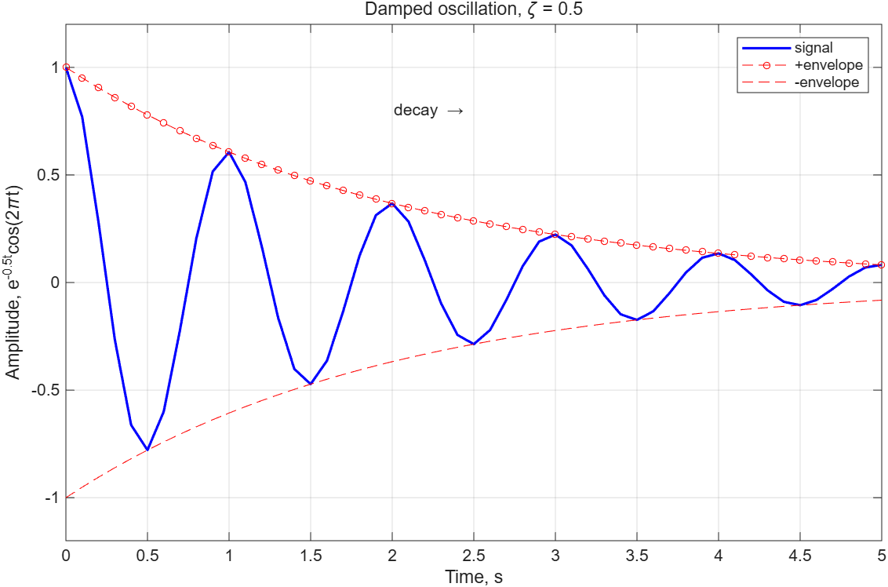

# 중간고사 대비 문제 50선

Holly Moore, *MATLAB for Engineers* 6th ed. Chapter 2~8 전 범위. 챕터 순서가 아니라 **섞어서** 출제했다.
난이도는 "어려움" 기준. 해답은 [solutions.md](solutions.md), 코드는 [`code/`](code/)에 있다.

유형 표시:

| 표시 | 유형 | 요구 사항 |
|---|---|---|
| 🐞 **오류 찾기** | 코드를 주고 오류를 찾는다. **오류 개수는 알려 주지 않는다.** | 줄 번호, 원인, 고친 코드. 실행되지만 결과가 틀리는 "논리 오류"도 오류다. |
| 📤 **결과 → 코드** | Command Window 출력(또는 그림)을 주고 그 출력을 만드는 코드를 쓴다. | 출력이 **글자 하나까지** 같아야 한다. 여러 답이 가능하면 어느 것이든 좋다. |
| 🎯 **목적 → 코드** | 목적을 말로 주고 코드를 쓴다. | 9장(loop)은 범위 밖이므로 **`for`/`while` 금지**. 배열 연산, `find`, logical indexing으로 푼다. |
| 📝 **의사코드** | 문제를 해결하는 단계를 pseudocode로 쓴다(8.2). | 각 단계가 주석(`%`)으로 그대로 들어갈 수 있을 만큼 구체적으로. 필요하면 flowchart 기호(타원·평행사변형·마름모·직사각형)도 지정한다. |

> 모든 코드는 MATLAB R2026a에서 실행해 검증했다. 오류 메시지는 한국어 로케일 기준이다.

---

## 문제 01 🐞 오류 찾기 (2장, 7장)

반지름 벡터 `r`과 높이 `h`인 원기둥의 겉넓이 `SA`, 부피 `V`, 비 `V/SA`를 구해 **r마다 한 줄씩** 출력하려는 스크립트다. 오류를 모두 찾아라.

```matlab
clear, clc
r = [1 2 3 4];          % cm
h = 10;                 % cm
SA = 2*pi*r^2 + 2*pi*r*h;
V = pi*r.^2*h;
ratio = V/SA;
result = [r; SA; V; ratio];
fprintf('r = %4.1f cm: SA = %8.2f, V = %8.2f, V/SA = %5.3f \n', r, SA, V, ratio)
```

[`code/q01_cylinder.m`](code/q01_cylinder.m)

---

## 문제 02 📤 결과 → 코드 (3장)

다음은 한 스크립트의 전체 출력이다. `x` 정의 이후 **6개의 문장**을 써라. (`colmax`, `rowmax`/`where`, `s1`, `s2`, `m`, `n` 순서. 각 문장은 함수 호출 하나로 끝내고, `n`은 "전체 평균보다 큰 원소의 개수"다.)

```
x =

     4     9     2
     7     1     8
     3     6     5


colmax =

     7     9     8


rowmax =

     9
     8
     6


where =

     2
     3
     2


s1 =

     7     9     8
     4     6     5
     3     1     2


s2 =

     4     9     2
     3     6     5
     7     1     8


m =

    5.0000    5.3333    4.6667


n =

     4
```

---

## 문제 03 🎯 목적 → 코드 (8장, 7장)

센서 3개가 4시간 동안 측정한 온도(°C)가 아래 행렬에 있다. 행 = 센서, 열 = 시각.

```matlab
temp = [21.5 22.0 25.8 23.1;
        20.9 26.2 26.7 22.4;
        22.3 21.8 22.0 27.5];
limit = 25;
```

다음을 수행하는 코드를 써라. **loop 금지.**

1. `limit`를 초과한 측정값의 (센서 번호, 시각, 값)을 `Sensor 2, hour 2: 26.2 C` 꼴로 **열 순서대로**(MATLAB이 `find`로 돌려주는 순서) 한 줄씩 출력.
2. 초과한 개수를 `4 readings exceeded 25 C`로 출력.
3. 원본은 두고 초과값을 `NaN`으로 바꾼 행렬 `clean`을 만들어 표시.
4. 초과하지 않은 값들의 평균을 소수 둘째 자리까지 출력.

힌트: `[row, col] = find(...)`, `sub2ind`, logical indexing.

---

## 문제 04 📝 의사코드 (8장, 4장, 7장)

점수 벡터 `scores = [95 82 67 58 74 88 91 60 79 45]`를 받아

- 90 이상 A, 80 이상 B, 70 이상 C, 60 이상 D, 그 미만 F로 분류하고
- 학점별 인원을 세고
- 점수와 학점을 두 열짜리 표(`table`)로 출력하는

프로그램의 **pseudocode**를 써라. 조건: `if`와 loop를 쓰지 않고 **logical indexing만으로** 분류해야 한다. 각 단계는 주석으로 옮길 수 있을 만큼 구체적으로 쓰고, 그 아래에 실제 코드도 완성하라.

---

## 문제 05 🐞 오류 찾기 (6장, 7장)

반지름 벡터의 원 넓이와 둘레를 **스크립트 끝의 local function**으로 계산해 r마다 한 줄씩 출력하려 한다. 오류를 모두 찾아라.

```matlab
clear, clc
r = [1 2 3];
area = circle_stats(r);
fprintf('r = %g: area = %.3f, circ = %.3f\n', [r; area; circ])

function [area, circ] = circle_stats(r)
% CIRCLE_STATS 반지름 r(벡터 가능)의 넓이와 둘레
area = pi*r^2;
circ = 2*pi*r;
```

[`code/q05_local_function.m`](code/q05_local_function.m)

---

## 문제 06 📤 결과 → 코드 (7장, 2장)

섭씨 `C = [-40 0 37 100]`에서 화씨(`C*9/5+32`)와 켈빈(`C+273.15`)을 구해 아래와 **똑같이** 출력하는 코드를 써라. 제목과 머리글은 `disp`, 본문 네 줄은 **`fprintf` 한 번**, 마지막 줄은 `fprintf` 한 번으로 만든다. 열 너비와 소수 자릿수를 정확히 맞춰라.

```
Temperature Conversion
 Celsius  Fahrenheit    Kelvin
   -40.0       -40.0     233.15
     0.0        32.0     273.15
    37.0        98.6     310.15
   100.0       212.0     373.15
Range of F: -40.0 to 212.0 (4 rows)
```

---

## 문제 07 🎯 목적 → 코드 (5장)

`t = 0:0.25:10` (초)에서 속도 `v = 20*exp(-0.3*t)` (m/s)와 이동 거리 `d = cumsum(v)*0.25` (m)를 계산하고 **한 figure에** 다음을 그려라.

- `tiledlayout(2, 2)`. 위 왼쪽: `t`–`v` 선 그래프, 파란 실선에 작은 원 마커, 제목 "Velocity", 축 이름(단위 포함), `grid on`.
- 위 오른쪽: 같은 데이터를 **y축 로그**로, 빨간 파선, 제목 "Velocity (log scale)".
- 아래 행 **두 칸을 합쳐서** `t`–`d`, 선 굵기 2, 제목 "Distance", `grid minor`.
- 전체 제목 두 줄: "Decaying Motion" / "v = 20e^{-0.3t}" (지수는 TeX 윗첨자).

---

## 문제 08 🐞 오류 찾기 (8장, 7장)

도시 이름을 입력받아 항공료를 출력한다. Boston과 Denver는 할인 요금 150, Honolulu는 500, 그 밖의 도시는 요금 0으로 두고 "Not on file"을 출력한다. 요금이 0이면 "No fare", 100 초과 400 미만이면 "Discount fare: $요금", 아니면 "Full fare: $요금"을 출력해야 한다. 오류를 모두 찾아라.

```matlab
clear, clc
city = input("Enter a city: ", "s");
switch city
    case "Boston" | "Denver"
        fare = 150;
    case Honolulu
        fare = 500;
    otherwise
        fare = 0;
        disp("Not on file")
end
if fare = 0
    disp("No fare")
elseif fare > 100 && fare < 400
    disp("Discount fare: $" + fare)
else disp("Full fare: $" + fare)
end
```

추가 질문: `input(..., "s")`로 받은 `city`는 char인데 `case "Boston"`(string)과 비교된다. 이것은 오류인가? 슬라이드의 설명과 R2026a의 실제 동작을 각각 말하라.

[`code/q08_switch_fare.m`](code/q08_switch_fare.m)

---

## 문제 09 📤 결과 → 코드 (4장)

다음 출력을 만드는 코드를 써라. `M` 정의 다음에 `a`~`e`는 **인덱싱 식 하나**로, 그 다음 두 문장은 각각 `M`의 한 행을 지우는 문장과 `S = [1.5 2.5]`에 원소 하나를 대입하는 문장이다.

```
M =

     2     4     6     8
     1     3     5     7
    10    20    30    40


a =

     2     8
     1     7
    10    40


b =

    10    20    30    40


c =

     1     3     5


d =

     3     5     7
    20    30    40


e =

     2     1    10     4     3    20     6     5    30     8     7    40


M =

     2     4     6     8
    10    20    30    40


S =

    1.5000    2.5000         0         0    9.0000
```

---

## 문제 10 📝 의사코드 (7장, 8장)

MATLAB 내장 데이터 파일 `patients.dat`(100명 × 10변수: LastName, Gender, Age, Location, Height(in), Weight(lb), Smoker, Systolic, Diastolic, SelfAssessedHealthStatus)를 읽어

- 흡연자이면서 수축기 혈압이 125 이상인 환자만 골라내고
- 체질량지수 BMI = 체중(kg) / 키(m)² 열을 추가하고 (1 lb = 0.4536 kg, 1 in = 0.0254 m)
- 수축기 혈압 내림차순으로 정렬해 상위 5명의 이름·나이·혈압·BMI를 표시하고
- 결과 전체를 CSV 파일로 저장하는

프로그램의 pseudocode를 써라. 각 단계에서 쓸 **함수 이름**(`readtable`, `height`, `sortrows`, `writetable` 등)을 명시하라. 그 아래에 코드를 완성하라. (표의 열은 `T.Smoker`처럼 점으로 접근한다.)

---

## 문제 11 🐞 오류 찾기 (5장)

sin, cos, sin·cos 세 곡선을 한 그래프에 그리고 범례·축 범위·제목·축 이름·주석을 붙이려는 스크립트다. 오류를 모두 찾아라. (문법 오류뿐 아니라 **의도와 다른 결과가 나오는 줄**도 포함.)

```matlab
clear, clc, clf
x = 0:pi/100:2*pi;
y1 = sin(x);
y2 = cos(x);
Y = [y1; y2];
plot(x, Y)
hold on
plot(x, y1.*y2, "LineWidth" = 2)
legend("sin", "cos")
axis([-1 1 0 2*pi])
title("Trig functions")
xlabel("x, rad") ylabel("value")
text("Peak", pi/2, 1)
```

[`code/q11_plot_bugs.m`](code/q11_plot_bugs.m)

---

## 문제 12 📤 결과 → 코드 (8장)

다음 출력을 만드는 코드를 써라. `x`와 `y = [1 2 3; 4 5 6; 7 8 9]` 정의 이후 각 결과는 문장 하나다. `flag`는 `xor`를 쓴다.

```
x =

     3     8     1     9     6     2     7


big =

  1×7 logical 배열

   0   1   0   1   1   0   1


idx =

     2     4     5     7


vals =

     8     6     7


cnt =

     3


r =

     3
     2


c =

     2
     3


flag =

  1×7 logical 배열

   0   1   1   1   0   1   1
```

`vals`는 "5 초과 9 미만", `cnt`는 "5 이하인 원소 개수"(`big`을 재사용), `r`/`c`는 "`y`에서 4보다 크고 **짝수**인 원소의 행·열 번호", `flag`는 "2 초과"와 "7 미만" 중 **하나만** 참인 자리다.

---

## 문제 13 🎯 목적 → 코드 (6장, 5장, 7장)

1. 자유낙하 거리 `d = 0.5*g*t^2`와 속도 `v = g*t`를 돌려주는 함수 `freefall(t, g)`를 **스크립트 끝의 local function**으로 작성하라. `g`를 생략하면 9.8을 쓴다(`nargin`). `t`는 벡터다.
2. `t = 0:2:10`에 대해 지구(`g` 생략)와 달(`g = 1.6`)의 결과를 다음 형식으로 한 줄씩 출력하라.
   ```
      0 s: Earth     0.0 m (  0.0 m/s) | Moon    0.0 m ( 0.0 m/s)
      2 s: Earth    19.6 m ( 19.6 m/s) | Moon    3.2 m ( 3.2 m/s)
   ```
   (너비: `%4.0f`, `%7.1f`, `%5.1f`, `%6.1f`, `%4.1f`)
3. 두 번째 입력을 1.6으로 고정한 **익명 함수 핸들** `moon_fall`을 만들고 `fplot`으로 0~10초 구간을 빨간 파선으로 그려라. 제목·축 이름·grid 포함.

---

## 문제 14 🐞 오류 찾기 (7장)

기대 출력은 다음과 같다.

```
   1 feet =  12.00 inches
   2 feet =  24.00 inches
   3 feet =  36.00 inches
Conversion done for 3 rows
Count: 3
Rate:  5.00 %
```

오류를 모두 찾아라. 각 오류가 **실제로 어떤 현상**(오류 메시지 / 아무 출력 없음 / 잘못된 출력)을 일으키는지도 써라.

```matlab
clear, clc
feet = 1:3;
inches = feet*12;
fprintf('%4.0f feet = %6.2 inches /n', feet, inches)
disp('Conversion done for', numel(feet), 'rows')
disp(['Count: ' 3])
rate = 5;
fprintf('Rate: %5.2f %\n', rate)
```

[`code/q14_fprintf_bugs.m`](code/q14_fprintf_bugs.m)

---

## 문제 15 📝 의사코드 (8장, 3장, 7장)

해군사관학교 지원자 데이터가 `applicants = [키(in), 나이]` 행렬(8행)로 주어진다. 자격: 키 66 이상, 나이 18 이상 **35 미만**.

- 자격자 행 번호를 `find`로 구하고
- `Applicant #2: 67 in, 19 yr` 꼴로 한 줄씩 출력하고
- 합격 인원과 비율(%), 합격자 평균 키를 출력하고
- 탈락 사유별 인원(키 미달 / 나이 부적합)을 출력하는

프로그램의 pseudocode와 **flowchart**(각 단계에 쓸 기호 이름을 괄호로 표시)를 써라. 그 아래에 코드를 완성하라. **loop와 if 금지.**

---

## 문제 16 📤 결과 → 코드 (2장, 3장)

다음 출력을 만드는 코드를 써라. `a`, `b`, `c`는 각각 **함수 호출 하나 또는 콜론 식 하나**로, `d`가 두 번 표시되는 사이에는 `format` 명령이 있다. `e`와 `f`는 같은 두 벡터 `[1 2 3]`으로 만든다.

```
a =

         0    0.2500    0.5000    0.7500    1.0000


b =

     1    10   100


c =

    10     7     4     1


d =

   0.785398163397448


d =

   7.8540e-01


e =

     1     2     3
     2     4     6
     3     6     9


f =

     1     4     9
```

---

## 문제 17 🎯 목적 → 코드 (4장, 7장, 8장)

원금 `P = 1000`, 연이율 `rate = [0.03 0.05 0.08 0.10]`, 기간 `years = 0:5:30`에 대해 복리 원리금 `A = P(1+r)^n`을 **모든 (이율, 연수) 조합**에 대해 계산하라.

1. `meshgrid`로 2차원 배열 `R`, `N`을 만들고 `A`를 구한다. (행 = 연수, 열 = 이율)
2. 아래처럼 표를 출력한다. 머리글은 `disp`, 본문은 `fprintf` 한 번.
   ```
   Year    3%       5%       8%      10%
      0     1000     1000     1000     1000
      5     1159     1276     1469     1611
   ```
3. 이율마다 원금이 **처음으로 두 배 이상**이 되는 연도를 `Rate 5%: doubles by year 15` 꼴로 출력한다. loop 없이 `sum(A < 2*P)`를 이용하라.

---

## 문제 18 🐞 오류 찾기 (3장, 7장)

학생 4명 × 시험 3회 점수다. 의도: (1) 시험별 최고점, (2) **학생별** 평균, (3) 학생별 최고점과 그 **시험 번호**, (4) **시험 1 점수 기준으로 학생(행)을 내림차순 정렬**(행은 통째로 이동), (5) 평균 75 이상인 학생 번호와 평균 출력. 오류를 모두 찾아라. 실행하면 어디까지 돌고 어떤 메시지가 나오는지도 써라.

```matlab
clear, clc
scores = [78 92 65; 88 71 95; 60 85 79; 90 68 72];
max = max(scores)
avg = mean(scores, 1)'
[best, exam] = max(scores, 2)
ranked = sort(scores, 'descend')
pass = find(avg >= 75)
fprintf('Student %d passed with average %.1f\n', pass, avg(pass))
```

[`code/q18_stats_bugs.m`](code/q18_stats_bugs.m)

---

## 문제 19 📤 결과 → 코드 (8장, 7장)

어떤 스크립트를 세 번 실행했더니 다음과 같았다. 이 스크립트를 써라. (`input` 한 번, `if/elseif/else` 하나. 0 미만이거나 100 초과면 "Invalid score", 90 이상이면 A와 "B 기준선(80)보다 몇 점 위인지", 80 이상이면 B와 "A까지 몇 점 남았는지", 그 외 "Grade C or below".)

```
Enter the score (0-100): 83
Grade B (7 points to A)
```
```
Enter the score (0-100): 100
Grade A (20 points above B)
```
```
Enter the score (0-100): -5
Invalid score
```

조건의 **순서**가 왜 중요한지(유효성 검사가 왜 첫 번째여야 하는지) 한 줄로 설명하라.

---

## 문제 20 🎯 목적 → 코드 (7장, 8장, 3장)

반지름(cm)을 `input`으로 받아 구의 부피 `4/3·π·r³`와 겉넓이 `4·π·r²`를 출력하는 프로그램을 써라.

- 숫자가 아니거나 스칼라가 아니면 `error`로 "The radius must be a single number." 를 내고 멈춘다.
- 0 이하이면 `error`로 `The radius must be positive, not -3.` 처럼 **입력값을 포함한** 메시지를 낸다(`error`도 `fprintf`처럼 서식을 받는다).
- 100 초과이면 `beep`를 울리고 경고 문장을 출력한 뒤 **계속 진행**한다.
- 출력 형식: `r = 2.50 cm -> V = 6.545e+01 cm^3, S =    78.54 cm^2` (`%.2f`, `%.3e`, `%8.2f`).

`isnumeric`, `isscalar`를 써라. `error`와 `beep + disp`의 차이를 주석으로 적어라.

---

## 문제 21 📝 의사코드 (5장, 3장, 7장)

점수 벡터 `scores = [100 95 74 87 22 78 34 82 93 88 86 69 55 72 61 90]`에 대해

- 학점 경계 `edges = [0 60 70 80 90 100]`로 구간별 인원을 **`histcounts`**로 구하고
- 학점 이름(F D C B A)과 인원을 `table`로 출력하고
- `tiledlayout(1,2)`에 (왼쪽) edge를 지정한 `histogram`, (오른쪽) 인원 `bar` 그래프(x축 눈금 글자를 학점으로)를 그리고
- 평균·표준편차·중앙값을 한 줄로 출력하는

프로그램의 pseudocode를 쓰고 코드를 완성하라. `histogram(x, edges)`와 `histogram(x, 5)`의 두 번째 인수가 어떻게 다르게 해석되는지 한 줄로 설명하라.

---

## 문제 22 🐞 오류 찾기 (4장)

기대 출력: `full = "Holly Moore"`, `n = 11`, `greeting = "Hello, Holly Moore!"`, `initials = "HM"`, `tag = "Trial 11"`, `lens = [6; 6; 5]`(각 이름의 글자 수). 오류를 모두 찾아라. **실행은 되지만 값이 다른 줄**이 여럿이다. 각 줄이 실제로 무엇을 내놓는지 써라.

```matlab
clear, clc
names = ['Steven'; 'Jasmin'; 'David'];
first = "Holly";
last = 'Moore';
full = first + " " + last
n = length(full)
greeting = ['Hello, ' full '!']
initials = full(1) + last(1)
tag = "Trial " + 11
lens = strlength(names)
```

[`code/q22_string_bugs.m`](code/q22_string_bugs.m)

---

## 문제 23 📤 결과 → 코드 (5장)

아래 그림을 만드는 코드를 써라. 데이터는 `t = 0:0.1:5`, 신호 `y = exp(-0.5*t).*cos(2*pi*t)`, 포락선 `±exp(-0.5*t)`다. 선 종류·색·마커·굵기, 범례 항목, 축 범위, 제목과 축 이름의 **TeX 기호**(ζ, 윗첨자, π, →), 주석 위치(약 (2, 0.8))를 모두 맞춰라.



---

## 문제 24 🎯 목적 → 코드 (3장, 5장, 8장)

1. `rand`로 [5, 10] 구간 균일분포 난수 1000개를 **열 벡터**로 만들고 최소·최대·평균을 출력하라. (`rand`의 결과를 구간에 맞게 바꾸는 식을 직접 써야 한다.)
2. `randn`으로 평균 70, 표준편차 8인 정규분포 난수 1000개를 만들고 평균·표준편차를 출력하라.
3. 평균에서 ±1σ 안에 든 비율과 ±2σ 안에 든 비율(%)을 구해 `Within 1 sigma: 65.1%, within 2 sigma: 94.2% (expect 68%, 95%)` 꼴로 출력하라. (`abs`, 비교, `sum`을 쓴다. `%` 기호 출력에 주의.)
4. `tiledlayout(1,2)`에 두 분포의 histogram(각각 10개, 20개 bin)을 그리고 제목에 TeX로 μ, σ를 써라.

---

## 문제 25 🐞 오류 찾기 (6장, 5장)

`f(x) = x² − 4`를 익명 함수로 만들어 [-3, 3]에서 그래프를 그리고, `g = f + 1`, `f(2)`, 낙하 거리 함수 `distance`를 핸들로 감싼 `h(3)`, 두 벡터의 **원소별** 곱 `k`를 구하려 한다. 오류를 모두 찾아라.

```matlab
clear, clc, clf
f = @x x.^2 - 4;
g = @(x) f(x) + 1
fplot(f(x), [-3 3])
root = f(2)
h = @(t) distance(t);
d = h(3)
k = @(x, y) x*y;
prod3 = k([1 2 3], [4 5 6])

function r = distance(t)
    r = 0.5*g*t.^2;
end
```

[`code/q25_handle_bugs.m`](code/q25_handle_bugs.m)

---

## 문제 26 📤 결과 → 코드 (7장)

`x = [4 7 9]`로 다음 출력을 만드는 코드를 써라. 다섯 개의 출력 문장을 쓴다: `disp` 세 번(첫째는 `num2str`, 둘째는 string 배열 표시, 셋째는 합계), `fprintf` 한 번(세 줄), `disp` 한 번(열 벡터).

```
The values are: 4  7  9
    "Value 4"
    "Value 7"
    "Value 9"

Total = 20
4 squared is  16
7 squared is  49
9 squared is  81
     4
     7
     9
```

둘째 출력에서 **왜 큰따옴표가 붙어 세 줄로 나오는지**, 첫째 출력과 무엇이 다른지 설명하라.

---

## 문제 27 🎯 목적 → 코드 (8장, 7장, 3장)

```matlab
names = ["Jason" "Jose" "Wesley" "Rose" "Mia" "Ken"];
temp = [98.2 100.3 97.0 101.0 99.1 102.4];
```

loop와 if 없이:

1. 98.6 이하 "Well", 98.6 초과 101 미만 "Fever", 101 이상 "High fever"인 string 배열 `status`를 만든다. (`strings(size(temp))`로 시작해 `<missing>`이 남지 않게.)
2. 이름·체온·상태를 `Patient`, `Temp_F`, `Status` 열 이름의 표로 표시한다.
3. 상태별 인원을 `Well: 2, Fever: 2, High fever: 2` 꼴로 출력한다.
4. 최고 체온 환자 이름과 체온을 출력한다(`[v, k] = max(...)`).
5. 101 이상인 환자 이름을 `Patients to call: Rose, Ken`으로 출력한다(`strjoin`).

---

## 문제 28 📝 의사코드 (7장, 2장)

실험 장비가 측정값을 ASCII 파일 `speeds.dat`(열: mph, km/h, ft/s)로 남긴다고 하자. 다음 프로그램의 pseudocode를 써라.

- `mph = 0:20:120`에서 km/h(×1.609)와 ft/s(×5280/3600)를 계산해 세 열짜리 행렬로 묶는다.
- 머리글과 함께 `fprintf`로 표를 출력한다.
- `save ... -ascii`로 `speeds.dat`에 저장한다.
- 작업공간을 지운 뒤 `load`로 다시 읽어 **변수 이름이 무엇이 되는지**, 크기가 몇 행 몇 열인지, km/h 열의 최댓값을 출력한다.

`save`에서 `-ascii`를 붙일 때와 안 붙일 때 파일이 어떻게 다른지, `load speeds`와 `load speeds.dat`의 차이를 설명하라. 코드도 완성하라.

---

## 문제 29 🐞 오류 찾기 (2장)

반지름 벡터와 높이로 원기둥 부피·겉넓이를 구하고 ASCII 파일로 저장한 뒤 다시 불러오려는 스크립트다. 오류를 모두 찾아라. (section 구분도 의도대로 되는지 확인.)

```matlab
%%Define data
clear, clc
2nd_run = 5;
radius = [1 2 3];
height = 4;
volume = pi*radius^2*height
area = 2*pi*radius(radius + height)
%% Save and reload
save results.dat volume area - ascii
load results
```

[`code/q29_script_bugs.m`](code/q29_script_bugs.m)

---

## 문제 30 📤 결과 → 코드 (4장)

다음 출력을 만드는 코드를 써라. `D = magic(4);` 이후의 `d1`, `d2`, `E`, `F`는 각각 `D`에서 함수 호출로 만든다(`d1` 주대각선, `d2` 주대각선 **아래** 대각선, `E` 1행을 좌우 반전, `F` 행 합). `G`는 `ones`/`zeros`의 결합이다.

```
A =

     0     0     0
     0     0     0


B =

     7     7     7
     7     7     7
     7     7     7


C =

     5     0     0
     0     6     0
     0     0     7


d1 =

    16    11     6     1


d2 =

     5     7    15


E =

    13     3     2    16


F =

    34    34    34    34


G =

     1     0     0
     1     0     0
```

---

## 문제 31 🎯 목적 → 코드 (5장, 4장, 8장)

`z = x·e^(−x²−y²)`를 `x, y ∈ [−2, 2]`(간격 0.1)에서 계산해 `tiledlayout(2,2)`에 (a) `mesh`, (b) `surf` + `shading interp` + `colormap jet`, (c) 등고선 15개짜리 `contour` + `axis equal`, (d) `surfc`를 그리고 전체 제목을 TeX(`e^{-x^2-y^2}`)로 붙여라. `meshgrid`에 **벡터 하나만** 넘기는 형태를 써라.

그다음 `z`의 최댓값과 그 위치의 `x`, `y` 값을 `Max z = 0.4288 at x = 0.7, y = 0.0 (linear index 1128)` 꼴로 출력하라. (`max(Z(:))`로 값과 single index를, `[r, c] = find(...)`로 행·열을 구한다.)

---

## 문제 32 🐞 오류 찾기 (8장)

의도: (1) 98.6 초과 100 미만인 환자의 이름(`hot_names`), (2) 99 초과인 위치를 `row r col c`로 한 줄씩, (3) 전원의 상태(Sick/Well) 3×3 string 배열, (4) **모두** 발열일 때만 "Everyone has a fever". 오류를 모두 찾아라. 실행되는 줄은 실제 결과도 써라.

```matlab
clear, clc
temp = [95.3 100.2 98.6; 97.4 99.2 98.9; 100.1 99.3 97];
names = ["A" "B" "C"; "D" "E" "F"; "G" "H" "I"];
hot = find(temp > 98.6 && temp < 100);
hot_names = names(temp)
[r, c] = find(temp > 99);
fprintf('row %d col %d\n', r, c)
status(temp > 98.6) = "Sick"
if temp > 98.6
    disp("Everyone has a fever")
end
```

[`code/q32_find_bugs.m`](code/q32_find_bugs.m)

---

## 문제 33 📤 결과 → 코드 (3장)

`x = [-7.5 2.49 2.5 3.51]`로 다음 출력을 만드는 코드를 써라. `a`는 네 가지 반올림 함수를 **행으로 쌓은** 4×4 행렬이다(순서: 0 쪽으로 자르기, 내림, 올림, 반올림). 나머지는 함수 호출 하나씩이다.

```
a =

    -7     2     2     3
    -8     2     2     3
    -7     3     3     4
    -8     2     3     4


b =

    -1


c =

    3.1420


d =

     1     3     6    10    15


e =

     1     2     6    24


f =

    -3


g =

   1.5000 + 2.5981i


h =

   120    10


k =

     2     3     5     7    11    13    17    19


m =

     2     3     1


n =

   1.2246e-16
```

힌트: `b`는 −7을 3으로 나눈 나머지, `c`는 π를 소수 셋째 자리로, `f`와 `g`는 **같은 수 −27의 세제곱근**을 두 방법으로, `h`는 5!과 ₅C₂, `m`은 `[log(e²) log₁₀(1000) e⁰]`, `n`은 `sin(π)`.

---

## 문제 34 🎯 목적 → 코드 (6장, 7장)

재료 시험 데이터가 있다. 초기 지름 `d0 = [10.0 12.5 8.0]` mm, 최종 지름 `d1 = [8.5 11.0 6.0]` mm, 하중 `F = [12000 15000 9000]` N.

스크립트 끝에 **local function 두 개**를 두고 처리하라.

- `cw = cold_work(d_initial, d_final)`: 냉간가공률 `(d_i² − d_f²)/d_i²`.
- `[s, idx] = stress(force, d)`: 응력 = 힘 / 단면적(π(d/2)²) [MPa], 그리고 최대 응력의 **위치** `idx`. 값은 쓰지 않고 위치만 받을 때 `~`를 쓴다.

출력:
```
Sample 1: cold work  27.8%, stress   211.5 MPa
Sample 2: cold work  22.6%, stress   157.8 MPa
Sample 3: cold work  43.8%, stress   318.3 MPa
Highest stress: sample 3
```
각 함수의 첫 주석 줄이 `help cold_work`에 나오도록 작성하라.

---

## 문제 35 📝 의사코드 (3장, 5장, 7장)

발사 속도 `v = 110` m/s, `g = 9.8`, 발사각 `theta = 0:5:90`(도)에 대해 사거리 `R = v²/g · sin(2θ)`를 구하고

- 최대 사거리와 그때의 각도를 찾고 (`max`의 두 번째 출력)
- `sprintf`로 "Max range 1235 m at 45°" 문자열을 만들어
- 그래프의 그 점 옆에 `text`로 붙이고 (최대점은 빨간 별 마커)
- 최대의 90% 이상을 내는 각도들을 `num2str`로 한 줄에 출력하는

프로그램의 pseudocode를 쓰고 코드를 완성하라. 각도가 **도(degree)** 단위라는 점을 어디서 어떻게 처리해야 하는지 명시하라.

---

## 문제 36 🐞 오류 찾기 (7장, 5장)

행성별 100초 낙하 거리를 표로 만들고, 제목 문자열을 `sprintf`로 만들어 막대그래프에 쓰고, 표를 엑셀 파일로 저장하려 한다. 오류를 모두 찾아라. 특히 **`T`가 어떤 모양으로 만들어지는지** 써라.

```matlab
clear, clc, clf
planet = ["Earth", "Moon", "Mars"];
g = [9.8, 1.6, 3.7];
d = 0.5 * g * 100^2;
T = table(planet, g, d, VariableNames = ["Planet" "g" "Distance"])
label = sprintf("Max distance: %6.1f m on %s", max(d), planet(d == max(d)));
bar(d)
xticklabels(planet)
title(label)
ylabel(Distance, m)
writetable("planets.xlsx", T)
```

[`code/q36_table_bugs.m`](code/q36_table_bugs.m)

---

## 문제 37 📤 결과 → 코드 (8장, 7장)

`speed = [62 71 58 85 90 67 74]`(km/h), 제한 `limit = 70`. 다음 출력을 만드는 코드를 써라. `fine`은 "제한 이하 0, 초과 시 50 + 5×초과량"이고 `zeros`로 시작해 **logical indexing**으로 채운다.

```
over =

     2     4     5     7


excess =

     1    15    20     4

Car 2: 71 km/h (1 over)
Car 4: 85 km/h (15 over)
Car 5: 90 km/h (20 over)
Car 7: 74 km/h (4 over)
4 of 7 cars speeding, max excess 20 km/h

fine =

     0    55     0   125   150     0    70
```

---

## 문제 38 🎯 목적 → 코드 (4장, 3장, 7장)

```matlab
names = ["Steven" "Jasmin" "David" "Terrell" "Maria" "Lin"];
scores = [88 92 75 60 95 81];
```

loop 없이:

1. 글자 수가 5보다 큰 이름만 담은 `long_names`.
2. 점수 내림차순 순위를 `"Maria (95)"` 꼴의 string 배열 `ranking`으로. (`sort`의 두 번째 출력으로 이름을 재배열.)
3. 80점 이상인 사람만 `Steven: 88` 꼴로 한 줄씩 출력(`fprintf('%s\n', ...)`에 string 배열을 넘긴다).
4. `"Top: Maria, bottom: Terrell"` 문자열 `label`.
5. 가장 긴 이름 `longest`와 전체 글자 수 합 `total_chars`.

---

## 문제 39 🐞 오류 찾기 (5장)

의도: 2행 타일 배치. 위 행 왼쪽은 sin, 위 행 오른쪽은 cos를 **두 칸 폭**으로, 아래 행에는 극좌표 그래프 `r = 1 + cos θ`와 로그 y축 그래프 `e^x`. 전체 제목 "Trig layout". 오류를 모두 찾아라. 격자 크기 자체가 의도와 맞는지부터 따져라.

```matlab
clear, clc, clf
x = 0:pi/20:2*pi;
t = tiledlayout(2, 2)
nexttile
plot(x, sin(x)), title("sin")
nexttile(2, [1 2])
plot(x, cos(x)), title("cos")
nexttile
polarplot(1 + cos(x), x), title("polar")
nexttile
semilogy(x, exp(x)), title("log y")
title("Trig layout")
```

[`code/q39_tiled_bugs.m`](code/q39_tiled_bugs.m)

---

## 문제 40 📤 결과 → 코드 (6장)

Command Window에서 다음과 같이 동작하는 **함수 파일** `kinematics.m`을 써라. 가속도 `a = 0.5t`, 속도 `v = t²/4`, 거리 `d = t³/12`이며 `t`는 벡터일 수 있다. `help` 출력의 두 줄도 그대로 나오게 하라.

```
>> [d, v, a] = kinematics(4)

d =

    5.3333


v =

     4


a =

     2

>> kinematics(2)

ans =

    0.6667

>> nargin("kinematics")

ans =

     1

>> nargout("kinematics")

ans =

     3

>> help kinematics
  kinematics 시각 t에서의 거리, 속도, 가속도 (문제 40 정답)
    가속도 a = 0.5 t, 속도 v = t^2/4, 거리 d = t^3/12

>> x = kinematics([2 4 6])

x =

    0.6667    5.3333   18.0000
```

`kinematics(2)`가 왜 `d`만 돌려주는지, 함수 안에서 `a`, `v`, `d`를 계산하는 **순서**가 출력 순서와 관계있는지 답하라.

---

## 문제 41 🎯 목적 → 코드 (2장, 7장)

`mph = 0:20:120`에서 km/h(×1.609)와 ft/s(×5280/3600)를 구해

1. 세 열짜리 행렬 `table_data`(열 벡터들을 가로로 붙임)를 만들고
2. 머리글 `  mph    km/h    ft/s`를 `disp`로, 본문을 `fprintf('%5.0f %7.1f %7.2f\n', ...)` 한 번으로 출력하고
3. `save`로 **ASCII** 파일 `speeds.dat`에 저장한 뒤
4. `clear`로 작업공간을 지우고 `load`로 다시 읽어 `Reloaded 7 rows x 3 cols; fastest = 193.1 km/h`를 출력하라. (`size`의 두 출력을 `fprintf`에 한꺼번에 넘길 수 있다.)

---

## 문제 42 📝 의사코드 (8장, 7장)

`menu`로 "km -> mi", "kg -> lb", "C -> F" 중 하나를 고르게 하고, `input`으로 값을 받아 `switch`로 변환해 `C -> F: 37 -> 98.60 F` 꼴로 출력하는 프로그램의 pseudocode를 써라. `menu`가 돌려주는 값의 **자료형**이 무엇이고 그래서 `case`에 무엇을 써야 하는지, `otherwise`가 필요한지 아닌지 근거를 들어 밝혀라. 코드도 완성하라.

---

## 문제 43 🐞 오류 찾기 (4장)

각 줄이 **오류를 내는지, 조용히 예상 밖의 결과를 내는지, 정상인지** 판정하고, 정상이 아닌 줄은 고쳐라. 의도: `x`의 첫 원소, 가운데 원소, 7번째 자리에 70 추가, `M`의 마지막 행, 2열 삭제, 삭제 후 마지막 열, 마지막 원소, 2행 전체.

```matlab
clear, clc
x = [10 20 30 40 50];
first = x(0)
mid = x(2.5)
x(7) = 70
M = [1 2 3; 4 5 6; 7 8 9];
row4 = M(4, :)
M(:, 2) = []
col = M(:, 3)
last = M(end, end)
v = M(2, 1:end)
```

[`code/q43_index_bugs.m`](code/q43_index_bugs.m)

---

## 문제 44 📤 결과 → 코드 (7장)

어떤 스크립트를 실행하면 Command Window에 `count = 16`만 표시되고, 파일 `speed_log.txt`의 내용은 다음과 같다. 이 스크립트를 써라. 데이터는 `t = 0:0.5:2`, `v = 9.8*t`. `fopen`/`fclose`를 쓰고 `fprintf`는 **세 번**(제목, 본문 다섯 줄, 마지막 줄) 호출하며, `count`는 세 번째 `fprintf`의 반환값이다. 왜 16인지 설명하라.

```
Free-fall speed log
t =  0.0 s  v =   0.00 m/s
t =  0.5 s  v =   4.90 m/s
t =  1.0 s  v =   9.80 m/s
t =  1.5 s  v =  14.70 m/s
t =  2.0 s  v =  19.60 m/s
END (5 samples)
```

---

## 문제 45 🎯 목적 → 코드 (8장, 7장)

배송비 계산 프로그램을 써라.

- `input(..., "s")`로 지역(`domestic` / `asia` / `other`)을, `input`으로 무게(kg)를 받는다.
- 무게가 숫자 스칼라가 아니거나 0 이하면 `error`.
- `switch`로 지역별 기본요금과 kg당 요금을 정한다: domestic 3000/500, asia 12000/2500, other 25000/6000. `asia`는 `Asia`도 받아야 한다(cell 배열 case). 그 외는 `error("Unknown region: %s", region)`.
- `if/elseif/else`로 요금 계산: 1 kg 이하 기본요금, 5 kg 이하 기본 + kg당 요금 × (무게 − 1), 5 kg 초과는 5 kg까지는 위 규칙, 넘는 부분은 kg당 요금의 1.5배.
- 출력: `asia, 3.5 kg -> 18250 KRW` (`round` 사용).

---

## 문제 46 🐞 오류 찾기 (8장, 6장)

나이 벡터 `[15 17 45 72]`를 받아 `"wait" "youth" "standard" "senior"`를 돌려주는 함수를 만들려 한다. 오류를 모두 찾아라. 문법을 고친 뒤에도 **벡터 입력에서 기대 출력이 나오지 않는 이유**를 설명하고, 올바른 구현을 써라.

```matlab
clear, clc
ages = [15 17 45 72];
msg = license_type(ages)

function out = license_type(age)
if age < 16
    out = "wait";
else if age < 18
    out = "youth";
elseif age < 70
    out = "standard";
else
    out = "senior";
end
end
```

[`code/q46_function_if_bugs.m`](code/q46_function_if_bugs.m)

---

## 문제 47 📤 결과 → 코드 (4장, 3장)

`x = 1:4`, `y = [10 20 30]`으로 다음 출력을 만드는 코드를 써라. `Z = X² + Y`, `colsum`은 열 합, `rowmax`는 행별 최댓값을 **행 벡터**로, `big`은 25 초과 원소를 **열 순서**로 행 벡터에 모은 것이다.

```
X =

     1     2     3     4
     1     2     3     4
     1     2     3     4


Y =

    10    10    10    10
    20    20    20    20
    30    30    30    30


Z =

    11    14    19    26
    21    24    29    36
    31    34    39    46


colsum =

    63    72    87   108


rowmax =

    26    36    46


big =

    31    34    29    39    26    36    46
```

`big`의 원소 순서가 왜 `31 34 29 ...`인지 설명하라.

---

## 문제 48 🎯 목적 → 코드 (5장, 6장, 7장)

`tiledlayout(2,1)`에:

1. 위: `x = 0:0.1:6`에서 `sin(x)`(왼쪽 y축, 굵기 1.5)와 `e^x`(오른쪽 y축, 파선)를 **`yyaxis`**로 한 축계에 그리고 각 y축 이름, x축 이름, 제목, grid.
2. 아래: 익명 함수 `f = @(x) exp(-x/3).*sin(2*x)`를 `fplot`으로 [0, 6]에서 빨간 선으로 그리고 제목은 TeX로 `f(x) = e^{-x/3}sin(2x)`. 그다음 `xs = 0:0.01:6`에서 `f(xs)`의 최댓값과 위치를 `max`로 찾아 `sprintf`로 만든 문자열을 그 점에 `text`로 붙여라.

`yyaxis right` 다음에 호출한 `ylabel`이 어느 축에 붙는지 설명하라.

---

## 문제 49 📝 의사코드 (8장, 3장, 7장)

측정값 `raw = [23.1 24.0 -999 25.2 310 24.8 -999 23.9 -5 24.4]`에서 −999는 결측, 0 미만이거나 200 초과는 이상치다.

- 결측 위치를 `find`로 찾아 출력하고
- 이상치 위치와 값을 출력하고 (결측은 이상치로 세지 않는다)
- 유효 데이터만 뽑아 개수·평균·표준편차를 출력하고
- 결측과 이상치를 **유효 데이터 평균**으로 치환한 벡터를 표시하는

프로그램의 pseudocode를 쓰고 코드를 완성하라. logical 배열을 변수로 저장해 재사용하는 방식으로 설계하라.

---

## 문제 50 🐞 오류 찾기 (종합: 3·5·7·8장)

발사 속도를 입력받아 각도별 사거리를 구하고, 최대 사거리와 최대의 90% 이상인 각도를 출력한 뒤 그래프와 표를 만든다. 오류를 모두 찾아라. 문법 오류, 실행 시 오류, **조용히 틀린 결과**, 슬라이드가 "반드시 하라"고 한 것을 빠뜨린 줄을 구분해서 써라.

```matlab
%% Projectile range analysis
clear, clc, clf
g = 9.8;                          % m/s^2
v = input("Launch speed (m/s): ");
theta = 0:5:90;                   % degrees
range = v^2/g * sin(2*theta);
[maxR, idx] = max(range)
best_angle = theta(idx);
fprintf("Max range %.1f m at %d degrees \n", maxR, best_angle)
good = find(range >= 0.9*maxR);
fprintf("Angles within 90%: ")
fprintf("%d ", theta(good)); fprintf("\n")
plot(theta, range, "r--o", LineWidth = 1.5)
xlabel("Angle, \theta (deg)"), ylabel("Range, m")
title("v = " + v + " m/s")
hold on
plot(theta(idx), maxR, "k*", MarkerSize = 12)
legend("range", "max")
label = sprintf("Max = %.1f m", maxR);
text(label, best_angle, maxR)
axis([0 90 0 maxR*1.2])
summary = table(theta, range)
```

[`code/q50_final.m`](code/q50_final.m)
