# 해답과 해설

문제는 [problems.md](problems.md). 모든 정답 코드는 `code/aNN_*.m`에 있고 R2026a에서 실행해 아래 출력을 얻었다. 오류 메시지는 R2026a 한국어 로케일에서 실제로 나온 문장이다.

> **채점 기준 메모.** 오류 찾기 문제는 "오류 개수"를 맞히는 것이 아니라 **각 줄의 실제 동작**을 설명할 수 있어야 한다. 문법 오류(parse error)가 하나라도 있으면 스크립트 전체가 한 줄도 실행되지 않는다는 점, 실행 오류는 그 줄 **직전까지** 실행된다는 점을 구분하라.

---

## 문제 01 🐞 원기둥 겉넓이·부피

[`a01_cylinder.m`](code/a01_cylinder.m)

| 줄 | 원인 | 현상 | 수정 |
|---|---|---|---|
| `SA = 2*pi*r^2 + ...` | `r`이 1×4 벡터인데 행렬 거듭제곱 `^` | 실행 오류: `차원이 정확하지 않아 행렬을 거듭제곱할 수 없습니다. ... POWER(.^)를 사용하십시오.` | `r.^2` |
| `ratio = V/SA;` | 벡터/벡터의 `/`는 행렬 나눗셈(최소제곱) → **스칼라 하나** | 오류 없이 조용히 진행. `result = [r; SA; V; ratio]`에서 행 길이가 달라 결합 오류 | `V./SA` |
| `fprintf(..., r, SA, V, ratio)` | 배열 4개를 따로 넘기면 `r` 4개를 먼저 다 쓰고 `SA`로 넘어간다 (7.2.2 "variable number of arrays") | 첫 줄에 `r = 1.0 cm: SA = 2.00, V = 3.00, V/SA = 4.000` 식으로 엉뚱하게 짝지어짐 | `fprintf(..., result)` — 4×4 행렬을 **열 순서**로 소비 |

`V = pi*r.^2*h`는 `h`가 스칼라이므로 `*`도 된다. 고친 출력:

```
r =  1.0 cm: SA =    69.12, V =    31.42, V/SA = 0.455 
r =  2.0 cm: SA =   150.80, V =   125.66, V/SA = 0.833 
r =  3.0 cm: SA =   245.04, V =   282.74, V/SA = 1.154 
r =  4.0 cm: SA =   351.86, V =   502.65, V/SA = 1.429 
```

---

## 문제 02 📤 데이터 분석 함수

[`a02_sort_stats.m`](code/a02_sort_stats.m)

```matlab
x = [4 9 2; 7 1 8; 3 6 5]
colmax = max(x)                  % 열별 최댓값 (column dominant)
[rowmax, where] = max(x, [], 2)  % 행별 최댓값과 그 열 번호. dim 앞에 빈 자리 [] 필수
s1 = sort(x, "descend")          % 열마다 따로 내림차순 → 행이 흩어진다
s2 = sortrows(x, -2)             % 2열 기준 내림차순, 행은 통째로
m = mean(x, 2)'                  % 행 평균(열 벡터)을 전치
n = numel(find(x > mean(x(:))))  % 전체 평균 5보다 큰 원소 수. sum(x(:) > mean(x(:)))도 정답
```

함정: `max(x, 2)`는 "각 원소와 2 중 큰 것"이다(Table 3.5 `max(x,y)`). `sort`와 `sortrows`의 차이는 `s1`의 1행 `7 9 8`이 원래 어느 행에도 없다는 데서 드러난다.

---

## 문제 03 🎯 센서 온도

[`a03_sensor_find.m`](code/a03_sensor_find.m)

```matlab
[sensor, hour] = find(temp > limit);                 % 열 순서(column-major)로 나온다
n_over = numel(sensor);
report = [sensor, hour, temp(sub2ind(size(temp), sensor, hour))]';   % 3 x n
fprintf('Sensor %d, hour %d: %.1f C\n', report)
fprintf('%d readings exceeded %.0f C\n', n_over, limit)
clean = temp;
clean(temp > limit) = NaN
avg_ok = mean(temp(temp <= limit));
fprintf('Mean of valid readings: %.2f C\n', avg_ok)
```

```
Sensor 2, hour 2: 26.2 C
Sensor 1, hour 3: 25.8 C
Sensor 2, hour 3: 26.7 C
Sensor 3, hour 4: 27.5 C
4 readings exceeded 25 C

clean =

   21.5000   22.0000       NaN   23.1000
   20.9000       NaN       NaN   22.4000
   22.3000   21.8000   22.0000       NaN

Mean of valid readings: 22.00 C
```

포인트: `find`는 **열을 따라 내려가며** 번호를 매기므로 (2,2) → (1,3) → (2,3) → (3,4) 순서다. `temp(temp > limit)`로 값을 꺼내면 같은 순서로 나오므로 `sub2ind` 대신 `temp(temp > limit)'`를 세 번째 행으로 써도 된다. `mean(clean)`을 쓰면 NaN이 전파되므로 원본에서 logical indexing으로 골라야 한다.

---

## 문제 04 📝 학점 분류

[`a04_grade_logical.m`](code/a04_grade_logical.m)

**Pseudocode**

1. 점수 벡터를 정의한다.
2. 점수와 같은 크기의 빈 string 배열 `grade`를 만든다 (`strings(size(scores))`).
3. 구간마다 logical 조건으로 자리를 골라 글자를 대입한다. 구간은 `&`로 묶는다 (90 이상 → "A", 80 이상 **그리고** 90 미만 → "B", …, 60 미만 → "F").
4. `grade == "A"`처럼 비교해 `sum`으로 인원을 센다.
5. `table(scores', grade', VariableNames = [...])`을 `disp`로 출력한다. 열 벡터로 전치해야 한다.
6. 학점 이름과 인원을 `fprintf`로 출력한다.

```matlab
scores = [95 82 67 58 74 88 91 60 79 45];
grade = strings(size(scores));
grade(scores >= 90) = "A";
grade(scores >= 80 & scores < 90) = "B";
grade(scores >= 70 & scores < 80) = "C";
grade(scores >= 60 & scores < 70) = "D";
grade(scores < 60) = "F";
counts = [sum(grade == "A"), sum(grade == "B"), sum(grade == "C"), ...
          sum(grade == "D"), sum(grade == "F")];
disp(table(scores', grade', VariableNames = ["Score", "Grade"]))
fprintf('%s: %s\n', [["A" "B" "C" "D" "F"]; string(counts)])
```

```
    Score    Grade
    _____    _____

     95       "A" 
     82       "B" 
     67       "D" 
     ...
A: 2
B: 2
C: 2
D: 2
F: 2
```

주의: 조건을 `scores >= 80`만으로 쓰면 뒤 문장이 앞 문장을 덮어쓰므로, 겹치지 않게 `&`로 막거나 **낮은 학점부터** 대입해야 한다. 마지막 `fprintf`에서 숫자와 string을 한 배열에 넣으면 전부 string이 되므로 `%d`가 아니라 `%s`를 써야 한다.

---

## 문제 05 🐞 local function

[`a05_local_function.m`](code/a05_local_function.m)

| 줄 | 원인 | 현상 |
|---|---|---|
| 함수 끝에 `end` 없음 | 스크립트 안의 local function은 `end`가 **필수** (6.1 p12) | 파일 전체가 실행되지 않음: `스크립트의 모든 함수는 'end'로 닫혀있어야 합니다.` |
| `area = pi*r^2;` | 벡터 거듭제곱 | `.^` |
| `area = circle_stats(r);` 뒤에 `circ` 사용 | 출력 하나만 받으면 첫 번째만 온다. `circ`는 함수 안의 **local variable**이라 스크립트에서 보이지 않음 | `'circ'은(는) 인식할 수 없는 함수 또는 변수입니다.` → `[area, circ] = circle_stats(r);` |

```
r = 1: area = 3.142, circ = 6.283
r = 2: area = 12.566, circ = 12.566
r = 3: area = 28.274, circ = 18.850
```

---

## 문제 06 📤 온도 변환표

[`a06_fprintf_table.m`](code/a06_fprintf_table.m)

```matlab
C = [-40 0 37 100];
F = C*9/5 + 32;
K = C + 273.15;
disp("Temperature Conversion")
disp(" Celsius  Fahrenheit    Kelvin")
fprintf('%8.1f %11.1f %10.2f\n', [C; F; K])
fprintf('Range of F: %.1f to %.1f (%d rows)\n', min(F), max(F), numel(C))
```

너비 세는 법: `   -40.0` 는 8칸, 그 뒤 공백 1 + `      -40.0` 11칸, 공백 1 + `    233.15` 10칸. 세 벡터를 **행으로 쌓아** 넘겨야 한 줄에 (C, F, K)가 짝지어진다 (열 순서 소비).

---

## 문제 07 🎯 tiledlayout

[`a07_tiled_plot.m`](code/a07_tiled_plot.m) · 결과: 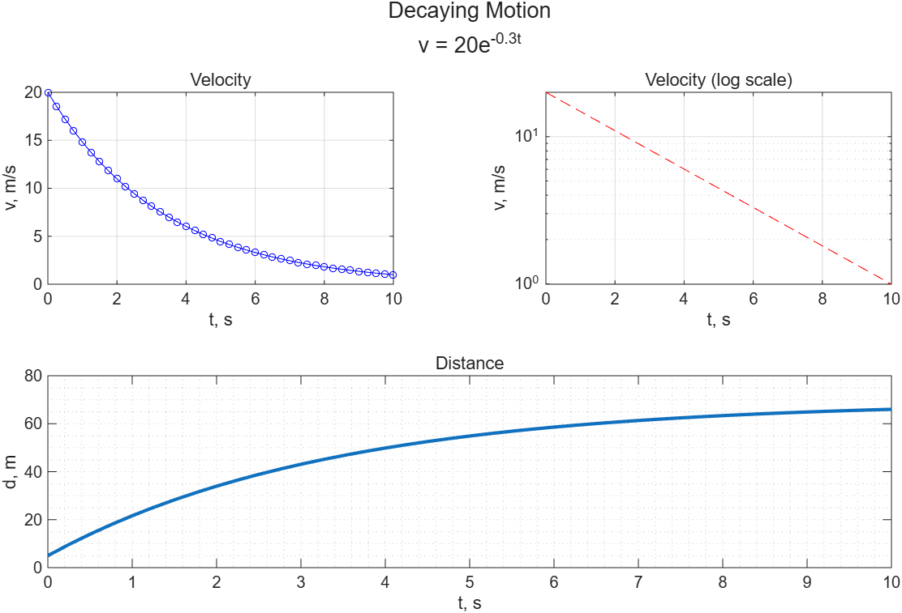

```matlab
t = 0:0.25:10;  v = 20*exp(-0.3*t);  d = cumsum(v)*0.25;
tl = tiledlayout(2, 2);
nexttile
plot(t, v, "b-o", MarkerSize = 4)
title("Velocity"), xlabel("t, s"), ylabel("v, m/s"), grid on
nexttile
semilogy(t, v, "r--")
title("Velocity (log scale)"), xlabel("t, s"), ylabel("v, m/s"), grid on
nexttile(3, [1 2])                    % 3번 타일부터 1행 2열
plot(t, d, LineWidth = 2)
title("Distance"), xlabel("t, s"), ylabel("d, m"), grid minor
title(tl, ["Decaying Motion"; "v = 20e^{-0.3t}"])   % 두 줄 제목은 2x1 string 배열
```

지수 감쇠는 semilogy에서 직선이 된다(5.3.2). 전체 제목은 반드시 layout 객체 `tl`을 첫 인수로.

---

## 문제 08 🐞 switch/case

[`a08_switch_fare.m`](code/a08_switch_fare.m)

| 줄 | 원인 | 수정 |
|---|---|---|
| `if fare = 0` | 대입 연산자. **문법 오류**라 파일 전체가 실행되지 않음: `'=' 연산자를 잘못 사용했습니다. '='를 사용하여 변수에 값을 대입하고 '=='를 사용하여 값이 같은지 비교하십시오.` | `fare == 0` |
| `case "Boston" \| "Denver"` | string에 `\|`를 쓰면 **pattern 객체**가 만들어지고, `case`에는 쓸 수 없다 (`badCaseExpression`) | `case {"Boston", "Denver"}` (cell 배열) |
| `case Honolulu` | 따옴표 없음 → 변수 `Honolulu`를 찾다가 `인식할 수 없는 함수 또는 변수` | `case "Honolulu"` |
| `else disp(...)` | 문법적으로는 **허용**된다(else 뒤에 조건이 없으므로). 다만 읽기 어려우니 줄을 나눈다 | 스타일 |

추가 질문: 슬라이드(8.5.4 p61)는 "`input(...,'s')`는 char이므로 case도 char(`'Boston'`)여야 한다"고 한다. 그러나 **R2026a에서는 `switch` 문자열 비교에 `strcmp`가 쓰이므로 char `'Denver'`와 `case "Denver"`가 일치한다.** 검증 결과 `Discount fare: $150`이 정상 출력됐다. 시험에서 "슬라이드 기준" 답을 요구하면 "자료형을 맞춰야 한다"고 쓰고, 실제 동작을 물으면 "일치한다"고 쓰되 둘 다 아는 것이 안전하다.

> **[보강]** R2026a 검증: `switch 'Boston'; case "Boston"` → 일치.

---

## 문제 09 📤 인덱싱

[`a09_indexing.m`](code/a09_indexing.m)

```matlab
M = [2 4 6 8; 1 3 5 7; 10 20 30 40]
a = M(:, [1 end])      % 1열과 마지막 열
b = M(end, :)          % 마지막 행
c = M([2 5 8])         % single index: 열 순서로 2, 5, 8번째 → 1, 3, 5
d = M(2:3, 2:end)
e = M(:)'              % 한 열로 편 뒤 전치
M(2, :) = []           % 2행 삭제
S = [1.5 2.5];
S(5) = 9               % 3, 4번째는 0으로 채워진다
```

`c`가 어렵다: `M(:)`은 `2 1 10 4 3 20 ...`이므로 2, 5, 8번째가 `1 3 5`다. `a`는 `M(:, [1 4])`도 정답.

---

## 문제 10 📝 patients.dat

[`a28_file_io.m`](code/a28_file_io.m) (문제 28과 같은 파일 I/O 묶음. 검증 코드는 `a28`에 있다.)

**Pseudocode**

1. `T = readtable("patients.dat")`로 표를 읽는다. 열 이름은 파일 첫 줄에서 자동으로 온다.
2. `height(T)`, `width(T)`로 크기를 출력한다.
3. 조건 `T.Smoker == 1 & T.Systolic >= 125`로 logical 벡터를 만들어 **행 인덱싱** `T(조건, :)`으로 부분 표 `risky`를 만든다.
4. `risky.BMI = risky.Weight*0.4536 ./ (risky.Height*0.0254).^2`로 열을 추가한다 (원소별 `./`, `.^`).
5. `sortrows(risky, "Systolic", "descend")`로 정렬한다.
6. `risky(1:5, ["LastName" "Age" "Systolic" "BMI"])`를 `disp`한다.
7. `writetable(risky, "risky_patients.csv")`로 저장하고 행 수를 출력한다.

```
100 patients, 10 variables
25 at-risk patients
     LastName      Age    Systolic     BMI  
    ___________    ___    ________    ______

    {'Bell'   }    45       138       24.393
    {'Ramirez'}    48       138       23.516
    ...
Saved 25 rows to risky_patients.csv
```

`readtable`이 읽은 문자열 열이 `{'Bell'}`처럼 cell로 보이는 것은 파일에서 읽을 때 기본이 char cell이기 때문이다(7.4.1).

---

## 문제 11 🐞 플롯

[`a11_plot_bugs.m`](code/a11_plot_bugs.m) · 결과: 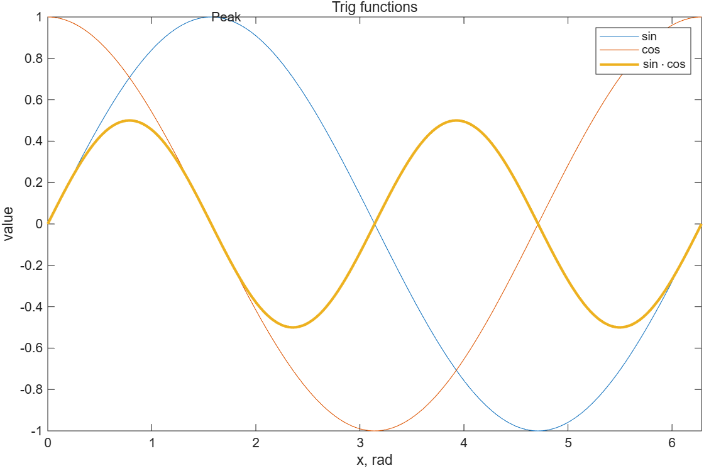

| 줄 | 원인 | 수정 |
|---|---|---|
| `"LineWidth" = 2` | Name=Value 문법은 이름에 따옴표를 **안 쓴다**. 문법 오류: `'=' 연산자는 사용할 수 없습니다. ... 이름이 묶는 따옴표가 없는 유효한 식별자인지 확인하십시오.` | `LineWidth = 2` 또는 `"LineWidth", 2` |
| `xlabel("x, rad") ylabel("value")` | 명령 둘 사이에 구분자 없음 → 문법 오류 | 쉼표 |
| `text("Peak", pi/2, 1)` | 인수 순서는 `text(x, y, 문자열)` | `text(pi/2, 1, "Peak")` |
| `axis([-1 1 0 2*pi])` | `[xmin xmax ymin ymax]` 순서. 실행은 되지만 x축이 -1~1, y축이 0~6.28로 그래프가 거의 안 보인다 | `axis([0 2*pi -1 1])` |
| `legend("sin", "cos")` | 선은 세 개(`plot(x, Y)`가 두 줄 + 한 줄)인데 항목이 둘 → 세 번째 선 범례 없음 | 항목 셋 |
| `hold on` 뒤 `hold off` 없음 | 슬라이드: "Never issue hold on without hold off" | `hold off` 추가 |

함정: `plot(x, Y)`에서 `Y`가 2×201이고 `x`가 1×201인 것은 **정상**이다(5.1.1 p27). MATLAB이 길이가 맞는 쪽으로 열/행을 맞춘다.

---

## 문제 12 📤 관계·논리 연산

[`a12_logical_output.m`](code/a12_logical_output.m)

```matlab
x = [3 8 1 9 6 2 7]
big = x > 5
idx = find(big)
vals = x(x > 5 & x < 9)
cnt = sum(~big)
y = [1 2 3; 4 5 6; 7 8 9];
[r, c] = find(y > 4 & rem(y, 2) == 0)
flag = xor(x > 2, x < 7)
```

`r = [3; 2]`, `c = [2; 3]`: 6은 (2,3), 8은 (3,2)인데 **열 순서**로 8이 먼저 나온다. `flag`는 "2 초과"와 "7 미만"이 **둘 다 참**인 3, 6은 0, 둘 다 거짓인 경우는 없고, 하나만 참인 8, 1, 9, 2, 7은 1.

---

## 문제 13 🎯 nargin과 함수 핸들

[`a13_function_nargin.m`](code/a13_function_nargin.m) · 결과: 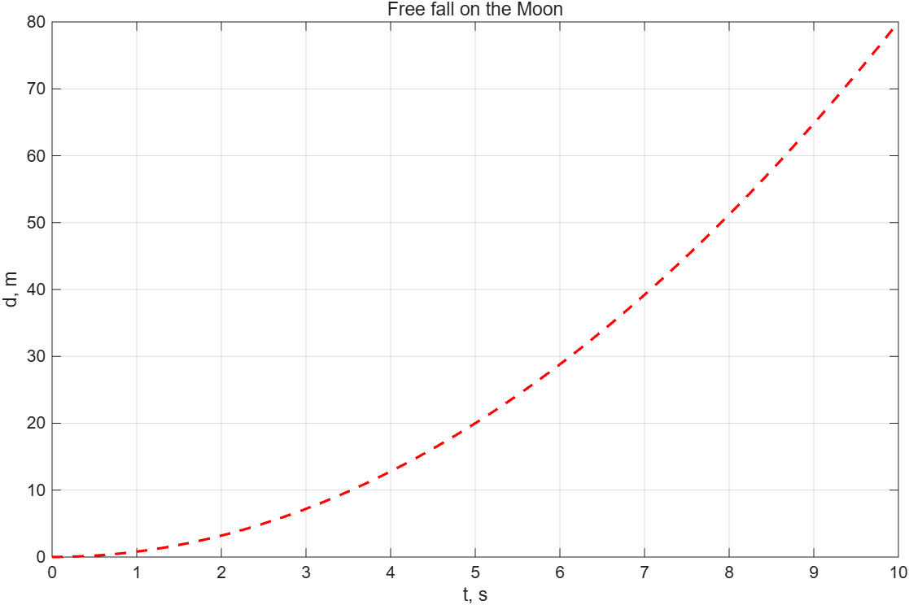

```matlab
t = 0:2:10;
[d_earth, v_earth] = freefall(t);
[d_moon, v_moon] = freefall(t, 1.6);
fprintf('%4.0f s: Earth %7.1f m (%5.1f m/s) | Moon %6.1f m (%4.1f m/s)\n', ...
        [t; d_earth; v_earth; d_moon; v_moon])
moon_fall = @(t) freefall(t, 1.6);
fplot(moon_fall, [0 10], "r--", LineWidth = 1.5)
title("Free fall on the Moon"), xlabel("t, s"), ylabel("d, m"), grid on

function [d, v] = freefall(t, g)
% FREEFALL 자유낙하 거리 d와 속도 v. g를 생략하면 9.8 m/s^2
if nargin < 2
    g = 9.8;
end
d = 0.5*g*t.^2;
v = g*t;
end
```

함수 **안**에서 `nargin`은 "실제로 넘어온 입력 개수"다(6.1.5). 익명 함수로 감싸면 `fplot`이 요구하는 "입력 하나짜리 함수"가 되고, 출력이 둘이어도 `fplot`은 첫 번째(`d`)만 쓴다.

---

## 문제 14 🐞 fprintf / disp

[`a14_fprintf_bugs.m`](code/a14_fprintf_bugs.m)

| 줄 | 원인 | 실제 현상 |
|---|---|---|
| `%6.2` (type 없음) | 7.2.2 Hint: "field type identifier를 빠뜨리면 작동하지 않지만 오류 메시지도 없다" | `   1 feet = ` 까지만 찍고 **조용히** 멈춘다 |
| `/n` | 줄바꿈은 `\n` | 문자 그대로 `/n`이 찍힘 |
| `feet, inches` 따로 전달 | `feet`를 다 쓰고 `inches`로 넘어감 | 짝이 어긋남 → `[feet; inches]` |
| `disp('...', numel(feet), 'rows')` | `disp`는 인수 **하나** | 실행 오류: `입력 인수가 너무 많습니다.` (여기서 스크립트가 멈춘다) |
| `['Count: ' 3]` | char와 숫자를 `[]`로 붙이면 3이 **문자 코드 3**(제어문자)이 됨 | `Count: ` 뒤에 보이지 않는 문자 → `num2str(3)` 또는 `"Count: " + 3` |
| `%\n` | `%` 하나는 자리표시자 시작 | `Rate:  5.00 ` 뒤가 사라짐 → `%%` |

---

## 문제 15 📝 지원자 자격 심사

[`a15_applicants.m`](code/a15_applicants.m)

**Pseudocode / Flowchart**

1. (타원) 시작
2. (직사각형) 지원자 행렬 `[키, 나이]`를 정의한다.
3. (직사각형) `find(키 >= 66 & 나이 >= 18 & 나이 < 35)`로 자격자 행 번호 `qualify`를 구한다.
4. (직사각형) 인원 `numel(qualify)`, 비율 `n/height(applicants)*100`을 계산한다.
5. (평행사변형) `[qualify, applicants(qualify, :)]'`를 `fprintf`로 한 줄씩 출력한다.
6. (평행사변형) 인원·비율·평균 키(`mean(applicants(qualify, 1))`)를 출력한다.
7. (평행사변형) 탈락 사유별 인원 `sum(키 < 66)`, `sum(나이 < 18 | 나이 >= 35)`를 출력한다.
8. (타원) 끝

마름모(판단)가 **없다**는 점이 핵심이다. `find`와 logical indexing이 선택을 대신한다(8.3 Hint "Don't ignore find in favor of if").

```
Applicant #2: 67 in, 19 yr
Applicant #4: 72 in, 20 yr
Applicant #6: 78 in, 34 yr
Applicant #8: 70 in, 25 yr
4 of 8 qualified (50.0%)
Mean height of qualified: 71.75 in
Too short: 2, wrong age: 2
```

슬라이드 코드는 `<= 35`인데 문장은 "less than 35"다. 이 문제는 문장대로 `< 35`를 썼다.

---

## 문제 16 📤 배열 생성과 format

[`a16_format_output.m`](code/a16_format_output.m)

```matlab
a = linspace(0, 1, 5)
b = logspace(0, 2, 3)      % 10^0, 10^1, 10^2
c = 10:-3:0                % 감소 콜론. 0은 포함 안 됨 (10 7 4 1)
format long
d = pi/4
format short e
d
format short
e = [1 2 3]'*[1 2 3]       % 열 x 행 = 3x3 외적
f = [1 2 3].*[1 2 3]       % 원소별
```

`logspace`의 앞 두 인수는 **10의 지수**다. `[1 2 3]*[1 2 3]`은 오류(1×3 · 1×3)이고 `[1 2 3]*[1 2 3]'`는 스칼라 14다.

---

## 문제 17 🎯 복리 표 (meshgrid)

[`a17_meshgrid_interest.m`](code/a17_meshgrid_interest.m)

```matlab
P = 1000;
rate = [0.03 0.05 0.08 0.10];
years = (0:5:30)';
[R, N] = meshgrid(rate, years);     % 열 수 = numel(rate), 행 수 = numel(years)
A = P*(1 + R).^N;
disp("Year    3%       5%       8%      10%")
fprintf('%4d %8.0f %8.0f %8.0f %8.0f\n', [years, A]')
below = sum(A < 2*P);               % 열마다 "아직 두 배 미만"인 행 수
double_year = years(below + 1)';
fprintf('Rate %.0f%%: doubles by year %d\n', [rate*100; double_year])
```

```
Year    3%       5%       8%      10%
   0     1000     1000     1000     1000
   5     1159     1276     1469     1611
  10     1344     1629     2159     2594
  ...
Rate 3%: doubles by year 25
Rate 5%: doubles by year 15
Rate 8%: doubles by year 10
Rate 10%: doubles by year 10
```

`[years, A]`는 7×5이므로 **전치해서** 넘겨야 한 행이 한 줄이 된다. `A`가 연수에 대해 단조증가이므로 "미만인 개수 + 1"이 첫 초과 행의 번호다.

---

## 문제 18 🐞 데이터 분석

[`a18_stats_bugs.m`](code/a18_stats_bugs.m)

실행 흐름: `max = max(scores)`는 **성공**하고(`90 92 95`), `avg`도 찍히지만 값이 틀리고(`79 79 77.75` — 시험별 평균), `[best, exam] = max(scores, 2)`에서 멈춘다. 이때 `max`는 이미 **변수**이므로 `max(scores, 2)`는 함수 호출이 아니라 인덱싱이고, 출력이 하나뿐이라 `등호 우변의 출력값 개수가 부족하여 대입식이 성립될 수 없습니다.`가 난다.

| 줄 | 원인 | 수정 |
|---|---|---|
| `max = max(scores)` | 함수 이름을 변수로 덮음 (3.5.1 Hint). 이후 `max` 호출 전부 깨짐 | 다른 이름, `clear max`로 복구 |
| `mean(scores, 1)'` | dim 1은 **열**(시험별). 학생별은 dim 2 | `mean(scores, 2)` |
| `max(scores, 2)` | 원소와 2의 비교. dim을 주려면 빈 자리 필요 | `max(scores, [], 2)` |
| `sort(scores, 'descend')` | 열마다 따로 정렬 → 행이 흩어짐 | `sortrows(scores, -1)` |
| `fprintf(..., pass, avg(pass))` | `pass`를 다 쓰고 `avg(pass)` 소비 | `[pass'; avg(pass)']` |

```
exam_max = 90 92 95
avg = 78.3333  84.6667  74.6667  76.6667  (열 벡터)
best = 92 95 85 90,  exam = 2 3 2 1
ranked = [90 68 72; 88 71 95; 78 92 65; 60 85 79]
Student 1 passed with average 78.3
Student 2 passed with average 84.7
Student 4 passed with average 76.7
```

---

## 문제 19 📤 if/elseif

[`a19_elseif_output.m`](code/a19_elseif_output.m)

```matlab
score = input("Enter the score (0-100): ");
if score < 0 || score > 100
    disp("Invalid score")
elseif score >= 90
    fprintf('Grade A (%.0f points above B)\n', score - 80)
elseif score >= 80
    fprintf('Grade B (%.0f points to A)\n', 90 - score)
else
    disp("Grade C or below")
end
```

유효성 검사가 먼저여야 하는 이유: 100 초과(예: 150)는 `score >= 90`도 참이므로, 검사가 뒤에 있으면 "Grade A"로 통과해 버린다. `elseif`는 **앞 조건이 거짓일 때만** 평가되므로 "80 이상"에 `& < 90`을 또 쓸 필요가 없다(8.5.3 p57).

---

## 문제 20 🎯 입력 검사

[`a20_input_validation.m`](code/a20_input_validation.m)

```matlab
r = input("Enter the radius in cm: ");
if ~isnumeric(r) || ~isscalar(r)
    error("The radius must be a single number.")
elseif r <= 0
    error("The radius must be positive, not %g.", r)   % error도 서식 지원
elseif r > 100
    beep                                     % 소리만 내고 계속 진행 (error는 중단)
    disp("Warning: radius larger than 100 cm, check the units")
end
V = 4/3*pi*r^3;
S = 4*pi*r^2;
fprintf('r = %.2f cm -> V = %.3e cm^3, S = %8.2f cm^2\n', r, V, S)
```

`r = 2.5` → `r = 2.50 cm -> V = 6.545e+01 cm^3, S =    78.54 cm^2`. 조건 순서: 숫자 검사가 먼저여야 `r <= 0`에서 문자열 비교 오류가 안 난다. `||`는 스칼라용이고, `~isnumeric(r)`이 참이면 뒤를 평가하지 않는다(short-circuit).

---

## 문제 21 📝 점수 분포

[`a21_histogram.m`](code/a21_histogram.m) · 결과: 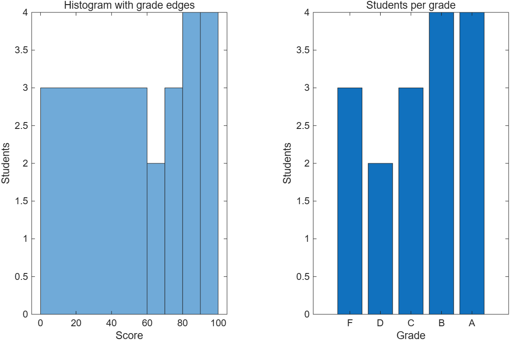

**Pseudocode**: (1) 점수 벡터 정의 → (2) `edges` 정의 → (3) `counts = histcounts(scores, edges)` → (4) 학점 이름 string 배열과 `counts'`를 `table`로 출력 → (5) `tiledlayout(1,2)`; `histogram(scores, edges)`; `bar(counts)` + `xticklabels(labels)` → (6) `mean`, `std`, `median`을 `fprintf` 한 줄.

```
    Grade    Count
    _____    _____
     "F"       3  
     "D"       2  
     "C"       3  
     "B"       4  
     "A"       4  
mean = 74.1, std = 21.9, median = 80.0
```

`histogram(x, 5)`의 5는 **bin 개수**(최소~최대를 5등분), `histogram(x, edges)`의 벡터는 **bin 경계**다. 스칼라냐 벡터냐로 해석이 갈린다(5.3.4 p7-8). `xticklabels`는 슬라이드 밖 함수다 (**[보강]**); 없으면 `bar` 대신 `table`만 써도 된다.

---

## 문제 22 🐞 char vs string

[`a22_string_bugs.m`](code/a22_string_bugs.m)

실행 흐름: 첫 줄 `['Steven'; 'Jasmin'; 'David']`에서 바로 `결합하려는 배열의 차원이 일치하지 않습니다.` (6, 6, 5글자). 나머지는 그 줄을 고친 뒤의 동작이다.

| 줄 | 실제 결과 | 왜 | 수정 |
|---|---|---|---|
| `['Steven'; 'Jasmin'; 'David']` | 오류 | char 행렬은 행 길이가 같아야 함 (4.4.1) | `["Steven"; "Jasmin"; "David"]` 또는 `char('Steven','Jasmin','David')` |
| `first + " " + last` | `"Holly Moore"` ✓ | string + char → string | 정상 |
| `length(full)` | **1** | string 스칼라는 1×1 배열 | `strlength(full)` → 11 |
| `['Hello, ' full '!']` | 1×3 string 배열 `"Hello, " "Holly Moore" "!"` | `[]`에 string이 섞이면 전부 string **원소**로 결합 | `"Hello, " + full + "!"` |
| `full(1) + last(1)` | `"Holly MooreM"` | `full(1)`은 string 원소 전체, `last(1)`은 `'M'` | `f = char(full); string(f(1)) + last(1)` |
| `"Trial " + 11` | `"Trial 11"` ✓ | 숫자는 string으로 변환 | 정상 |
| `strlength(names)` | 오류 `첫 번째 인수는 텍스트여야 합니다.` (2-D char) | `strlength`는 string/char **벡터**용 | `names`를 string 배열로 → `[6; 6; 5]` |

---

## 문제 23 📤 그림 → 코드

[`a23_figure_plot.m`](code/a23_figure_plot.m)

```matlab
t = 0:0.1:5;
y = exp(-0.5*t).*cos(2*pi*t);
env = exp(-0.5*t);
plot(t, y, "b-", LineWidth = 1.5)
hold on
plot(t, env, "r--o", MarkerSize = 4)
plot(t, -env, "r--")
hold off
grid on
axis([0 5 -1.2 1.2])
title("Damped oscillation, \zeta = 0.5")
xlabel("Time, s"), ylabel("Amplitude, e^{-0.5t}cos(2\pit)")
legend("signal", "+envelope", "-envelope")
text(2, 0.8, "decay \rightarrow")
```

읽어야 할 단서: 파란 굵은 실선(굵기 ≈1.5), 빨간 파선에 작은 원 마커는 **양의** 포락선에만, 음의 포락선은 마커 없음, y축 -1.2~1.2, 범례 3개 순서, 제목의 ζ(`\zeta`), y축 이름의 윗첨자 `^{-0.5t}`와 π(`\pi`), 화살표 `\rightarrow`.

---

## 문제 24 🎯 난수

[`a24_random_sim.m`](code/a24_random_sim.m) · 결과: 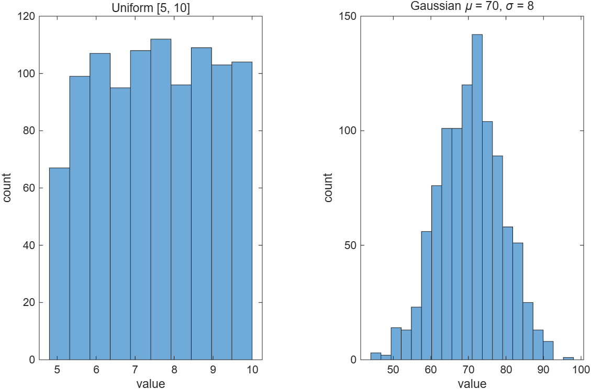

```matlab
a = 5; b = 10; n = 1000;
u = (b - a)*rand(n, 1) + a;              % 3.6.1: (max-min)*rand + min
mu = 70; sigma = 8;
g = sigma*randn(n, 1) + mu;              % 3.6.2: std*randn + mean
fprintf('Uniform : min %.3f, max %.3f, mean %.3f (target 7.5)\n', min(u), max(u), mean(u))
fprintf('Gaussian: mean %.3f, std %.3f (target 70, 8)\n', mean(g), std(g))
within1 = sum(abs(g - mu) < sigma) / n * 100;
within2 = sum(abs(g - mu) < 2*sigma) / n * 100;
fprintf('Within 1 sigma: %.1f%%, within 2 sigma: %.1f%% (expect 68%%, 95%%)\n', within1, within2)
tiledlayout(1, 2)
nexttile, histogram(u, 10), title("Uniform [5, 10]")
nexttile, histogram(g, 20), title("Gaussian \mu = 70, \sigma = 8")
```

`rng(1)`을 앞에 두면 재현된다(**[보강]**, 슬라이드 밖). 난수라서 값은 실행마다 다르다. 순서 `sigma*randn + mu`가 중요하다: 더한 뒤 곱하면 평균이 `sigma*mu`가 된다.

---

## 문제 25 🐞 익명 함수·핸들

[`a25_handle_bugs.m`](code/a25_handle_bugs.m)

| 줄 | 원인 | 수정 |
|---|---|---|
| `f = @x x.^2 - 4;` | 입력 목록은 괄호 `@(x)`. 문법 오류 `예기치 않은 'x'입니다.` → 파일 전체 미실행 | `@(x) x.^2 - 4` |
| `fplot(f(x), [-3 3])` | `f(x)`는 값을 **계산**하려는 것인데 `x`가 없음. `fplot`에는 핸들 자체를 | `fplot(f, [-3 3])` |
| `distance` 안의 `g` | 함수 작업공간은 독립적(6.1.6). 스크립트의 `g`(게다가 익명 함수)는 보이지 않음 → `g` 미정의 오류 | 함수 안에 `g = 9.8;` |
| `k = @(x, y) x*y` | 1×3 · 1×3 행렬곱 오류 | `x.*y` |

고친 결과: `g = @(x)f(x)+1`, `root = 0`, `d = 44.1`, `prod3 = 4 10 18`. `g = @(x) f(x) + 1`은 정상이다 — 익명 함수가 만들어질 때 `f`의 **값**이 포착된다.

---

## 문제 26 📤 disp와 string

[`a26_disp_output.m`](code/a26_disp_output.m)

```matlab
x = [4 7 9];
disp("The values are: " + num2str(x))   % num2str → char 한 줄 '4  7  9'
disp("Value " + x')                     % string + 3x1 숫자 → 3x1 string 배열
disp("Total = " + sum(x))
fprintf('%d squared is %3d\n', [x; x.^2])
disp(x')
```

둘째 줄: string에 **배열**을 더하면 원소마다 string이 하나씩 생겨 3×1 string 배열이 되고, `disp`는 string 배열을 따옴표와 함께 한 줄에 하나씩 보여 준다(7.2.1 p22). 첫째 줄은 `num2str`이 숫자 전체를 **char 한 덩어리**로 바꾸므로 string 하나가 된다(p23). 빈 줄은 string 배열 표시 뒤에 MATLAB이 넣는 것이다.

---

## 문제 27 🎯 체온 분류

[`a27_fever_table.m`](code/a27_fever_table.m)

```matlab
status = strings(size(temp));
status(temp <= 98.6) = "Well";
status(temp > 98.6 & temp < 101) = "Fever";
status(temp >= 101) = "High fever";
disp(table(names', temp', status', VariableNames = ["Patient" "Temp_F" "Status"]))
fprintf('Well: %d, Fever: %d, High fever: %d\n', sum(status == "Well"), ...
        sum(status == "Fever"), sum(status == "High fever"))
[hottest, who] = max(temp);
fprintf('Highest: %s at %.1f F\n', names(who), hottest)
fprintf('Patients to call: %s\n', strjoin(names(temp >= 101), ", "))
```

```
    Patient     Temp_F       Status   
    ________    ______    ____________
    "Jason"      98.2     "Well"      
    "Jose"      100.3     "Fever"     
    ...
Well: 2, Fever: 2, High fever: 2
Highest: Ken at 102.4 F
Patients to call: Rose, Ken
```

`strings(size(temp))`로 먼저 채워 두면 8.4의 `<missing>` 문제가 없다. `strjoin`은 슬라이드 밖(**[보강]**); 모르면 `fprintf('%s ', names(temp >= 101))`로 대체.

---

## 문제 28 📝 ASCII 저장과 load

[`a41_conversion_save.m`](code/a41_conversion_save.m) (문제 41과 같은 코드)

**Pseudocode**: (1) `mph` 열 벡터 → (2) `kmh`, `fps` 계산 → (3) `[mph, kmh, fps]`로 7×3 행렬 → (4) `disp` 머리글 + `fprintf` (행렬을 **전치**해서) → (5) `save speeds.dat table_data -ascii` → (6) `clear` → (7) `load speeds.dat` → 변수 이름은 **파일 이름** `speeds` → (8) `size(speeds)`, `max(speeds(:,2))` 출력.

- `-ascii` 없이 `save speeds.dat table_data`를 하면 확장자만 .dat인 **MAT 바이너리** 파일이 되어 다른 프로그램이 못 읽는다. `-ascii`를 붙이면 숫자만 텍스트로, 변수 이름은 사라진다.
- `load speeds`는 `speeds.mat`을 찾으므로 실패한다(`파일 또는 디렉터리 "speeds"을(를) 찾을 수 없습니다.`). `load speeds.dat`처럼 **확장자를 써야** ASCII로 읽고, 변수 이름은 파일 이름이 된다(2.4.1 p75).
- `- ascii`처럼 띄우면 오류 ("Do not put a space between the - and ascii").

출력은 문제 41 해답 참고.

---

## 문제 29 🐞 2장 스크립트

[`a29_script_bugs.m`](code/a29_script_bugs.m)

| 줄 | 원인 | 수정 |
|---|---|---|
| `2nd_run = 5;` | 변수 이름은 글자로 시작. 문법 오류 `예기치 않은 'nd_run'입니다.` → 파일 전체 미실행 | `run2` |
| `%%Define data` | `%%` 뒤에 공백이 없으면 **section이 아니라 주석** (2.4.3) | `%% Define data` |
| `radius^2` | 벡터 거듭제곱 | `.^` |
| `radius(radius + height)` | 암시적 곱셈 없음 → `radius`를 인덱스 5, 6, 7로 **인덱싱**하려다 범위 초과 오류 | `radius.*(radius + height)` |
| `- ascii` | 띄어쓰기 → `-`를 변수로 해석하려다 오류 | `-ascii` |
| `load results` | `results.mat`을 찾음 → `파일 또는 디렉터리 "results"을(를) 찾을 수 없습니다.` | `load results.dat` → 변수 `results` (2×3) |

```
volume =  12.5664   50.2655  113.0973
area   =  31.4159   75.3982  131.9469
results = [12.5664 50.2655 113.0973; 31.4159 75.3982 131.9469]
```

---

## 문제 30 📤 특수 행렬

[`a30_special_arrays.m`](code/a30_special_arrays.m)

```matlab
A = zeros(2, 3)
B = ones(3) * 7
C = diag([5 6 7])          % 벡터 입력 → 대각 행렬
D = magic(4);
d1 = diag(D)'              % 행렬 입력 → 대각선 추출 (열 벡터라 전치)
d2 = diag(D, -1)'          % k = -1: 주대각선 아래
E = fliplr(D(1, :))
F = sum(D, 2)'             % 행 합. sum(D')도 가능
G = [ones(2, 1), zeros(2, 2)]
```

`diag`는 입력이 벡터냐 행렬이냐에 따라 **반대 일**을 한다(4.3.3). `magic(4)`의 행·열·대각 합은 모두 34.

---

## 문제 31 🎯 3-D 표면

[`a31_surface.m`](code/a31_surface.m) · 결과: 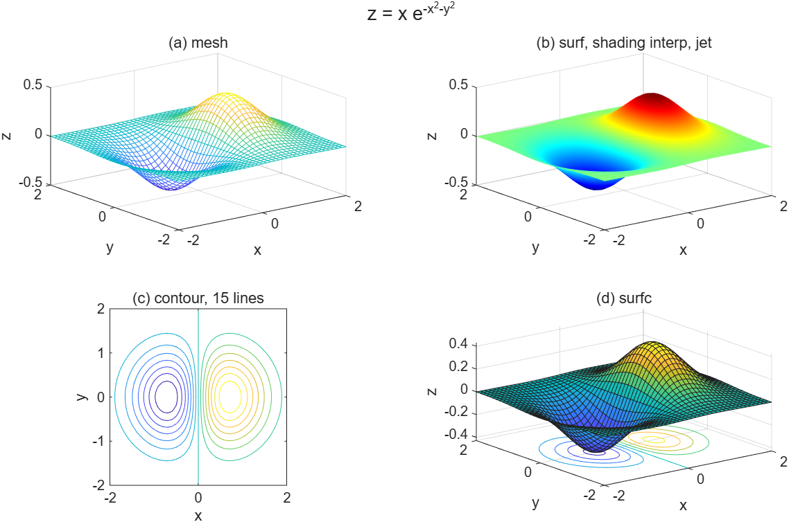

```matlab
[X, Y] = meshgrid(-2:0.1:2);          % 벡터 하나 → meshgrid(x, x)
Z = X.*exp(-X.^2 - Y.^2);
tl = tiledlayout(2, 2);
nexttile, mesh(X, Y, Z), title("(a) mesh"), xlabel("x"), ylabel("y"), zlabel("z")
nexttile, surf(X, Y, Z), shading interp, colormap(gca, "jet"), title("(b) surf, shading interp, jet")
nexttile, contour(X, Y, Z, 15), title("(c) contour, 15 lines"), axis equal
nexttile, surfc(X, Y, Z), title("(d) surfc")
title(tl, "z = x e^{-x^2-y^2}")
[zmax, k] = max(Z(:));
[r, c] = find(Z == zmax);
fprintf('Max z = %.4f at x = %.1f, y = %.1f (linear index %d)\n', zmax, X(r, c), Y(r, c), k)
```

`Max z = 0.4288 at x = 0.7, y = 0.0 (linear index 1128)`. `colormap(gca, "jet")`처럼 축을 지정하면 그 타일만 바뀐다(**[보강]**; `colormap jet`만 쓰면 figure 전체).

---

## 문제 32 🐞 find / logical indexing

[`a32_find_bugs.m`](code/a32_find_bugs.m)

| 줄 | 원인 | 실제 현상 |
|---|---|---|
| `temp > 98.6 && temp < 100` | `&&`는 **스칼라**용 (8.1 Table 8.2) | 실행 오류: `쇼트서킷 AND(&&) 및 OR(\|\|)에 대한 피연산자는 논리형 스칼라로 변환될 수 있어야 합니다. ... 요소별 연산의 경우 AND(&) 및 OR(\|) 연산자를 대신 사용하십시오.` → `&` |
| `names(temp)` | 인덱스로 **온도값** 사용 | `배열 인덱스는 양의 정수이거나 논리값이어야 합니다.` → `names(hot)` |
| `fprintf('row %d col %d\n', r, c)` | `r` 전부 → `c` 전부 순으로 소비 | `[r c]'` |
| `status(temp > 98.6) = "Sick"` | 나머지 자리가 `<missing>` | `status = strings(size(temp))`로 시작, `status(~(temp > 98.6)) = "Well"` |
| `if temp > 98.6` | 배열 조건은 **모두 참**일 때만 참(8.5.1 p50). 의도는 맞지만 읽는 사람을 위해 `all` 명시 | `if all(temp(:) > 98.6)` |

고친 결과: `hot_names = "E" "H" "F"`(열 순서: 99.2, 99.3, 98.9), `row 3 col 1 / row 1 col 2 / row 2 col 2 / row 3 col 2`, `5 of 9 have a fever`.

---

## 문제 33 📤 수학 함수

[`a33_math_output.m`](code/a33_math_output.m)

```matlab
x = [-7.5 2.49 2.5 3.51];
a = [fix(x); floor(x); ceil(x); round(x)]
b = rem(-7, 3)           % -1 (부호는 피제수 따라감)
c = round(pi, 3)         % 3.1420 (표시는 short)
d = cumsum(1:5)
e = cumprod([1 2 3 4])
f = nthroot(-27, 3)      % -3 (실근)
g = (-27)^(1/3)          % 1.5 + 2.5981i (복소 주근)
h = [factorial(5) nchoosek(5, 2)]
k = primes(20)
m = [log(exp(2)) log10(1000) exp(0)]
n = sin(pi)              % 1.2246e-16, 0이 아니다
```

`fix(-7.5) = -7`(0 쪽), `floor(-7.5) = -8`, `round(2.5) = 3`(MATLAB은 .5를 0에서 먼 쪽으로). `log`는 자연로그다.

---

## 문제 34 🎯 local function 두 개

[`a34_subfunctions.m`](code/a34_subfunctions.m)

```matlab
cw = cold_work(d0, d1);
[sigma, best] = stress(F, d1);
fprintf('Sample %d: cold work %5.1f%%, stress %7.1f MPa\n', [1:3; cw*100; sigma])
fprintf('Highest stress: sample %d\n', best)

function cw = cold_work(d_initial, d_final)
% COLD_WORK 단면적 감소율 (r_i^2 - r_f^2)/r_i^2
cw = (d_initial.^2 - d_final.^2) ./ d_initial.^2;
end

function [s, idx] = stress(force, d)
% STRESS 응력 = 힘 / 단면적 (N/mm^2 = MPa), 최대 응력 위치도 반환
area = pi*(d/2).^2;
s = force ./ area;
[~, idx] = max(s);
end
```

지름 비로 써도 된다(`1 - (d_f/d_i).^2`). 함수 정의 바로 다음 주석 줄이 `help`에 나온다(6.1.2). 스크립트 안 함수는 Command Window에서 `help cold_work`가 안 되고, 별도 파일로 저장해야 된다는 것도 시험 포인트.

---

## 문제 35 📝 사거리

[`a35_projectile.m`](code/a35_projectile.m) · 결과: 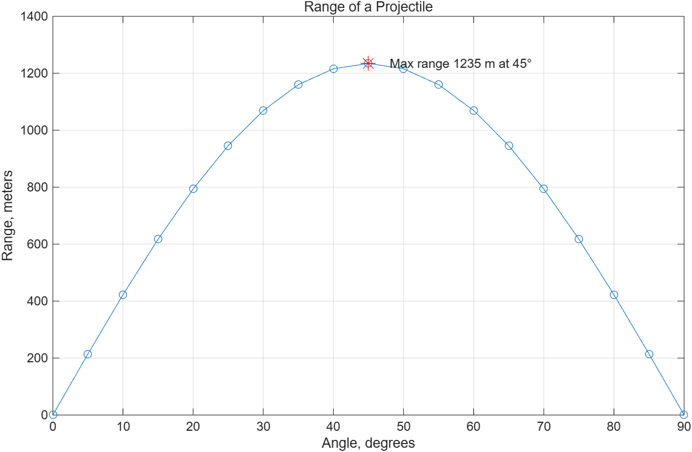

**Pseudocode**: (1) `g`, `v`, `theta`(도) 정의 → (2) `range = v^2/g*sind(2*theta)` — 각도가 **도**이므로 `sind`, 또는 `sin(2*deg2rad(theta))`. `sin(2*theta)`는 라디안으로 해석해 완전히 틀린 값 → (3) `[maximum, k] = max(range)`; `best = theta(k)` → (4) `label = sprintf("Max range %.0f m at %d%c", maximum, best, char(176))` → (5) `plot(theta, range, "-o")`, `hold on`, `plot(best, maximum, "r*")`, `hold off`, 제목·축 이름, `text(best + 3, maximum, label)` → (6) `theta(range >= 0.9*maximum)`을 `num2str`로 한 줄 출력.

```
Max range 1235 m at 45°
Angles giving >= 90% of max: 35  40  45  50  55
```

`sprintf`의 결과는 변수에 담겨 `text`, `title`에 바로 쓸 수 있다(7.2.3). `%c`로 문자 코드 176(°)을 넣는 것은 **[보강]**.

---

## 문제 36 🐞 table / writetable

[`a36_table_bugs.m`](code/a36_table_bugs.m) · 결과: 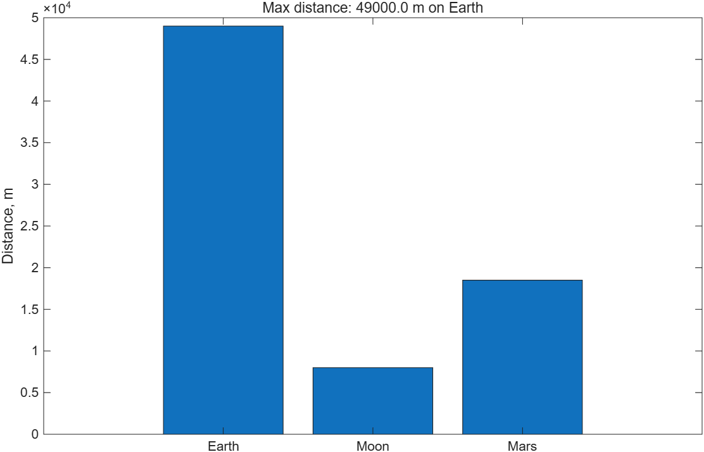

실행 흐름: `T`는 **오류 없이** 만들어지지만 **1×3 table**이고, 각 변수가 1×3 배열이다(`"Earth" "Moon" "Mars" | 9.8 1.6 3.7 | 49000 8000 18500`이 한 행에). 그다음 `ylabel(Distance, m)`에서 `'Distance'은(는) 인식할 수 없는 함수 또는 변수입니다.`로 멈춘다.

| 줄 | 원인 | 수정 |
|---|---|---|
| `table(planet, g, d, ...)` | 입력은 **열 벡터**여야 행마다 한 레코드 (7.2.4 p4) | `planet', g', d'` → 3×3 table |
| `ylabel(Distance, m)` | 따옴표 없음 | `ylabel("Distance, m")` |
| `writetable("planets.xlsx", T)` | 인수 순서는 `writetable(T, 파일명)` | 바꿈 |
| `VariableNames = [...]` | 슬라이드는 `'VariableNames'` 작은따옴표를 요구하지만 R2026a에서는 Name=Value 문법도 **정상** | 오류 아님 (**[보강]**) |

`sprintf`에 `%s`로 string `planet(d == max(d))`를 넣는 것, `title(label)`은 정상이다.

---

## 문제 37 📤 find + fprintf

[`a37_find_fprintf.m`](code/a37_find_fprintf.m)

```matlab
speed = [62 71 58 85 90 67 74];
limit = 70;
over = find(speed > limit)
excess = speed(over) - limit
fprintf('Car %d: %d km/h (%d over)\n', [over; speed(over); excess])
fprintf('%d of %d cars speeding, max excess %d km/h\n', numel(over), numel(speed), max(excess))
fine = zeros(size(speed));
fine(speed > limit) = 50 + 5*excess
```

마지막 줄: 좌변의 logical 자리 수(4)와 우변 `50 + 5*excess`의 길이(4)가 같아야 한다.

---

## 문제 38 🎯 string 배열

[`a38_strings.m`](code/a38_strings.m)

```matlab
len = strlength(names);
long_names = names(len > 5)
[sorted_scores, order] = sort(scores, "descend");
ranking = names(order) + " (" + sorted_scores + ")"
report = names + ": " + scores;
fprintf('%s\n', report(scores >= 80))
label = "Top: " + names(order(1)) + ", bottom: " + names(order(end))
longest = names(len == max(len))
total_chars = sum(len)
```

```
long_names = "Steven" "Jasmin" "Terrell"
ranking = "Maria (95)" "Jasmin (92)" "Steven (88)" "Lin (81)" "David (75)" "Terrell (60)"
Steven: 88 / Jasmin: 92 / Maria: 95 / Lin: 81
label = "Top: Maria, bottom: Terrell"
longest = "Terrell",  total_chars = 32
```

`sort`의 두 번째 출력(원래 위치)으로 **다른 배열**을 같은 순서로 재배열하는 것이 핵심이다(`sortrows`가 숫자 행렬에서 하는 일을 string에 대해 손으로 하는 셈).

---

## 문제 39 🐞 tiledlayout

[`a39_tiled_bugs.m`](code/a39_tiled_bugs.m) · 결과: 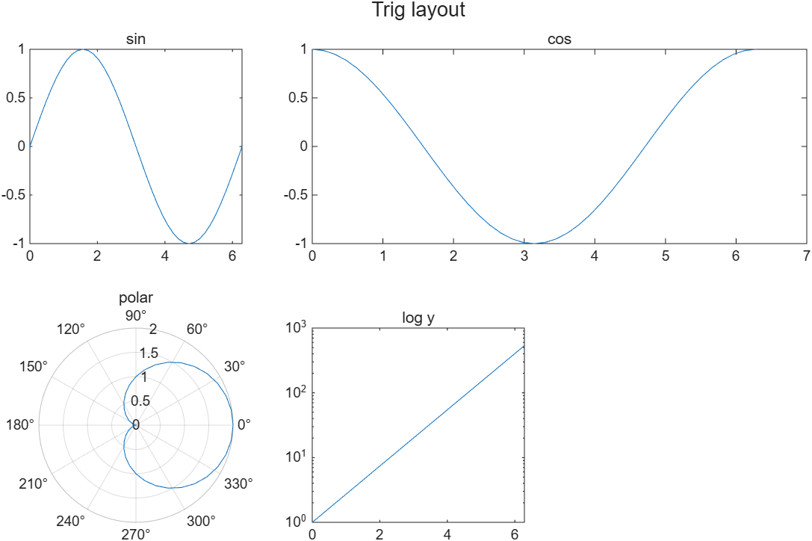

실행 흐름: `t = tiledlayout(2, 2)`가 세미콜론이 없어 속성 목록을 길게 출력(스타일, 5.2 p57 "suppress the output")하고, `nexttile(2, [1 2])`에서 `타일이 레이아웃에 맞지 않습니다.`로 멈춘다.

| 줄 | 원인 | 수정 |
|---|---|---|
| `tiledlayout(2, 2)` + `nexttile(2, [1 2])` | 2열 격자에서 **2번 타일부터 2칸 폭**은 격자를 벗어난다. "sin 한 칸 + cos 두 칸"은 **3열**이 필요 | `tiledlayout(2, 3);` |
| `polarplot(1 + cos(x), x)` | 인수 순서는 `polarplot(theta, r)` | `polarplot(x, 1 + cos(x))` |
| `title("Trig layout")` | 마지막 타일의 제목을 덮어쓴다 | `title(t, "Trig layout")` |
| `semilogy(x, exp(x))` | 정상 (지수함수 → 직선) | — |

---

## 문제 40 📤 함수 파일

[`kinematics.m`](code/kinematics.m) · 호출: [`a40_kinematics_calls.m`](code/a40_kinematics_calls.m)

```matlab
function [d, v, a] = kinematics(t)
% KINEMATICS 시각 t에서의 거리, 속도, 가속도 (문제 40 정답)
%   가속도 a = 0.5 t, 속도 v = t^2/4, 거리 d = t^3/12
a = 0.5*t;
v = t.^2/4;
d = t.^3/12;
end
```

- `kinematics(2)`는 출력을 지정하지 않았으므로 **첫 번째 출력 `d`** 만 `ans`에 온다(6.1.3 p23).
- 함수 안의 계산 순서는 무관하다. 출력 순서는 **정의 줄의 `[d, v, a]`** 가 정한다.
- 파일 이름과 함수 이름이 같아야 하고, `help`는 정의 줄 바로 아래 주석을 보여 준다.
- `t`가 벡터일 수 있으므로 `.^`.

---

## 문제 41 🎯 변환표와 ASCII 저장

[`a41_conversion_save.m`](code/a41_conversion_save.m)

```matlab
mph = (0:20:120)';
kmh = mph*1.609;
fps = mph*5280/3600;
table_data = [mph, kmh, fps];
disp("  mph    km/h    ft/s")
fprintf('%5.0f %7.1f %7.2f\n', table_data')     % 전치!
save speeds.dat table_data -ascii
clear
load speeds.dat                                  % 변수 이름 = speeds
fprintf('Reloaded %d rows x %d cols; fastest = %.1f km/h\n', size(speeds), max(speeds(:, 2)))
```

```
  mph    km/h    ft/s
    0     0.0    0.00
   20    32.2   29.33
   ...
  120   193.1  176.00
Reloaded 7 rows x 3 cols; fastest = 193.1 km/h
```

`size(speeds)`는 `[7 3]`이라 `%d` 두 개를 채운다.

---

## 문제 42 📝 menu 변환기

[`a42_menu_converter.m`](code/a42_menu_converter.m)

**Pseudocode**: (1) 선택지 string 배열 `options` 정의 → (2) `choice = menu("Select a conversion:", options)` → **버튼 번호(double 1, 2, 3)** 가 돌아온다 → (3) `value = input(...)` → (4) `switch choice`의 `case 1`, `case 2`, `case 3`에서 변환식과 단위 string → (5) `fprintf('%s: %g -> %.2f %s\n', options(choice), value, result, unit)`.

- `menu`는 **숫자**를 돌려주므로 `case "km -> mi"`가 아니라 `case 1`이다(8.5.5 p64).
- `otherwise`: 슬라이드는 "사용자가 목록 밖 값을 넣을 수 없으니 필요 없다"고 한다. 단, 창을 **닫으면** `menu`가 0을 돌려주므로 `otherwise, error(...)`를 두는 편이 안전하다(**[보강]**).
- 검증은 GUI 없이 `choice = 3; value = 37;`로 고정: `C -> F: 37 -> 98.60 F`.

---

## 문제 43 🐞 인덱싱 판정

[`a43_index_bugs.m`](code/a43_index_bugs.m)

| 줄 | 판정 | 설명 |
|---|---|---|
| `x(0)` | **오류** `배열 인덱스는 양의 정수이거나 논리값이어야 합니다.` | 인덱스는 1부터 → `x(1)` |
| `x(2.5)` | **오류** (같은 메시지) | 정수만 → `x(3)` 또는 `x(ceil(end/2))` |
| `x(7) = 70` | 정상이지만 **조용히** 6번째가 0으로 채워진다 → `10 20 30 40 50 0 70` (4.1.1 p13) | 의도대로면 OK |
| `M(4, :)` | **오류** 인덱스 범위 초과 | `M(end, :)` |
| `M(:, 2) = []` | 정상. 2열 삭제 → 3×2 | — |
| `M(:, 3)` | **오류** `위치 2의 인덱스가 배열 경계를 초과합니다.` — 삭제로 열이 2개뿐 | `M(:, end)` |
| `M(end, end)`, `M(2, 1:end)` | 정상 (`9`, `4 6`) | — |

---

## 문제 44 📤 파일 출력

[`a44_file_output.m`](code/a44_file_output.m)

```matlab
t = 0:0.5:2;
v = 9.8*t;
fid = fopen("speed_log.txt", "wt");
fprintf(fid, 'Free-fall speed log\n');
fprintf(fid, 't = %4.1f s  v = %6.2f m/s\n', [t; v]);
count = fprintf(fid, 'END (%d samples)\n', numel(t))
fclose(fid);
```

파일에 쓸 때는 **첫 인수가 file id**이고 Command Window에는 아무것도 안 나온다. `fprintf`의 반환값은 쓴 **바이트 수**: `END (5 samples)` 15글자 + 줄바꿈 1 = 16 (7.2.2 p47 `ans = 29000`과 같은 원리). 세미콜론을 붙인 앞 두 호출은 반환값을 표시하지 않는다.

---

## 문제 45 🎯 배송비

[`a45_shipping.m`](code/a45_shipping.m)

```matlab
region = input("Region (domestic/asia/other): ", "s");
w = input("Weight in kg: ");
if ~isnumeric(w) || ~isscalar(w) || w <= 0
    error("Weight must be a positive number")
end
switch region
    case "domestic",       base = 3000;  per_kg = 500;
    case {"asia", "Asia"}, base = 12000; per_kg = 2500;
    case "other",          base = 25000; per_kg = 6000;
    otherwise
        error("Unknown region: %s", region)
end
if w <= 1
    cost = base;
elseif w <= 5
    cost = base + per_kg*(w - 1);
else
    cost = base + per_kg*4 + 1.5*per_kg*(w - 5);
end
fprintf('%s, %.1f kg -> %d KRW\n', region, w, round(cost))
```

`asia, 3.5 kg -> 18250 KRW` (12000 + 2500×2.5). `elseif w <= 5`에 `w > 1`을 또 쓸 필요가 없다. `%d`에 실수가 들어가면 지수 표기가 되므로 `round`가 필요하다(7.2.2 Table 7.1).

---

## 문제 46 🐞 else if

[`a46_function_if_bugs.m`](code/a46_function_if_bugs.m)

| 원인 | 설명 |
|---|---|
| `else if` (띄어쓰기) | `else` 안에 **새 if가 중첩**된다. 그래서 `end`가 하나 모자라고, 파일은 `스크립트의 모든 함수는 'end'로 닫혀있어야 합니다.`로 아예 실행되지 않는다. `elseif`로 고치거나 `end`를 하나 더 넣는다. |
| 벡터 입력 + `if age < 16` | 문법을 고쳐도 `[15 17 45 72] < 16`은 `1 0 0 0`이라 **모두 참이 아니므로 거짓**, 다음 `age < 18`도 거짓, `age < 70`도 거짓 → 전부 "senior" 하나만 나온다(8.5.1 p50). `if`는 스칼라용이다. |

벡터를 다루는 올바른 구현은 logical indexing:

```matlab
function out = license_type(age)
out = strings(size(age));
out(age < 16) = "wait";
out(age >= 16 & age < 18) = "youth";
out(age >= 18 & age < 70) = "standard";
out(age >= 70) = "senior";
end
```

`msg = "wait" "youth" "standard" "senior"`, `license_type(16) = "youth"`.

---

## 문제 47 📤 meshgrid

[`a47_meshgrid_output.m`](code/a47_meshgrid_output.m)

```matlab
x = 1:4;  y = [10 20 30];
[X, Y] = meshgrid(x, y)      % 3x4: 열 수 = numel(x), 행 수 = numel(y)
Z = X.^2 + Y
colsum = sum(Z)
rowmax = max(Z, [], 2)'
big = Z(Z > 25)'
```

`big`이 `31 34 29 39 26 36 46`인 이유: logical indexing은 결과를 **열 순서**(1열 위→아래, 2열 …)로 모은다. 1열에서 31, 2열에서 34, 3열에서 29·39, 4열에서 26·36·46.

---

## 문제 48 🎯 yyaxis와 fplot

[`a48_yyaxis_fplot.m`](code/a48_yyaxis_fplot.m) · 결과: 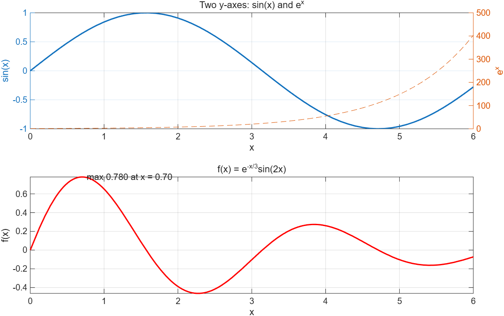

```matlab
x = 0:0.1:6;
tiledlayout(2, 1)
nexttile
yyaxis left
plot(x, sin(x), LineWidth = 1.5), ylabel("sin(x)")
yyaxis right
plot(x, exp(x), "--"), ylabel("e^x")
xlabel("x"), title("Two y-axes: sin(x) and e^x"), grid on
nexttile
f = @(x) exp(-x/3).*sin(2*x);
fplot(f, [0 6], "r", LineWidth = 1.5)
title("f(x) = e^{-x/3}sin(2x)"), xlabel("x"), ylabel("f(x)"), grid on
xs = 0:0.01:6;
[fmax, k] = max(f(xs));
text(xs(k), fmax, sprintf("  max %.3f at x = %.2f", fmax, xs(k)))
```

`yyaxis right` 이후의 `plot`, `ylabel`은 **오른쪽 축**에 붙는다. `xlabel`, `title`은 축계 공통. `yyaxis left`는 기본이라 생략 가능(5.3.5 p19).

---

## 문제 49 📝 데이터 정리

[`a49_data_cleaning.m`](code/a49_data_cleaning.m)

**Pseudocode**: (1) `raw` 정의 → (2) `missing = find(raw == -999)` 출력 → (3) `bad = raw ~= -999 & (raw < 0 | raw > 200)` logical 저장, `find(bad)`와 `raw(bad)` 출력 → (4) `valid = raw(raw ~= -999 & ~bad)` → (5) `numel`, `mean`, `std` 출력 → (6) `filled = raw; filled(raw == -999 | bad) = mean(valid)` 표시.

```
Missing at index: 3  7
Outliers at index: 5  9 (values 310   -5)
6 valid of 10; mean 24.23, std 0.74
   23.1000   24.0000   24.2333   25.2000   24.2333   24.8000   24.2333   23.9000   24.2333   24.4000
```

결측(-999)은 "0 미만"이기도 하므로 이상치 조건에 `raw ~= -999 &`를 넣어 **제외**해야 한다. logical 배열 `bad`를 변수에 두면 조건을 반복해 쓰지 않아도 되고 `~bad`로 반전할 수 있다.

---

## 문제 50 🐞 종합

[`a50_final.m`](code/a50_final.m) · 결과: 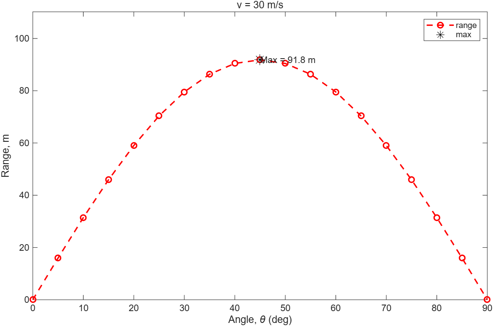

| 분류 | 줄 | 원인 | 수정 |
|---|---|---|---|
| 조용히 틀림 | `sin(2*theta)` | `theta`가 **도**인데 `sin`은 라디안. 최대 사거리가 45°가 아닌 엉뚱한 각에서 나온다 | `sind(2*theta)` |
| 조용히 틀림 | `fprintf("Angles within 90%: ")` | `%:`는 잘못된 서식 → `Angles within 90` 에서 **잘린다** | `90%%:` |
| 실행 오류 | `text(label, best_angle, maxR)` | `text(x, y, 문자열)` 순서. `입력값은 x, y 및 선택적으로 z 좌표 다음에 문자형 벡터, ... string형 배열 ...이 와야 합니다.` | `text(best_angle, maxR, label)` |
| 조용히 틀림 | `table(theta, range)` | 행 벡터 → **1×2 table**(각 변수가 1×19) | `table(theta', range', VariableNames = [...])` |
| 빠뜨림 | `hold on` 뒤 `hold off` 없음 | "Never issue hold on without hold off" | `hold off` |
| 함정 아님 | `fprintf("%d ", theta(good))` | 배열을 넘기면 서식을 **반복** 적용 — 정상 | — |
| 함정 아님 | `title("v = " + v + " m/s")` | 숫자 + string 결합 — 정상 | — |

`v = 30`일 때: `Max range 91.8 m at 45 degrees`, `Angles within 90%: 35 40 45 50 55`, 표는 19×2.

---

## 문제 51 🐞 NaN 제거 통계

[`a51_nan_stats.m`](code/a51_nan_stats.m)

| 줄 | 원인 | 현상 | 수정 |
|---|---|---|---|
| `odd = data(rem(round(data), 2) = 1)` | 괄호 안의 `=`는 대입 | **문법 오류**라 파일 전체가 실행되지 않음: `'=' 연산자는 사용할 수 없습니다. 값이 같은지 비교하려면 '=='를 사용하십시오. 이름-값 인수를 지정하려면 ...` | `== 1` |
| `bad = data == NaN;` | `NaN`은 **자기 자신과도 같지 않다**(3.9). 비교 결과가 전부 0이라 아무것도 지워지지 않음 | 조용히 진행. `n = 8`, `avg = NaN`, `spread = NaN`, 출력 `Mean   NaN, std   NaN over 8 samples` | `isnan(data)` |
| 마지막 `fprintf` | `%d`가 둘인데 인수는 하나 | 인수가 떨어진 자리에서 출력이 **멈춘다**: `0 of ` 까지만 찍히고 `\n`도 안 나와 다음 출력이 같은 줄에 붙는다 | `..., sum(data > avg), n)` |
| `n = length(data)` | 의심스럽지만 **오류 아님**. 벡터에서는 `length == numel` | — | 행렬이면 `numel` |

문법 오류 하나 때문에 나머지 두 줄의 "조용한" 오류는 실제로 보이지 않는다. 시험에서는 "`=`를 고친 뒤 실행하면 …" 식으로 단계를 나눠 쓴다. 고친 출력:

```
n =

     6


avg =

   10.9500


spread =

    1.6598


odd =

   12.5000   11.2000   13.1000    8.7000

Mean 10.95, std  1.66 over 6 samples
3 of 6 values are above the mean
```

---

## 문제 52 📤 복소수와 rem/mod

[`a52_complex_rem.m`](code/a52_complex_rem.m)

```matlab
z = [3+4i, -2i]
r = abs(z)
theta = rad2deg(angle(z))     % angle은 라디안. angle(z)*180/pi 도 된다
zc = conj(z)
zt = z'                       % 켤레 전치: 전치 + 부호 반전
zd = z.'                      % 단순 전치
rm = [rem(-7, 3) mod(-7, 3) rem(7, -3) mod(7, -3)]
```

- `abs`는 복소수의 **크기** √(3²+4²) = 5 (3.7).
- `'`와 `.'`의 차이는 복소수에서만 드러난다. `zt`는 허수부 부호가 바뀌었고 `zd`는 그대로다.
- `rem`은 부호가 **피제수**(첫 인수)를 따르고 `mod`는 **제수**를 따른다: `rem(-7,3) = -1`, `mod(-7,3) = 2`, `rem(7,-3) = 1`, `mod(7,-3) = -2` (3.3).
- `0.0000 - 2.0000i`처럼 실수부 0도 `0.0000`으로 찍히는 것은 배열 전체가 복소수 형식으로 표시되기 때문이다.

---

## 문제 53 🎯 fzero / fminbnd / integral

[`a53_fzero_fminbnd.m`](code/a53_fzero_fminbnd.m) → [`img/a53_fzero_fminbnd.png`](img/a53_fzero_fminbnd.png)

```matlab
f = @(x) x.^3 - 6*x.^2 + 4*x + 12;
guesses = [-1.5 2 5];
roots3 = arrayfun(@(x0) fzero(f, x0), guesses)
[xmin, fmin] = fminbnd(f, 0, 6)
A = integral(f, 0, 4)
fprintf('Roots: %.4f  %.4f  %.4f\n', roots3)
fprintf('Minimum f(%.4f) = %.4f on [0, 6]\n', xmin, fmin)
fprintf('Integral from 0 to 4 = %.4f\n', A)
fplot(f, [-2 6], LineWidth = 1.5)
hold on
plot(roots3, f(roots3), "ro", MarkerSize = 8, MarkerFaceColor = "r")
plot(xmin, fmin, "ks", MarkerSize = 10, MarkerFaceColor = "y")
yline(0, "--")
hold off
grid on, xlabel("x"), ylabel("f(x)")
title("f(x) = x^3 - 6x^2 + 4x + 12")
legend("f(x)", "roots", "minimum", Location = "northwest")
text(xmin, fmin - 5, sprintf("min = %.2f", fmin), HorizontalAlignment = "center")
```

```
Roots: -1.0514  2.5173  4.5341
Minimum f(3.6330) = -4.7093 on [0, 6]
Integral from 0 to 4 = 16.0000
```

- `fzero(f, x0)`는 **함수 handle**을 받는다. `fzero(f(x), ...)`처럼 호출 결과를 넘기면 안 된다(6.5).
- `arrayfun(@(x0) fzero(f, x0), guesses)`는 초기값마다 `fzero`를 한 번씩 부른다. loop 대신 쓰는 방법이며 교재 6.5에 있다. `fzero(f, -1.5), fzero(f, 2), fzero(f, 5)`를 따로 써서 `[ ]`로 묶어도 정답.
- `fminbnd`는 **구간 안의 국소 최소**만 찾는다. [0, 6]에서 x ≈ 3.63. 출력 둘을 받으면 값도 온다.
- `integral`도 벡터 입력이 되는 handle이 필요하므로 `.^`이 필수다. 결과 16은 해석적으로도 [x⁴/4 − 2x³ + 2x² + 12x]₀⁴ = 64 − 128 + 32 + 48 = 16.
- `yline(0)`은 `hold on` 상태에서 그려야 기존 선이 지워지지 않는다.

---

## 문제 54 📝 월 이름 → 계절

[`a54_month_season.m`](code/a54_month_season.m)

**Pseudocode** (flowchart 기호)

1. (타원) 시작.
2. (평행사변형) `m = input("Month name: ", "s")` — char로 받는다.
3. (직사각형) `m = lower(string(m))` — string으로 바꾸고 소문자로 통일.
4. (직사각형) `names = ["jan" ... "dec"]`, `days = [31 28 ... 31]` 정의.
5. (직사각형) `idx = find(names == m)` — string 배열과 스칼라 string의 `==`는 원소별 비교(4.4).
6. (마름모) `isempty(idx)`이면 → (직사각형) `error("Unknown month: %s", m)`.
7. (마름모·switch) `switch m`: `case {"dec","jan","feb"}` → `"winter"`; `case {"mar","apr","may"}` → `"spring"`; `case {"jun","jul","aug"}` → `"summer"`; `otherwise` → `"fall"`.
8. (평행사변형) `fprintf("%s: month %d, %d days, %s\n", upper(m), idx, days(idx), season)`.
9. (타원) 끝.

```matlab
% m = input("Month name: ", "s");       % 원래 코드
m = 'FEB';                              % 검증용 고정값
m = lower(string(m));
names = ["jan" "feb" "mar" "apr" "may" "jun" "jul" "aug" "sep" "oct" "nov" "dec"];
days  = [31 28 31 30 31 30 31 31 30 31 30 31];
idx = find(names == m);
if isempty(idx)
    error("Unknown month: %s", m)
end
switch m
    case {"dec", "jan", "feb"}, season = "winter";
    case {"mar", "apr", "may"}, season = "spring";
    case {"jun", "jul", "aug"}, season = "summer";
    otherwise,                  season = "fall";
end
fprintf("%s: month %d, %d days, %s\n", upper(m), idx, days(idx), season)
```

```
FEB: month 2, 28 days, winter
```

- 여러 값을 한 `case`에 넣을 때는 **cell 배열** `{ }`. `"dec" | "jan"`은 pattern이 되어 쓸 수 없다(문제 08).
- `lower`로 대소문자를 맞추는 것은 8.5.4 [보강]. `upper`는 출력용.
- `find(names == m)`이 빈 배열이면 `days(idx)`도 빈 배열이라 `fprintf`가 그 자리를 건너뛰고 `%d`가 비어 버린다. 그래서 `isempty` 검사가 먼저 와야 한다.

---

## 문제 55 🐞 극좌표·막대·파이

[`a55_polar_bar_pie.m`](code/a55_polar_bar_pie.m) → [`img/a55_polar_bar_pie.png`](img/a55_polar_bar_pie.png). 오류가 나기 직전까지의 그림은 [`img/q55_buggy.png`](img/q55_buggy.png).

| 줄 | 원인 | 현상 | 수정 |
|---|---|---|---|
| `r = 2 + cos(3*theta)` | `theta`가 **도** 단위인데 `cos`는 라디안 | 오류 없음. 0~1080 rad를 10 rad 간격으로 뽑은 엉뚱한 값 | `cosd(3*theta)` 또는 `cos(deg2rad(3*theta))` |
| `polarplot(r, theta)` | 인수 순서가 `(theta, r)`이고 theta는 **라디안**(5.3.1) | 오류 없음. 반지름이 0~360이 되어 축이 400까지 늘어나고 선이 뒤엉킨다(`q55_buggy.png` 왼쪽) | `polarplot(deg2rad(theta), r)` |
| `title(t, "Quarterly report")` | `tiledlayout(1, 3)`을 **출력 없이** 호출해 `t`가 없다 | 실행 오류: `'t'은(는) 인식할 수 없는 함수 또는 변수입니다.` 그 전까지의 세 그림은 이미 그려져 있다 | `t = tiledlayout(1, 3);` |
| `pie(sales, ["Q1" ...])` | 의심스럽지만 **정상**. 두 번째 인수가 string 배열이면 조각 라벨 | — | — |
| `xticklabels(["Q1" ...])` | **정상**. `bar` 뒤에 눈금 이름을 바꾸는 표준 방법(5.3.3) | — | — |

고친 그림(오른쪽 파이의 라벨, 가운데 막대의 눈금 이름, 왼쪽 세 잎 장미, 위쪽 레이아웃 제목):

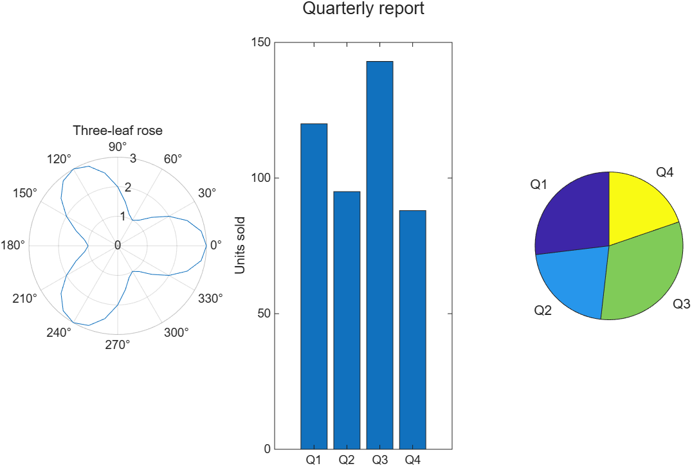

---

## 문제 56 📤 char 산술과 string 배열

[`a56_char_string.m`](code/a56_char_string.m)

```matlab
a = 'cat' + 1                 % char + 숫자 → 코드값 산술 (double)
b = char(a)                   % 코드값 → 글자: 'dbu'
c = "cat" + 1                 % string + 숫자 → 문자열 연결 "cat1"
s = ["apple" "fig" "banana"]
n = strlength(s)              % 원소별 글자 수
L = length(s)                 % 배열의 원소 개수 3
C = char(s')                  % 열 string → 3×6 char (공백 패딩)
sz = size(C)
long = s(strlength(s) > 3)
hit = s == "fig"
joined = s(1) + "-" + s(end)
```

- `'cat' + 1`은 각 글자의 코드(99, 97, 116)에 1을 더한 **double** 벡터. `"cat" + 1`은 **string 연결**. 같은 `+`가 자료형에 따라 정반대로 동작한다(4.4).
- `length` vs `strlength`: 전자는 배열 크기, 후자는 글자 수.
- `char`로 묶으면 가장 긴 원소에 맞춰 **공백 패딩**된다. `'apple '`에 공백이 붙은 것을 눈여겨봐라. 다시 `string(C)`로 바꿔도 패딩이 남는다.

> **[보강]** R2026a 검증: 행 string 배열을 그대로 `char(s)`에 넣으면 3×6이 아니라 **1×6×3 3차원 char**가 된다. 행마다 글자가 놓이려면 열 벡터 `char(s')` 또는 `char("apple", "fig", "banana")`처럼 따로 넘겨야 한다.

---

## 문제 57 🎯 all / any / find(cond, n)

[`a57_all_any_find.m`](code/a57_all_any_find.m)

```matlab
quiet = find(all(v < 3, 2))'
fprintf('Machines always below 3.0: %s\n', num2str(quiet))
loudShift = find(any(v > 5))
fprintf('Shifts with a reading above 5.0: %s\n', num2str(loudShift))
first2 = find(v > 4, 2)
[r, c] = ind2sub(size(v), first2);
fprintf('Reading %.1f at machine %d, shift %d\n', [v(first2)'; r'; c'])
lastIdx = find(v > 4, 1, "last");
[rl, cl] = ind2sub(size(v), lastIdx);
fprintf('Last reading above 4.0: machine %d, shift %d (%.1f)\n', rl, cl, v(lastIdx))
machine = ("M" + (1:5))';
peak = max(v, [], 2);
status = strings(5, 1);
status(peak <= 4) = "OK";
status(peak > 4) = "CHECK";
report = table(machine, peak, status, VariableNames = ["Machine" "Peak" "Status"])
```

```
Machines always below 3.0: 1  3
Shifts with a reading above 5.0: 2  3
Reading 4.4 at machine 4, shift 1
Reading 5.2 at machine 2, shift 2
Last reading above 4.0: machine 4, shift 4 (4.8)

report =

  5×3 table

    Machine    Peak    Status 
    _______    ____    _______

     "M1"      2.8     "OK"   
     "M2"      5.2     "CHECK"
     "M3"      2.6     "OK"   
     "M4"      6.1     "CHECK"
     "M5"      3.1     "OK"   
```

- `all(v < 3, 2)`: 행마다(2번째 차원 따라) "전부"를 묻는다. `all(v < 3)`이면 **열마다**다. `any(v > 5)`는 기본이 열이므로 교대조별 답이 바로 나온다.
- `find(cond, 2)`는 **열 우선** 선형 인덱스 처음 두 개(4, 7). `ind2sub`로 (행, 열)로 돌려야 기계·교대조 번호가 된다. `[r, c] = find(v > 4)`로 전부 받은 뒤 `r(1:2)`를 써도 된다.
- `"M" + (1:5)`는 string + 숫자 벡터 → `"M1" … "M5"`(문제 26). `table`에 넣으려면 **열 벡터**여야 하므로 `'`.
- `strings(5, 1)`로 빈 string 열을 만든 뒤 logical indexing으로 채우는 것이 `if` 없는 분류 방법(문제 04, 27).

---

## 문제 58 📝 bmi_report 함수

[`bmi_report.m`](code/bmi_report.m), [`a58_bmi_calls.m`](code/a58_bmi_calls.m)

**Pseudocode (함수)**

1. `function [bmi, category] = bmi_report(weight, height, units)` 선언. 바로 아래에 `help`용 주석 블록(첫 줄에 함수 이름과 한 줄 설명, 호출 형식 두 가지).
2. `nargin < 3`이면 `units = "metric"`.
3. `numel(weight) ~= numel(height)`이면 `error(...)`.
4. `any(weight <= 0) || any(height <= 0)`이면 `error(...)`. — 벡터 조건은 `any`/`all`로 스칼라로 만든 뒤 `||`.
5. `units == "imperial"`이면 `weight = weight*0.4536`, `height = height*0.0254`.
6. `bmi = weight ./ height.^2` (원소별).
7. `category = strings(size(bmi))`를 만들고 네 구간을 logical indexing으로 채운다. 경계는 `&`로 묶는다.
8. `end`.

**Pseudocode (스크립트)**

1. `help bmi_report`.
2. `[b, c] = bmi_report([70 55 95], [1.75 1.80 1.70])`.
3. `[b2, c2] = bmi_report(154, 69, "imperial")`.
4. `assert(abs(b2 - 154*0.4536/(69*0.0254)^2) < 1e-10, "...")` — 참이면 아무 일도 없다.
5. `try` 안에서 일부러 실패하는 `assert`와 틀린 호출 둘을 각각 실행하고 `catch err`에서 `err.message`만 출력.
6. `table(b', c', VariableNames = ["BMI" "Category"])`.

```
  bmi_report  체질량지수와 분류
    [bmi, category] = bmi_report(weight, height) : kg, m
    [bmi, category] = bmi_report(weight, height, "imperial") : lb, in
    weight와 height는 같은 크기의 벡터. 양수가 아니면 오류.

b =

   22.8571   16.9753   32.8720

c = 

  1×3 string 배열

    "normal"    "under"    "obese"

b2 =

   22.7420

c2 = 

    "normal"

Caught: Not everyone is normal: normal, under, obese
Caught: weight and height must have the same number of elements
Caught: weight and height must be positive

T =

  3×2 table

     BMI      Category
    ______    ________

    22.857    "normal"
    16.975    "under" 
    32.872    "obese" 
```

- 함수 파일 이름과 `function` 줄의 이름이 같아야 하고, 스크립트와 **같은 폴더**(또는 path)에 있어야 한다(6.1, 6.3).
- `error`는 함수 안에서 나도 스크립트까지 멈춘다. `try`/`catch`(7.5)로 감싸면 메시지를 잡고 계속 간다. `err.message`에는 서식이 적용된 문장만 들어 있다.
- `assert(조건, 메시지, 인수...)`는 `error`의 조건부 판이다. 두 번째 호출처럼 `%s` 서식도 받는다. `strjoin`은 string 배열을 하나로 잇는 **[보강]** 함수.
- 154 lb / 69 in은 70 kg / 1.75 m와 **정확히** 같지 않다(22.74 vs 22.86). 처음에 `abs(b2 - b(1)) < 0.05`로 썼다가 assert가 실패했고, 그래서 "직접 계산한 값"과 비교하도록 바꿨다. `assert`가 실패하면 메시지가 그대로 오류가 된다.

---

## 문제 59 🐞 함수 handle의 변수 캡처

[`a59_handle_scope.m`](code/a59_handle_scope.m)

| 줄 | 원인 | 현상 | 수정 |
|---|---|---|---|
| `f = @(t) 0.5*g*t^2;` | 벡터 `t`에 `^` | 실행 오류: `차원이 정확하지 않아 행렬을 거듭제곱할 수 없습니다. ... POWER(.^)를 사용하십시오.` (`d_earth = f(t)`에서) | `t.^2` |
| `g = 1.62; d_moon = f(t)` | 익명 함수는 **만들어진 순간의** `g` 값을 안에 담는다(6.4). 나중에 `g`를 바꿔도 handle 안의 값은 9.81 그대로 | 오류 없음. `d_moon`이 `d_earth`와 **완전히 같다** | `g`를 입력으로: `f = @(t, g) 0.5*g*t.^2`, `f(t, 1.62)` |
| `drop_time` 안의 `g` | 함수는 **자기 작업공간**만 본다. 스크립트의 `g`가 보이지 않는다(6.1) | 실행 오류: `'g'은(는) 인식할 수 없는 함수 또는 변수입니다.` | 입력으로 넘긴다 `drop_time(height, g)` (또는 `global g`를 양쪽에 — 비추천) |
| `h = @drop_time; h(100)` | **정상**. 스크립트 끝의 local function도 `@이름`으로 handle을 만들 수 있다 | — | — |
| `fzero(@(t) f(t) - 50, [0 10])` | **정상**. 구간 `[0 10]`의 양 끝에서 부호가 다르다 | — | — |

고친 출력:

```
d_earth =

         0    1.2263    4.9050   11.0363   19.6200   30.6562   44.1450

d_moon =

         0    0.2025    0.8100    1.8225    3.2400    5.0625    7.2900

t_hit =

    4.5152

t_50 =

    3.1928

Hits the ground after 4.52 s

same_as_earth =

  logical

   1
```

마지막 `same_as_earth`는 정답 코드에 붙인 확인용이다: `g = 9.81`로 handle을 만들고 `g = 1.62`로 바꾼 뒤 불러도 결과가 `d_earth`와 같다(`isequal` → 1). "handle은 변수의 **값**을 복사해 갖는다"가 시험 포인트.

---

## 문제 60 📤 fprintf 변환 문자

[`a60_fprintf_formats.m`](code/a60_fprintf_formats.m)

```matlab
x = 12345.678;
fprintf('%f|%e|%g\n', x, x, x)
fprintf('%g|%g\n', 0.00001234, 1e6)
fprintf('%d|%d\n', 7, 2.5)
fprintf('%s|%s\n', "abc", 'abc')
fprintf('%d ', 'abc'); fprintf('\n')
fprintf('%s is %d\n', "Tom", 25, "Ann", 31)
fprintf('[%-6s][%6s]\n', "ab", "cd")
fprintf('%5.1f%%\n', 45.678)
fprintf('%c%c%c\n', 72, 105, 33)
```

| 줄 | 포인트 |
|---|---|
| 1 | `%f`는 소수 6자리 고정, `%e`는 가수 6자리 지수형, `%g`는 **유효숫자 5~6자리**로 짧은 쪽을 고른다(7.2.2) |
| 2 | `%g`는 아주 작거나 큰 수에서 지수형으로 바뀐다: `1.234e-05`, `1e+06` |
| 3 | `%d`에 **정수가 아닌 값**을 주면 MATLAB이 `%e`로 바꿔 찍는다: `2.500000e+00`. 자주 나오는 함정 |
| 4 | `%s`는 string과 char 둘 다 받는다 |
| 5 | char를 `%d`로 찍으면 **문자 코드**(97 98 99)가 나온다. 서식에 `\n`이 없으니 따로 찍는다 |
| 6 | 인수가 서식보다 많으면 서식을 **재사용**해 두 줄이 나온다 |
| 7 | `%-6s`는 왼쪽 정렬, `%6s`는 오른쪽 정렬 |
| 8 | `%`를 찍으려면 `%%`. `%5.1f`는 너비 5라 앞에 공백 하나 |
| 9 | `%c`는 코드값을 글자로: 72 = H, 105 = i, 33 = ! |

---

## 문제 61 🎯 plot3 · 그룹 막대 · stem · errorbar

[`a61_plot3_bar_errorbar.m`](code/a61_plot3_bar_errorbar.m) → [`img/a61_plot3_bar_errorbar.png`](img/a61_plot3_bar_errorbar.png)

```matlab
tl = tiledlayout(2, 2);
nexttile
t = linspace(0, 6*pi, 300);
plot3(cos(t), sin(t), t, LineWidth = 1.5)
grid on, view(35, 25)
xlabel("x"), ylabel("y"), zlabel("z"), title("Helix")
nexttile
sales = [120 95; 143 88; 110 130];        % 행 = 분기, 열 = 제품
bar(sales)
xticklabels(["Q1" "Q2" "Q3"])
ylabel("Units"), legend("A", "B", Location = "northwest"), title("Sales by product")
nexttile
k = 0:10;
s = round(10*exp(-0.2*k).*cos(k), 2);
stem(k, s, "filled")
yline(mean(s), "r--", "mean")
xlabel("k"), ylabel("s[k]"), title("Sampled signal")
nexttile
trial = [4.8 5.1 5.0 4.7; 6.2 5.8 6.0 6.4; 7.1 7.5 6.9 7.3];
m = mean(trial, 2);
sd = std(trial, 0, 2);
errorbar(1:3, m, sd, "o-", LineWidth = 1.2, CapSize = 8)
xlim([0.5 3.5]), xticks(1:3), xticklabels(["low" "mid" "high"])
ylabel("Response"), title("Mean \pm 1 std")
title(tl, "Problem 61")
```

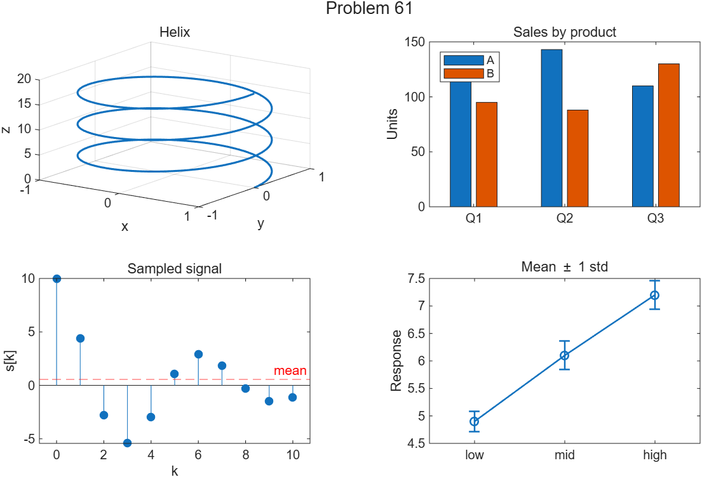

- `bar(행렬)`: **행이 한 묶음**, 열이 묶음 안의 막대. 3×2를 주면 분기 3묶음 × 제품 2막대(5.3.3).
- `std(trial, 0, 2)`: 두 번째 인수 0은 "N−1로 나눔"(기본), 세 번째가 차원. `std(trial, 2)`라고 쓰면 **가중치 2**로 해석되어 오류가 난다(문제 18과 같은 함정).
- `yline(값, 선스타일, 라벨)` 세 번째 인수가 라벨. `stem(..., "filled")`로 마커를 채운다(5.8).
- `view(az, el)`은 3차원 시점(5.4.1). `xticks`, `CapSize`는 슬라이드 밖 **[보강]**이며 없어도 그림은 된다.

---

## 문제 62 🎯 몬테카를로 π

[`a62_monte_carlo_pi.m`](code/a62_monte_carlo_pi.m) → [`img/a62_monte_carlo_pi.png`](img/a62_monte_carlo_pi.png)

```matlab
rng(1)
N = 100000;
x = rand(1, N);  y = rand(1, N);
inside = x.^2 + y.^2 <= 1;             % logical
piHat = 4*sum(inside)/N;
fprintf('N = %d: pi estimate = %.4f, error = %.4f\n', N, piHat, abs(piHat - pi))
running = 4*cumsum(inside)./(1:N);     % n개째까지의 추정값
errRun = abs(running - pi);
firstGood = find(errRun < 0.01, 1)
lastBad = find(errRun >= 0.01, 1, "last")
fprintf('Error first below 0.01 at n = %d, last above at n = %d\n', firstGood, lastBad)
tiledlayout(1, 2)
nexttile
show = 1:5000;  in5 = inside(show);
scatter(x(show(in5)), y(show(in5)), 2, "b", "filled"), hold on
scatter(x(show(~in5)), y(show(~in5)), 2, "r", "filled"), hold off
axis square, axis([0 1 0 1])
title(sprintf("\\pi \\approx %.4f", piHat))
nexttile
semilogx(1:N, errRun), hold on
yline(0.01, "k--", "0.01"), hold off
xlabel("n"), ylabel("|estimate - \pi|"), grid on, title("Running error")
```

```
N = 100000: pi estimate = 3.1469, error = 0.0053

firstGood =

   249

lastBad =

        9628

Error first below 0.01 at n = 249, last above at n = 9628
```

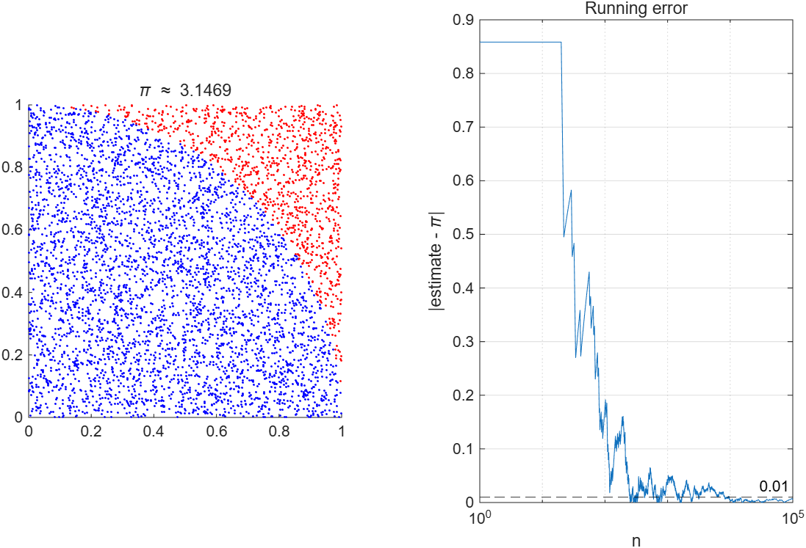

- `sum(logical)`은 참의 **개수**. `cumsum(logical)`은 "n개째까지의 개수"이므로 `./(1:N)`로 나누면 loop 없이 누적 추정값이 된다(3.5).
- `find(cond, 1)`과 `find(cond, 1, "last")`는 8.3 [보강]. `firstGood`(249)과 `lastBad`(9628)가 멀리 떨어진 것은 오차가 0.01 근처에서 **여러 번 들락날락**하기 때문이다. "처음 아래로 간 n"이 "그 뒤로 계속 좋다"를 뜻하지 않는다.
- `sprintf("\\pi")`: `sprintf`가 `\p`를 이스케이프로 해석하므로 **백슬래시를 두 번** 써야 TeX `\pi`가 살아남는다. `ylabel`에 직접 쓸 때는 한 번이면 된다.
- `rng(1)`이 없으면 실행마다 숫자가 달라진다(3.6).

---

## 문제 63 📤 특수값과 정수형

[`a63_special_values.m`](code/a63_special_values.m)

```matlab
x = 10:-3:-2
y = 5:1                      % 방향이 안 맞으면 조용히 빈 배열
e = isempty(y)
z = [1 -1], w = [1 - 1]      % 공백이 원소 구분 vs 뺄셈
B = ones(2, 3)*2;
B(:, end+1) = [9; 9]         % 범위 밖 대입으로 열이 늘어난다
I = eye(2)*5
v = [1/0 -1/0 0/0 Inf-Inf]
q = NaN == NaN
k = isnan(v)
a = int8(200)                % 포화: 127
b = intmax("int8") + 1       % 포화: 127
c = int8(2.5)                % 반올림(0에서 먼 쪽): 3
d = 5/int8(2)                % double/int8 → int8, 2.5 → 3
cls = class(d)
```

- `5:1`은 오류가 아니라 **1×0 빈 배열**. `[1 -1]`은 두 원소, `[1 - 1]`은 0 하나(4.1).
- `1/0 = Inf`, `-1/0 = -Inf`, `0/0 = NaN`, `Inf - Inf = NaN`(3.9). `NaN == NaN`은 **0**이므로 `isnan`을 쓴다.
- 정수형은 범위를 넘으면 오류 대신 **포화**(saturate)한다: `int8(200)`도 `intmax("int8") + 1`도 127(3.8). 소수는 반올림된다.
- `double / int8`은 결과가 **int8**이다. 2.5가 3으로 반올림되어 `d = 3`, `class(d) = 'int8'`. 정수형끼리 서로 다른 형은 섞을 수 없다.
- `B(:, end+1) = [9; 9]`처럼 없는 인덱스에 대입하면 배열이 자란다. 반대로 읽기에서 범위를 넘으면 오류(문제 43).

---

## 문제 64 🐞 요금 switch

[`a64_ticket_switch.m`](code/a64_ticket_switch.m)

| 줄 | 원인 | 현상 | 수정 |
|---|---|---|---|
| `if price > 10 fprintf("Premium\n") end` | 한 줄에 쓰려면 조건과 문장, `end` 사이에 **쉼표**가 필요 | **문법 오류**라 파일 전체가 안 돌아감: `예약된 키워드 "end"의 사용이 적절치 않습니다.` | `if price > 10, fprintf("Premium\n"), end` |
| `case "adult", "senior"` | `case` 값 하나 뒤의 쉼표는 **문장 구분자**. `"senior"`는 case 값이 아니라 그 case 안에서 실행되는 문장이 된다 | 오류 없음. `adult`를 넣으면 `ans = "senior"`가 **화면에 찍히고** 12가 된다. `senior`를 넣으면 어느 case에도 안 맞아 `otherwise`로 간다 | `case {"adult", "senior"}` |
| `otherwise` 안에 `price` 없음 | 요구는 "$0" | `senior`(또는 모르는 종류) 입력 시 `Unknown ticket type` 뒤 `fprintf`에서 실행 오류: `'price'은(는) 인식할 수 없는 함수 또는 변수입니다.` | `price = 0;` 추가 |
| `if age < 0 \| age > 120` | 스칼라끼리라 동작은 한다. 슬라이드는 `if`에 `\|\|`를 권장 | — | `\|\|` (스타일) |
| `switch lower(ticket)` 뒤 `if ticket == "child"` | 대문자 `Child`를 넣으면 switch는 맞지만 이 `if`는 거짓 | 조용한 논리 오류(경고가 안 나옴) | `ticket = lower(ticket)`을 먼저 해서 둘 다 같은 값을 쓴다 |
| `ticket == "child"` | 의심스럽지만 **정상**. char와 **string 스칼라**의 `==`는 문자열 전체 비교라 길이가 달라도 0이 된다(`'adult' == "child"` → 0). char끼리 `'adults' == 'child '`는 길이가 같아야 하고 원소별 비교가 된다 | — | — |

문법 오류를 고친 뒤 `70`, `senior`: `Unknown ticket type` → `price` 오류로 중단. `30`, `adult`: `ans = "senior"`가 찍힌 뒤 `Premium`, `Price: $12`. 완전히 고친 뒤 `70`, `Senior`:

```
Premium
Price: $12
```

---

## 문제 65 🐞 보정 종합

[`a65_calibration.m`](code/a65_calibration.m) → [`img/a65_calibration.png`](img/a65_calibration.png)

원본은 오류 메시지 없이 끝까지 돌고 아래를 출력한다.

```
Max error 2.34 kPa at V = 0.48 V
All within tolerance
```

| 줄 | 원인 | 현상 | 수정 |
|---|---|---|---|
| `if bad` | `bad`는 **logical 벡터** `[0 1 0 0 0 0]`. 배열 조건은 **모든** 원소가 참일 때만 참(8.5.1) | 2.34 kPa 오차가 있는데도 `All within tolerance` | `if any(bad)` |
| `length(bad)` | 개수가 아니라 벡터 **길이**(6) | 위를 고쳐도 `6 points exceed 1 kPa`로 틀림 | `sum(bad)` (또는 `nnz`, `numel(find(bad))`) |
| `title("... %.1f kPa/V", k)` | `title`은 서식을 모른다. 두 번째 인수는 **부제목**으로 해석 | 제목에 `%.1f`가 **글자 그대로** 찍히고 그 밑에 부제목 `20.85`가 생긴다 | `title(sprintf("Calibration: k = %.1f kPa/V", k))` |
| `V(err == worst)` | 의심스럽지만 **정상**. `worst`는 `err` 안의 값 그 자체이므로 `==`가 정확히 맞는다 | — | — |
| `"worst = " + num2str(worst, 3) + " kPa"` | **정상**. `num2str(x, 3)`은 유효숫자 3자리 | — | — |
| `table(V', P', ...)` | **정상**. 행 벡터를 `'`로 열로 세웠다(문제 36과 비교) | — | — |

고친 출력:

```
Max error 2.34 kPa at V = 0.48 V
1 points exceed 1 kPa

result =

  6×3 table

     V      P     Pfit
    ____    __    ____

    0.12     0       0
    0.48    10     7.7
    1.03    20    19.4
    1.51    30    29.6
    1.98    40    39.6
    2.47    50      50
```

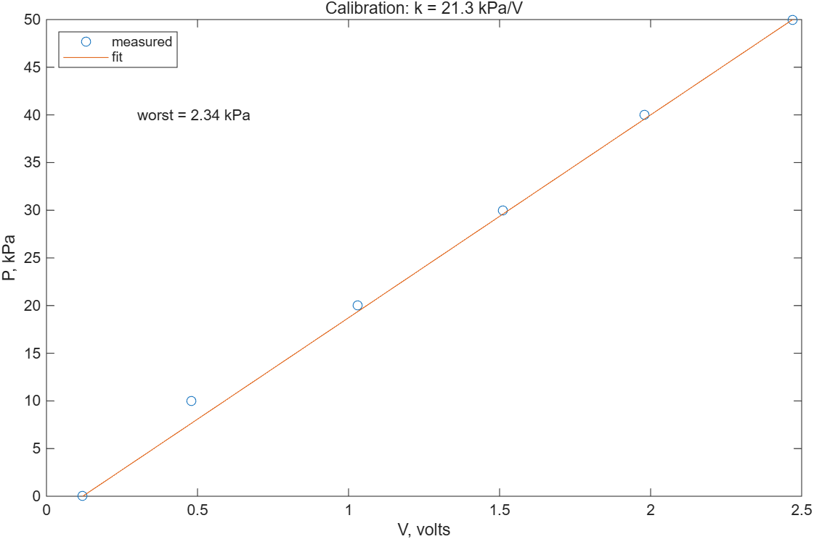

"오류 메시지가 없다 = 맞다"가 아니다. 이 문제의 세 오류는 전부 **조용히** 틀린다. `if` 조건에 배열이 들어가면 `any`/`all`로 의도를 분명히 하고, 서식이 필요한 문자열은 `sprintf`로 먼저 만든다는 두 규칙으로 대부분 막을 수 있다.
