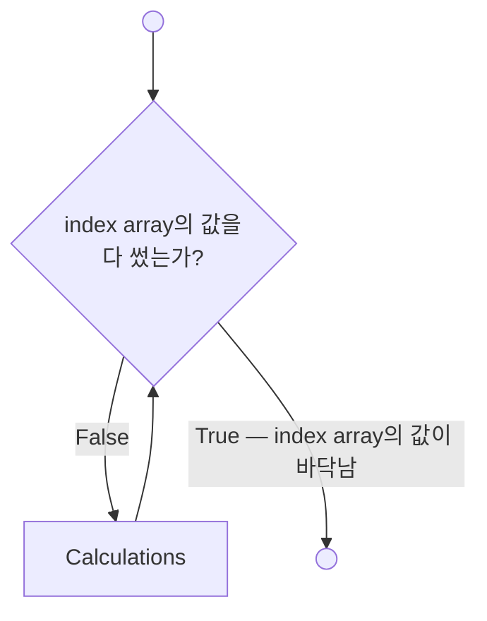

# 9.1 `for` Loops

## 구조

```matlab
for index = array
    commands to be executed
end
```

- **첫 줄**은 loop를 시작하고 **index**를 정한다. index는 pass마다 바뀌는 수이고, 반복을 언제 끝낼지 정하는 데 쓰인다.
- 그다음이 **실행할 명령들**이다.
- 마지막으로 **`end`**가 loop의 끝을 표시한다.
- loop는 첫 줄의 **index array 원소 하나마다 한 번** 실행된다.

---

## 아주 단순한 예 — index 값 보기

```matlab
for k = [10, 20, 30]
    k
end
```
```
k =
    10
k =
    20
k =
    30
```

슬라이드는 같은 구조를 `k = [1,2,3]`으로 보여 주고, 한 pass씩 따라간다. 줄 번호는 `clear, clc`(1행) → `for`(2행) → `k`(3행) → `end`(4행)이다.

| pass | 2행: `k`에 대입 | 3행: 실행 | `end`에서 |
|---|---|---|---|
| 1 | `k = 10` (첫 원소) | `k` 값을 command window로 보냄 | 2행으로 돌아가 다시 시작 |
| 2 | `k = 20` | 출력 | 2행으로 |
| 3 | `k = 30` | 출력 | 2행으로 → **index array에 남은 값이 없으므로 loop 종료** |

---

## index로 계산하기 — 스칼라는 매번 덮어써진다

```matlab
for k = 1:3
    a = 2^k
end
```
```
a =
     2
a =
     4
a =
     8
```

pass마다 `k`가 1, 2, 3으로 바뀌고 `a`가 새로 계산되어 출력된다. 세 번째 pass 뒤에는 `k` array에 남은 값이 없어서 loop가 끝난다.

**`a`는 스칼라다.** 한 번에 값 하나만 담는다. loop가 끝난 뒤 workspace의 `a`는 마지막 값 `8` 하나뿐이다. `k`의 모든 값에 대응하는 `a` **배열**을 만들고 싶다면 다른 방법이 필요하다.

---

## 배열을 원소 하나씩 만들기

index를 배열의 **인덱스로** 쓴다.

```matlab
for k = 1:3
    a(k) = 2^k
end
```
```
a =
     2
a =
     2     4
a =
     2     4     8
```

| pass | `k` | 3행 | command window |
|---|---|---|---|
| 1 | 1 | `a(1)` 계산 | `2` |
| 2 | 2 | `a(2)` 계산 → **배열 전체**를 출력 | `2 4` |
| 3 | 3 | `a(3)` 계산 → 배열 전체 출력 → 남은 값 없음, 종료 | `2 4 8` |

프로그램이 명령 묶음을 세 번 반복하므로, pass마다 `a`에 원소가 **하나씩 추가**된다. 최종 `a`는 `1×3`이다.

> 슬라이드 p.22는 같은 프로그램을 **Live Script**(`.mlx`)에서 실행한 화면이다. 차이는 하나, 출력이 command window가 아니라 **프로그램 파일 안**(코드 바로 옆/아래)에 찍힌다는 점이다. 계산 결과는 같다.

---

## Vectorize가 더 효율적이다

배열을 원소 하나씩 만드는 것은 **대개 비효율적**이다. `k` 배열을 먼저 만들고 `.^` 연산자로 `a`를 한 번에 계산하면 **더 빠르고 읽기도 쉽다**.

```matlab
k = 1:3;
a = 2.^k
```
```
a =
     2     4     8
```

---

## `for` + `if` — 조건을 만족하는 개수 세기

`scores` 중 **90보다 큰 값**이 몇 개인지 센다. `for` loop와 `if` 구조를 결합한다.

```matlab
scores = [88, 95, 72, 91, 99];
count = 0;                       % running total: loop 밖에서 0으로 초기화
for k = 1:length(scores)
    if scores(k) > 90
        count = count + 1;
    end
end
disp("Count = " + count)
```
```
Count = 3
```

- **running total**(누적 카운터) `count`를 **loop 밖에서** 0으로 초기화한다. 세기 시작하기 전에는 90 초과인 값의 개수가 0이기 때문이다.
- index array는 `length`로 만든다. `scores`의 원소가 5개이므로 `k = 1:5`, 즉 `k = [1,2,3,4,5]`와 같다. 배열 길이가 바뀌어도 코드를 고칠 필요가 없다.
- loop가 끝나면 `end` 다음 줄로 넘어간다. `disp`는 string `"Count = "`와 변수 `count`를 **`+` 연산자로 이어 붙여**(concatenation) 결과를 보고한다.

| pass | `k` | `if scores(k) > 90` | 결과 | `count` |
|---|---|---|---|---|
| 1 | 1 | `88 > 90` | 거짓 → `count = count + 1` 줄 건너뜀 | 0 |
| 2 | 2 | `95 > 90` | 참 → 실행, `count = 0 + 1` | 1 |
| 3 | 3 | `72 > 90` | 거짓 → 건너뜀 | 1 |
| 4 | 4 | `91 > 90` | 참 → `count = 1 + 1` | 2 |
| 5 | 5 | `99 > 90` | 참 → `count = 2 + 1` | 3 |
| — | — | `k` array에 값이 더 없음 | loop 종료, `disp` 줄로 | 3 |

> 슬라이드 원본은 원소 4개짜리 배열로 같은 과정을 4 pass에 걸쳐 보여 주고 결과는 `Count = 2`다.

> **[보강]** 8장 방식이면 한 줄이다. logical 배열의 합이 곧 참의 개수다.
>
> ```matlab
> sum(scores > 90)        % 3
> ```

> **[보강]** `"Count = " + count`에서 `+`가 이어 붙이기로 동작하는 것은 왼쪽이 **string**(큰따옴표)이기 때문이다. `'Count = ' + count`(작은따옴표 char)라면 문자 코드에 숫자를 더한 **숫자 배열**이 나온다. char로 쓰려면 `['Count = ', num2str(count)]`.

---

## 2차원 배열을 index array로

대부분의 `for` loop는 index array가 **행 하나**다. index 자리에 **2차원 배열**을 주면 MATLAB은 pass마다 **열 하나 전체**를 index로 쓴다. 극히 드문 방식이지만, 초보자가 **실수로** 하는 경우가 있다.

```matlab
for c = [1 2 3; 4 5 6]
    c
end
```
```
c =
     1
     4
c =
     2
     5
c =
     3
     6
```

`2×3` 배열이므로 **3번**(열 개수) 반복하고, `c`는 매번 `2×1` **열 벡터**다.

> **[보강]** 흔한 실수: 열 벡터 `x`를 `for v = x`로 돌리면 원소 하나씩이 아니라 **열 전체가 한 번에** 들어와 loop가 **1번만** 돈다. 원소를 하나씩 보려면 `for k = 1:length(x)` 후 `x(k)`, 또는 `for v = x'`(행으로 바꿔서).

---

## `for` loop 규칙 정리

- loop는 `for` 문으로 시작해 **`end`**로 끝난다.
- 첫 줄의 **index array**가 반복 횟수를 정한다.
- **index는 변수여야 한다.** `k`를 흔히 쓰지만 어떤 변수 이름이든 된다. 스타일 문제다.
- index array는 배열을 만드는 **어떤 방법**으로든 만들 수 있다. 흔한 방법은 colon 연산자다.

  ```matlab
  for index = start:inc:final
  ```
- 식이 **행 벡터**면 원소를 하나씩, pass마다 하나 쓴다.
- 식이 **2차원 배열**이면(흔하지 않음) pass마다 다음 **열**을 쓴다. index는 **열 벡터**가 된다.
- `for` loop가 끝나도 **index 변수는 마지막으로 쓴 값을 유지**한다.
- `for` loop는 **vectorize로 피할 수 있는 경우가 많다.**

```matlab
for k = 1:4
end
k                     % 4 — 마지막 값이 남는다

for k = 10:-3:1       % 감소하는 index array
    fprintf("%d ", k) % 10 7 4 1
end
```

> **[보강]** R2026a에서 확인한 경계 사례:
>
> ```matlab
> for k = 1:3
>     fprintf("pass k = %d\n", k)
>     k = 100;          % loop 안에서 index를 바꿔도
> end                   % 다음 pass는 index array의 다음 값(2, 3)으로 덮어쓴다
> k                     % 100 — 마지막 pass에서 바꾼 값이 남는다
>
> for k = []            % 빈 index array
>     disp("never")     % 한 번도 실행되지 않는다
> end
> k                     % [] (0×0) — index가 빈 배열로 대입된다
> ```
>
> 즉 **`for`의 반복 횟수는 첫 줄에서 이미 정해진다.** loop 안에서 index나 index array 변수를 바꿔도 횟수는 그대로다. 반복을 일찍 끝내려면 `break`(9.3).

---

## Flowchart



마름모(결정)에서 "index가 index array를 넘어섰는가"를 검사한다. 아직이면 계산(직사각형)을 하고 다시 마름모로, 다 썼으면 loop를 빠져나간다.

---

## ⚠️ 함정

- **`a = …`와 `a(k) = …`는 다르다.** 앞은 매번 덮어써서 마지막 값 하나, 뒤는 배열을 만든다.
- **카운터 초기화는 loop 밖.** `count = 0;`을 loop 안에 두면 pass마다 0으로 리셋된다.
- **`for k = length(x)`** 는 `1:`을 빠뜨린 것. index array가 숫자 하나(5)라서 **한 번만**, `k = 5`로 돈다.
- **2차원 배열·열 벡터를 index array로 주면 열 단위.** 원소별 반복을 기대했다면 오답.
- **index 변수 이름으로 `i`, `j`를 쓰면** 허수 단위 `i`, `j`를 덮어쓴다(3장 함수명 덮어쓰기와 같은 문제). 슬라이드가 `k`를 쓰는 이유 중 하나.
- **`'text' + n`은 이어 붙이기가 아니다.** 큰따옴표 string일 때만.

---

## 연습문제

> **[보강]** 아래 연습문제와 그 해답은 슬라이드에 없다. 시험 대비용으로 추가한 것이다.

1. `for` loop와 running product(누적 곱)로 6!을 계산하고 `factorial(6)`과 비교하시오. 누적 곱의 초기값은 무엇이어야 하는가?
2. 다음 코드의 출력과 loop가 끝난 뒤 `c`의 값을 예측하시오.

   ```matlab
   x = [1 2; 3 4];
   for c = x
       disp(c')
   end
   ```
3. `v = [4, -2, 0, -7, 5, -1]`에서 음수의 개수를 `for` + `if` + 카운터로 세고, 같은 답을 loop 없이 한 줄로 구하시오.

해답: [solutions.md](solutions.md#91)
