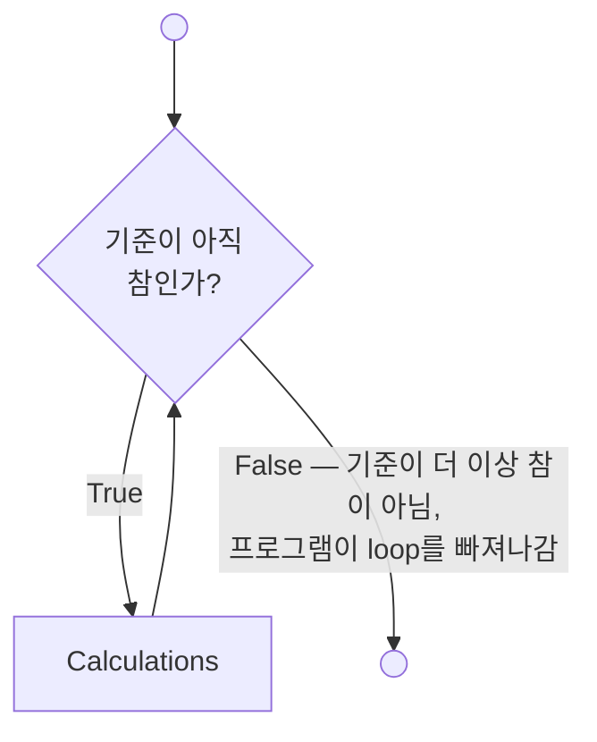

# 9.2 `while` Loops

## 구조

`while` loop는 `for` loop와 비슷하다. 큰 차이는 **MATLAB이 반복 횟수를 정하는 방법**이다. `for`는 index array의 원소 수만큼, `while`은 **기준(criterion)이 참인 동안** 반복한다.

```matlab
while criterion
    commands to be executed
end
```

**`for` loop로 풀 수 있는 문제는 모두 `while` loop로도 풀 수 있다.**

### Flowchart

`while` loop의 flowchart는 `for` loop와 매우 비슷하다. 마름모의 질문만 다르다.



---

## 아주 단순한 예

```matlab
k = 0;              % 2행: loop 밖에서 초기화
while k < 3         % 3행
    k = k + 1       % 4행
end                 % 5행
```
```
k =
     1
k =
     2
k =
     3
```

| pass | 3행 검사 시 `k` | `k < 3` | 4행 | `end`에서 |
|---|---|---|---|---|
| 1 | 0 | 참 | `k`를 1로 | 3행으로 돌아감 |
| 2 | 1 | 참 | `k`를 2로 | 3행으로 |
| 3 | 2 | 참 | `k`를 3으로 | 3행으로 |
| — | 3 | **거짓** | — | **loop 종료** |

- **`k`는 loop 밖에서 초기화**해야 한다. 그렇지 않으면 3행에서 `k`가 정의되지 않았다는 오류가 난다.
- 마지막 출력은 `k = 3`이다. 기준을 검사하기 **전에** 이미 증가시켰기 때문이다.

---

## `while`로 배열을 원소 하나씩 만들기

```matlab
k = 0;
while k < 3
    k = k + 1;          % 4행: 먼저 증가
    a(k) = 2^k          % 5행: 증가한 k를 인덱스로
end
```
```
a =
     2
a =
     2     4
a =
     2     4     8
```

| pass | 검사 시 `k` | 4행 후 `k` | 5행 | 출력 |
|---|---|---|---|---|
| 1 | 0 → 참 | 1 | `a(1)` 계산 | `2` |
| 2 | 1 → 참 | 2 | `a(2)` 계산, 배열 전체 출력 | `2 4` |
| 3 | 2 → 참 | 3 | `a(3)` 계산, 배열 전체 출력 | `2 4 8` |
| — | 3 → **거짓** | | loop 종료 | |

**4행과 5행의 순서가 중요하다.** `k = 0`에서 시작하므로, 증가를 먼저 해야 `a(0)`(MATLAB에 없는 인덱스)을 피한다.

이 예에서는 `while`의 비교에 index 번호를 썼지만, 계산을 끝낼 때를 정하는 데는 **다른 parameter도 쓸 수 있고 실제로 자주 쓴다**.

---

## 다른 기준

`while` 기준은 index 번호일 필요가 없다. 여기서는 **`a`가 10보다 작은 동안** loop 안의 계산이 계속된다.

```matlab
a = 0;
while a < 10
    a = a + 4
end
```
```
a =
     4
a =
     8
a =
    12
```

마지막 값 12는 10보다 크다. 8일 때 기준이 참이어서 한 번 더 돌았고, 12가 된 뒤에야 검사에서 거짓이 되었다. **기준은 pass의 맨 앞에서만 검사**한다.

> 슬라이드 예는 `a = a + 3`으로 `3, 6, 9, 12`가 나온다.

---

## 오류 검사 (error checking)

`while` loop의 흔한 용도 하나는 **입력 오류 검사**다. 사용자에게 양수를 입력하라고 요청하고, 양수가 들어올 때까지 다시 묻는다.

```matlab
x = input("Enter a positive value of x: ");
while x <= 0
    disp("log(x) is not defined for non-positive numbers")
    x = input("Enter a positive value of x: ");
end
y = log10(x);
fprintf("The log base 10 of %4.2f is %5.2f\n", x, y)
```

1. 2행에서 사용자에게 `x`를 묻는다.
2. 음수(또는 0)가 들어오면 3행 `while` 비교가 **참** → 오류 메시지를 표시하고, 다시 새 `x`를 묻는다.
3. 양수가 들어올 때까지 **무한정** 반복한다.
4. 양수가 들어오면 비교가 거짓 → loop 종료 → `log10` 계산과 출력.

`-3`, `0`, `5`를 차례로 입력한 경우:

```
Enter a positive value of x: -3
log(x) is not defined for non-positive numbers
Enter a positive value of x: 0
log(x) is not defined for non-positive numbers
Enter a positive value of x: 5
The log base 10 of 5.00 is  0.70
```

- **`input`을 loop 안에서 다시 부르는 줄**(갱신)이 없으면, 음수 한 번에 무한 루프가 된다.
- 첫 `input`은 loop **밖**에 있다(초기화). 위 "다섯 부분"이 그대로 보인다.

> **[보강]** R2026a `-batch`에서는 `input`이 오류(`MissingRequiredCapability`)라서 입력값 배열로 바꿔 검증했다.
>
> ```matlab
> entries = [-3, 0, 5]; i = 1;
> x = entries(i);
> while x <= 0
>     disp("log(x) is not defined for non-positive numbers")
>     i = i + 1; x = entries(i);
> end
> ```

---

## 무한 루프 (Infinite Loops)

### HINT

`while` loop를 제어하는 변수는 **pass마다 갱신되어야 한다.** 그렇지 않으면 **무한 루프**가 생긴다. 계산이 오래 걸릴 때는 MATLAB 창 왼쪽 아래의 "busy"(사용 중) 표시를 보면 컴퓨터가 실제로 일하고 있는지 확인할 수 있다. 계산을 직접 멈추려면 **`Ctrl+C`** 를 누른다(`Ctrl`과 `c`를 동시에). 이때 **command window가 활성 창**이어야 한다.

```matlab
k = 0;
while k < 3
    disp(k)         % k를 바꾸지 않는다 → 0이 끝없이 찍힌다
end
```

> **[보강]** `while`의 기준이 **배열**이면 8장 `if`와 같은 규칙이다. **모든 원소가 참(0이 아님)일 때만** 참이다. **빈 배열 `[]`는 거짓**이다.
>
> ```matlab
> x = [1 2 -1];
> while x > 0         % [1 1 0] → 하나라도 거짓이므로 한 번도 안 돈다
>     disp("never")
> end
> while []            % 빈 배열 → 거짓
>     disp("never")
> end
> ```

---

## ⚠️ 함정

- **초기화를 빼먹음.** `while k < 3` 앞에 `k = 0;`이 없으면 "인식할 수 없는 함수 또는 변수 'k'" 오류. 이전 실행의 `k`가 workspace에 남아 있으면 오류도 없이 **엉뚱하게 0번** 돌 수도 있다(`clear`를 쓰는 이유).
- **갱신을 빼먹음** → 무한 루프 → `Ctrl+C`.
- **증가와 사용의 순서.** `k = 0`에서 시작해 `a(k) = …`를 먼저 쓰면 `a(0)` → 인덱스 오류.
- **마지막 값이 기준을 넘는다.** `while a < 10`이 끝난 뒤 `a`는 10 이상(위 예에서는 12)이다. "10 미만의 최댓값"을 원했다면 한 단계 전 값이 답이다.
- **`while x <= 0`에 배열을 주면 "전부 참"일 때만 돈다.** 원소별 검사가 아니다.

---

## 연습문제

> **[보강]** 아래 연습문제와 그 해답은 슬라이드에 없다. 시험 대비용으로 추가한 것이다.

1. `while` loop로 `2^n > 1000`이 되는 가장 작은 정수 `n`을 구하시오.
2. 다음 코드가 끝난 뒤 `k`와 `passes`의 값을 손으로 예측하시오.

   ```matlab
   k = 10; passes = 0;
   while k > 0
       k = k - 3;
       passes = passes + 1;
   end
   ```
3. 점수(0~100)를 입력받아 범위 밖이면 다시 묻는 오류 검사 loop를 쓰시오. 입력이 `105`, `-4`, `87` 순서로 들어온다고 보고, 입력값 배열로 대신해 결과를 확인하시오.

해답: [solutions.md](solutions.md#92)
