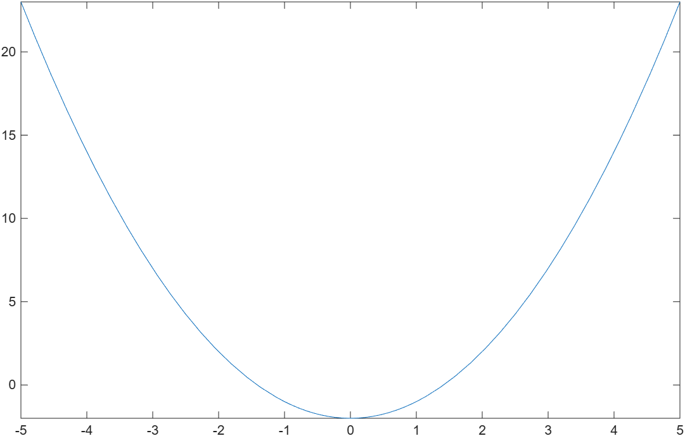
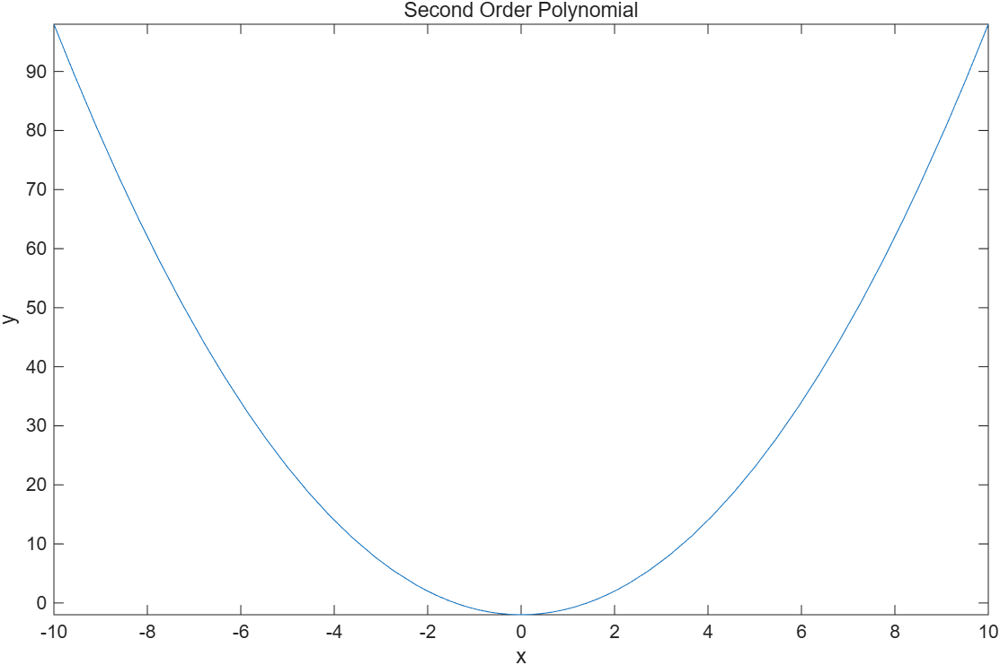
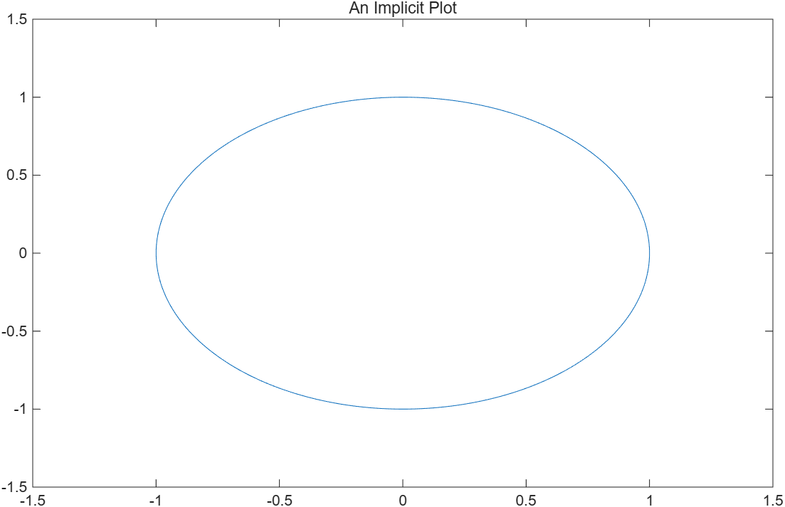
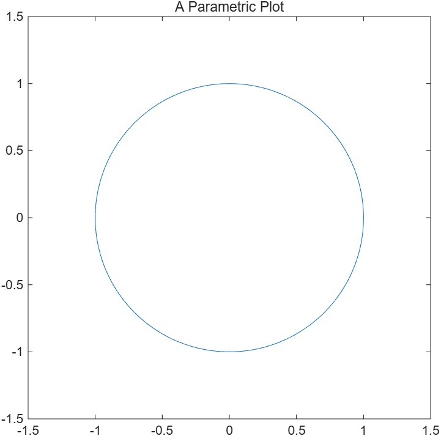
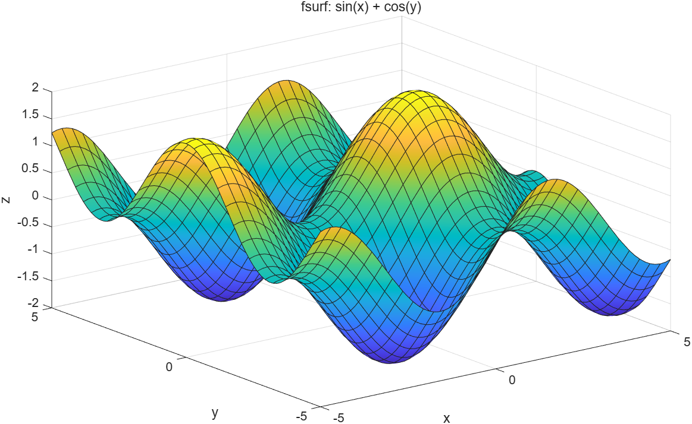

# 12.3 Symbolic Plotting

> **[보강]** 이 절의 symbolic 코드는 슬라이드(R2022a) 그대로이고 이 PC에서 실행하지 못했다. **그림은 같은 식을 function handle로 바꿔 R2026a에서 그린 것**이다. `fplot` 계열은 function handle 입력도 받기 때문에 toolbox 없이 같은 그림이 나온다([README](README.md#실행-환경-메모)).

- symbolic toolbox에는 symbolic expression과 function을 그리는 **함수 묶음**이 있다.
- 가장 기본은 **`fplot`** 이다. 앞 장(Chapter 5)에서 소개했다.
- `fplot`은 **overloaded function**의 예다. **같은 함수 이름을 둘 이상의 용도**에 쓴다는 뜻이다.
  - 어느 용도가 맞는지는 MATLAB이 **입력을 보고** 결정한다.
  - **symbolic 정보**를 주면 MATLAB은 **symbolic plotting 도구**를 쓴다.

## 12.3.1 `fplot` 함수

- `fplot`은 앞 장에서 **표준 MATLAB 함수**(function handle)를 그리는 데 썼다.
- 여기서는 **symbolic expression**과 **symbolic function**을 그리는 데 쓴다.
- `fplot`의 x 범위 기본값은 **−5 ~ +5**다.
  - x의 최솟값과 최댓값은 **둘째 입력에 배열로** 지정한다.
- MATLAB이 **매끄러운 곡선이 되도록 x 값을 충분히 자동 선택**한다. (`linspace`로 x를 만들 필요가 없다.)
- 주석(annotation: 제목, 축 이름)은 **평소 방식대로** 붙인다.

### 그래프 만들기

```matlab
syms x
y = x^2-2
```
```
y =
x^2 - 2
```
```matlab
fplot(y)
```

`fplot`의 입력은 **symbolic expression** 또는 **symbolic function** 어느 쪽이든 된다.

### 기본 그리기 범위

기본 범위는 **−5 ~ 5**다. x축이 −5에서 5까지 그려진다.



> **[보강]** 위 그림은 `fplot(@(x) x.^2-2)`로 그렸다. 실행 후 `xlim`이 `-5 5`임을 확인했다.

### 범위 지정과 주석

```matlab
figure
fplot(y,[-10,10])
title("Second Order Polynomial")
xlabel("x")
ylabel("y")
```

- x 값의 범위는 **둘째 입력**에 `[최솟값, 최댓값]`으로 지정한다.
- 주석은 평소처럼 `title`, `xlabel`, `ylabel`로 붙인다.



### `fimplicit`

**`fimplicit`** 함수는 x와 y의 **음함수(implicit function)** 를 그린다.

```matlab
syms x y
fimplicit(x^2 + y^2 == 1,[-1.5,1.5])
title("An Implicit Plot")
```

$x^2 + y^2 = 1$ (반지름 1인 원)은 `y = ...` 꼴로 한 번에 쓸 수 없다. `fimplicit`에는 **방정식(`==`)을 그대로** 넣는다. 둘째 입력 `[-1.5,1.5]`는 x와 y 양쪽에 적용되는 범위다.



> **[보강]** 위 그림은 `fimplicit(@(x,y) x.^2+y.^2-1,[-1.5,1.5])`로 그렸다. function handle 버전은 `==` 대신 **"= 0이 되는 식"** 을 준다. 축 비율이 1:1이 아니면 원이 타원처럼 보인다. `axis equal`이나 `axis square`를 붙이면 원으로 보인다.

### `fplot`으로 매개변수 그래프(Parametric Plots)

원은 **매개변수 방식(parametrically)** 으로도 정의할 수 있다. 셋째 변수 `t`로 x와 y의 식을 **따로** 정의하는 것이다.

```matlab
syms t
fplot(sin(t),cos(t),[0,2*pi])
axis([-1.5,1.5,-1.5,1.5])
axis square
title("A Parametric Plot")
```

- `fplot(x식, y식, [t최소, t최대])`. 입력이 식 **두 개**면 매개변수 그래프다.
- 셋째 입력은 x 범위가 아니라 **매개변수 t의 범위**다.
- `axis([xmin,xmax,ymin,ymax])`로 축 범위를, `axis square`로 축 모양을 정사각형으로 맞췄다.



> **[보강]** 위 그림은 `fplot(@(t) sin(t), @(t) cos(t), [0,2*pi])`로 그렸다. x = sin t, y = cos t 이므로 $x^2 + y^2 = 1$, 같은 원이다.

## 12.3.2 Additional Symbolic Plots

Symbolic Toolbox에는 **숫자 그래프 함수에 대응하는** symbolic 그래프 함수가 더 있다.

| Numeric Plots | Symbolic Plots | Plot Type |
|---|---|---|
| `plot` | `fplot` | Line plots (선 그래프) |
| `plot3` | `fplot3` | 3-D line plots (3차원 선 그래프) |
| `mesh` | `fmesh` | Mesh surface plots |
| `surf` | `fsurf` | Surface plots |
| (없음) | `fimplicit` | Implicit plots (음함수 그래프) |
| (없음) | `fimplicit3` | 3-D implicit plots |
| `contour` | `fcontour` | Contour plots (등고선) |
| `polarplot` | `ezpolar` | Polar plots (극좌표) |

- 규칙: 숫자 함수 이름 앞에 **`f`** 를 붙인다(`plot` → `fplot`, `surf` → `fsurf`). 예외는 **`ezpolar`**.
- `fimplicit`, `fimplicit3`에는 대응하는 숫자 그래프 함수가 **없다.**

> **[보강]** 슬라이드 표에는 `fimplict3`로 적혀 있는데 **오타**다. 실제 함수 이름은 **`fimplicit3`** 이다(R2026a에서 `exist("fimplicit3")`로 확인).

> **[보강]** 숫자 함수와 `f` 함수의 차이는 **입력**이다.
>
> | | 숫자 함수 (`plot`, `surf` …) | `f` 함수 (`fplot`, `fsurf` …) |
> |---|---|---|
> | 입력 | 미리 계산한 **x, y 데이터 배열** | **식**(symbolic) 또는 function handle |
> | x 값 | 내가 `linspace` 등으로 만든다 | MATLAB이 자동으로 고른다 |
> | 기본 범위 | 데이터 범위 | −5 ~ 5 |
>
> `fsurf`의 예(function handle 버전을 R2026a에서 실행). x, y 범위를 주지 않아 둘 다 −5 ~ 5다.
>
> ```matlab
> fsurf(@(x,y) sin(x)+cos(y))        % symbolic이라면: syms x y; fsurf(sin(x)+cos(y))
> title("fsurf: sin(x) + cos(y)")
> ```
>
> 

> **[보강]** R2026a에서 확인한 것: `fplot`, `fplot3`, `fmesh`, `fsurf`, `fimplicit`, `fimplicit3`, `fcontour`, `ezpolar`는 **Symbolic Math Toolbox가 없어도 기본 MATLAB에 있다**(`toolbox\matlab\charts\functionplots`). function handle을 넣으면 그대로 동작한다. symbolic expression을 입력으로 받는 기능이 toolbox 몫이다. 슬라이드가 "overloaded function"이라고 한 이유다. 구문법인 `ezplot`도 남아 있지만 `fplot`을 쓴다.[^ez]

[^ez]: 구문법: `ezplot(y)`, `ezplot(y,[-10,10])`. 최신 문법은 `fplot`.

---

## ⚠️ 함정

- **기본 범위는 −5 ~ 5다.** 범위를 주지 않으면 관심 구간이 잘릴 수 있다. 둘째 입력에 `[xmin, xmax]`를 준다.
- **`fplot`에는 x 데이터를 주지 않는다.** `plot(x, y)`처럼 `fplot(x, y)`를 쓰면 **매개변수 그래프**(x식, y식)로 해석된다. 식 하나만 준다.
- **symbolic expression은 `plot`으로 그릴 수 없다.** `plot`은 숫자 배열이 필요하다. `fplot`을 쓰거나 `subs` + `double`로 숫자로 바꾼다.
- **`fimplicit`에는 `==`.** `fimplicit(x^2 + y^2 = 1)`은 오류다.
- **매개변수 그래프의 범위는 t의 범위다.** `fplot(sin(t),cos(t),[0,2*pi])`의 `[0,2*pi]`는 x축 범위가 아니다. 축 범위는 `axis`로 따로 정한다.
- **`figure`를 빼면 앞 그림을 덮어쓴다.** 슬라이드는 두 번째 `fplot` 전에 `figure`를 써서 새 창(Figure 2)을 열었다.
- **이름 규칙의 예외.** 극좌표는 `fpolar`가 아니라 **`ezpolar`**. 음함수는 `fimplicit`(대응 숫자 함수 없음).
- **overloaded.** `fplot`은 function handle(Chapter 5)과 symbolic expression(Chapter 12) 둘 다 받는다. 함수 이름은 같고 입력 종류에 따라 다르게 동작한다.

---

## 연습문제

> **[보강]** 아래 연습문제와 그 해답은 슬라이드에 없다.

1. symbolic expression $y = x^3 - 4x$ 를 x 범위 −3 ~ 3으로 그리고, 제목 `"Cubic"`, x축 이름 `"x"`, y축 이름 `"y"`를 붙이는 코드를 쓰시오. 범위를 지정하지 않으면 x축은 어디부터 어디까지 그려지는가?
2. 타원 $\dfrac{x^2}{4} + y^2 = 1$ 을 (a) `fimplicit`으로, (b) 매개변수 방식(x = 2cos t, y = sin t)의 `fplot`으로 그리는 코드를 각각 쓰시오.
3. 다음 숫자 그래프 함수에 대응하는 symbolic 그래프 함수를 쓰시오: `plot3`, `mesh`, `surf`, `contour`, `polarplot`. 그리고 대응하는 숫자 함수가 없는 symbolic 그래프 함수 두 개를 쓰시오.

해답: [solutions.md](solutions.md#123)
