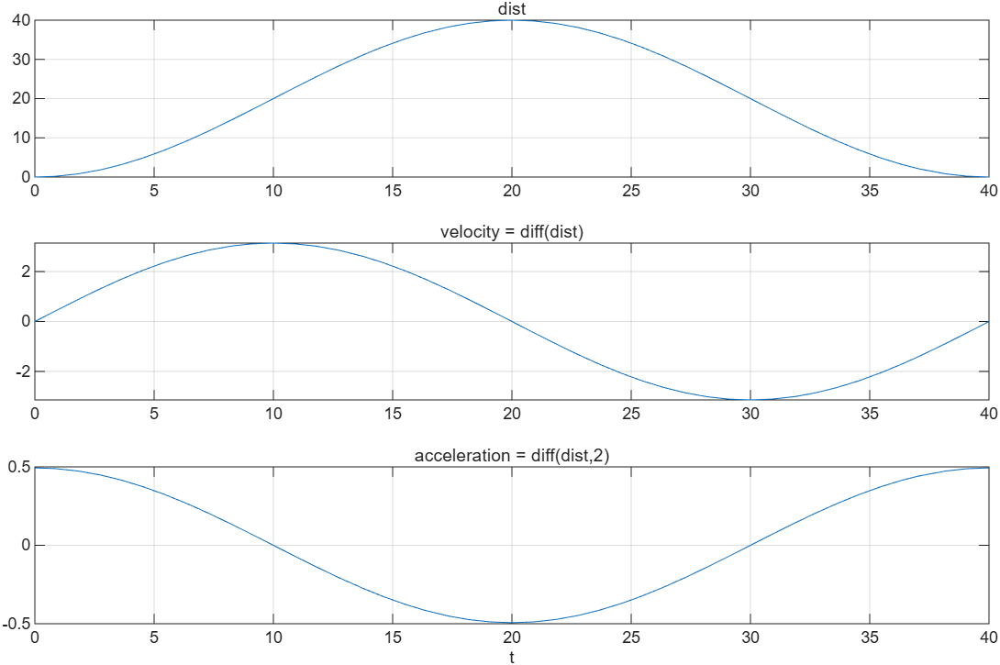

# 12.5 Calculus — 12.5.1 Differentiation

> **[보강]** 이 절의 MATLAB 출력 중 슬라이드에 있는 것은 슬라이드(R2022a) 화면 그대로다. symbolic 코드는 이 PC에서 실행하지 못했다. 숫자 배열의 `diff`와 그림은 R2026a에서 실행했다([README](README.md#실행-환경-메모)).

## 12.5 Calculus

- MATLAB의 symbolic toolbox로 **기호 미분(differentiate symbolically)** 과 **적분(integration)** 을 할 수 있다.
- 그래서 많은 문제에서 **수치 근사(numeric approximation) 대신 해석적 해(analytical solution)** 를 구할 수 있다. 미적분 경험이 적은 학생도 가능하다.

## 12.5.1 Differentiation

- 미분(differential calculus)은 1학기 미적분에서 깊이 배운다.
- **도함수(derivative)** 는 함수의 **기울기(slope)**, 또는 함수의 **변화율(rate of change)** 로 생각할 수 있다.
- 도함수를 구하는 함수는 **`diff`** 다.
  - `diff`는 **overloaded function**이다. **symbolic 입력**일 때와 **숫자 입력**일 때 다르게 동작한다.

`diff`의 입력:

| 입력 | 뜻 |
|---|---|
| **입력 하나** `diff(y)` | **1차 도함수**. 기본 독립 변수 **x**에 대해 미분한다. 식에 **변수가 하나뿐이면 그 변수**를 독립 변수로 쓴다 |
| **둘째 입력** `diff(y,t)` 또는 `diff(y,2)` | **독립 변수**를 지정하거나, **미분 차수(order)** 를 지정한다 |
| **셋째 입력** `diff(y,z,2)` | 독립 변수와 미분 차수를 **둘 다** 지정할 때 쓴다 |

### 1차 도함수 (First Derivatives)

다음 거리(distance) 식에는 독립 변수가 **t 하나뿐**이므로, 무엇으로 미분할지 지정할 필요가 없다.

```matlab
syms t
dist = 20 + 20*sin(pi*(t-10)/20);
velocity = diff(dist)
```
```
velocity =
pi*cos((pi*(t - 10))/20)
```

**속도(velocity)는 거리를 시간으로 미분한 1차 도함수**다.

> **[보강]** 확인: $\dfrac{d}{dt}\left[20 + 20\sin\dfrac{\pi(t-10)}{20}\right] = 20\cdot\dfrac{\pi}{20}\cos\dfrac{\pi(t-10)}{20} = \pi\cos\dfrac{\pi(t-10)}{20}$.

### 2차 도함수 (Second Derivatives)

```matlab
acceleration = diff(velocity)
```
```
acceleration =
-(pi^2*sin((pi*(t - 10))/20))/20
```
```matlab
acceleration = diff(dist,2)
```
```
acceleration =
-(pi^2*sin((pi*(t - 10))/20))/20
```

**가속도(acceleration)는 속도의 도함수**이고, 이는 **거리의 2차 도함수**와 같다. 두 방법의 결과가 같다.

- `diff(velocity)`: 한 번 미분한 것을 **다시 미분**
- `diff(dist,2)`: 둘째 입력 `2`로 **2차 도함수**를 바로 지정

> **[보강]** 세 식을 t = 0 ~ 40에서 그린 그림(function handle로 바꿔 R2026a에서 실행). 거리 곡선의 기울기가 0인 곳(t = 20)에서 속도가 0이고, 속도 곡선의 기울기가 0인 곳(t = 10, 30)에서 가속도가 0이다.
>
> 
>
> symbolic이라면 `fplot(dist,[0,40])`, `fplot(velocity,[0,40])`, `fplot(acceleration,[0,40])`으로 그린다.

### 독립 변수 지정 (Specifying the Independent Variable)

변수가 여러 개인 식:

```matlab
syms x z t
y = x^2+t-3*z^3
```
```
y =
x^2 - 3*z^3 + t
```
```matlab
diff(y)
```
```
ans =
2*x
```
```matlab
diff(y,x)
```
```
ans =
2*x
```

- 도함수는 **다른 것을 모두 일정하게 두었을 때**, 종속 변수(여기서는 `y`)가 독립 변수(여기서는 `x`)에 대해 어떻게 변하는지를 나타낸다. (편미분)
- `x`를 독립 변수로 **지정하든 안 하든 결과가 같다.**

### x가 기본 독립 변수다

x가 아닌 변수로 미분하려면 **둘째 입력에 반드시 지정**해야 한다.

```matlab
diff(y,t)
```
```
ans =
1
```
```matlab
diff(y,z)
```
```
ans =
-9*z^2
```

### 고차 도함수 (Higher Order Derivatives)

고차 도함수는 **셋째 입력**에 차수를 지정한다.

```matlab
diff(y,z,2)
```
```
ans =
-18*z
```

> **[보강]** `y = x^2 - 3*z^3 + t`에 대한 결과 정리:
>
> | 명령 | 뜻 | 결과 |
> |---|---|---|
> | `diff(y)` | ∂y/∂x (기본 변수 x) | `2*x` |
> | `diff(y,x)` | ∂y/∂x | `2*x` |
> | `diff(y,t)` | ∂y/∂t | `1` |
> | `diff(y,z)` | ∂y/∂z | `-9*z^2` |
> | `diff(y,z,2)` | ∂²y/∂z² | `-18*z` |
>
> 둘째 입력은 **변수면 "무엇으로"**, **숫자면 "몇 번"** 이다. `diff(dist,2)`의 `2`는 차수이고 `diff(y,t)`의 `t`는 변수다.

> **[보강]** `diff`가 overloaded라는 뜻: **숫자 배열**을 넣으면 미분이 아니라 **이웃한 원소의 차**를 구한다(Chapter 11에서 datetime의 `diff`로 썼다). R2026a에서 실행한 결과:
>
> ```matlab
> d = diff([1 4 9 16])
> d2 = diff([1 4 9 16], 2)
> ```
> ```
> d =
>      3     5     7
> d2 =
>      2     2
> ```
>
> 숫자 `diff`는 결과 길이가 하나씩 줄어든다. symbolic `diff`는 **식**을 돌려준다.

---

## ⚠️ 함정

- **`diff`는 overloaded다.** symbolic 식이면 **도함수**, 숫자 배열이면 **인접 원소의 차**. `syms`를 빠뜨리고 숫자 배열에 쓰면 오류 없이 전혀 다른 결과가 나온다.
- **기본 변수는 x다. 알파벳 첫 글자가 아니다.** `y = x^2 - 3*z^3 + t`에서 `diff(y)`는 t나 z가 아니라 **x**로 미분한다.
- **변수가 하나뿐이면 그 변수로 미분한다.** `dist`에는 t만 있으므로 `diff(dist)`가 t로 미분한다. x가 없어도 오류가 아니다.
- **둘째 입력의 두 가지 뜻.** `diff(y,2)`는 "x로 2번", `diff(y,z)`는 "z로 1번". z로 2번은 `diff(y,z,2)`(변수 먼저, 차수 나중).
- **다른 변수는 상수 취급.** `diff(y,t)`가 `1`인 이유는 `x^2`과 `-3*z^3`이 t와 무관한 상수로 취급되어 0이 되기 때문이다.
- **결과는 symbolic이다.** `diff(y,t)`의 `1`도 sym이다.
- **특정 시점의 값은 `subs`로.** `velocity`는 식이다. t = 10에서의 속도는 `subs(velocity,t,10)` → `pi`, 숫자는 `double(...)` → `3.1416`.

---

## 연습문제

> **[보강]** 아래 연습문제와 그 해답은 슬라이드에 없다.

1. `syms x` 다음 각 명령의 결과를 쓰시오.
   ```matlab
   diff(x^3 + 2*x)
   diff(x^3 + 2*x, 2)
   ```
2. `syms x t; y = x^2*t^3`일 때 `diff(y)`, `diff(y,t)`, `diff(y,t,2)`의 결과를 쓰시오.
3. 본문의 `dist = 20 + 20*sin(pi*(t-10)/20)`에 대해 (a) t = 10에서의 속도, (b) t = 20에서의 가속도를 구하는 코드를 쓰고, 각각 symbolic 결과와 double 값을 쓰시오.

해답: [solutions.md](solutions.md#1251)
