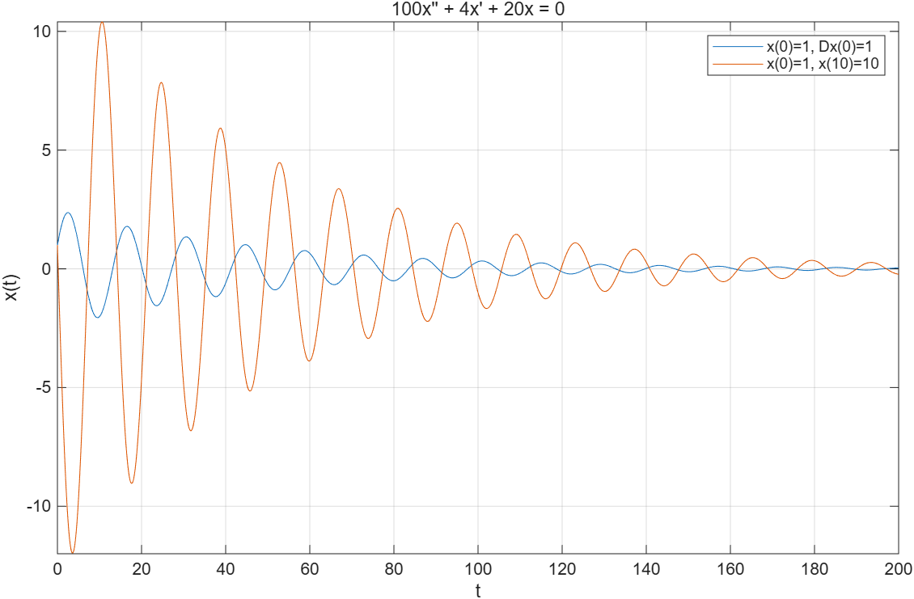

# 12.6.2 Higher-Order Differential Equations

> **[보강]** 이 절의 MATLAB 출력 중 슬라이드에 있는 것은 슬라이드(R2022a) 화면 그대로다. `dsolve`는 이 PC에서 실행하지 못했다. 슬라이드 화면에서 잘린 부분과 `[보강]`의 해는 수학적으로 검증했고, 그림은 그 해를 function handle로 옮겨 R2026a에서 그렸다([README](README.md#실행-환경-메모)).

**고차(higher-order) 미분방정식**도 1차 방정식과 **비슷한 방식**으로 푼다. 다음 미분방정식을 예로 든다.

$$100\frac{d^2x}{dt^2} + 4\frac{dx}{dt} + 20x = 0$$

```matlab
syms x(t)
eqn=100*diff(x,t,2)+4*diff(x,t)+20*x==0
```
```
eqn(t) =
20*x(t) + 4*diff(x(t), t) + 100*diff(x(t), t, t) == 0
```
```matlab
dsolve(eqn)
```
```
ans =
C1*exp(-t/50)*cos((499^(1/2)*t)/50) - C2*exp(-t/50)*sin((499^(1/2)*t)/50)
```

- `diff(x,t,2)`가 2차 도함수 $d^2x/dt^2$ 다. 화면에는 `diff(x(t), t, t)`로 표시된다.
- **2차 미분방정식**은 경계 조건을 지정하지 않으면 결과에 **미지 상수 두 개(`C1`, `C2`)** 가 생긴다.

> **[보강]** 확인: 특성방정식 $100r^2 + 4r + 20 = 0$ 의 근은 $r = \dfrac{-4 \pm \sqrt{16 - 8000}}{200} = -\dfrac{1}{50} \pm \dfrac{\sqrt{499}}{50}i$. 따라서 해는 $e^{-t/50}\left(A\cos\dfrac{\sqrt{499}\,t}{50} + B\sin\dfrac{\sqrt{499}\,t}{50}\right)$ 꼴이다. 감쇠 진동(damped oscillation)이다. MATLAB 출력의 `- C2`는 임의 상수의 부호일 뿐이라 `+ C2`로 써도 같은 해 집합이다.

## 고차 미분방정식의 경계 조건

- 고차 미분방정식은 **차수(order)와 같은 개수**의 경계 조건이 필요하다.
- 이 예는 **2차** 문제이므로 **경계 조건 두 개**가 필요하다.
- `dsolve`는 **초기값 문제(initial value boundary condition problem)** 를 풀 수 있다. 관심 있는 **첫 지점**에서 독립 변수의 값을 알고, 그 지점에서 **종속 변수의 값과 이어지는 도함수들의 값**을 아는 문제다. 이 문제에서는 다음 두 개에 해당한다.
  - $x$
  - $dx/dt$

### General Boundary Conditions

- `dsolve`는 **일반 경계값 문제(general boundary value problem)** 도 풀 수 있다. 필요한 개수만큼의 지점에서 **종속 변수의 값 또는 그 도함수 가운데 하나의 값**을 아는 문제다. 예를 들어 이 문제에서 x를 **서로 다른 두 t 값**에서 알 수도 있다.
- **모든 경계 조건이 해를 주는 것은 아니다.**

### Initial Value Problems (초기값 문제)

경계 조건 $dx/dt\,(0) = 1$ 을 정의하려면 **새 symbolic function을 정의**해야 한다.

```matlab
syms x(t)
eqn=100*diff(x,t,2)+4*diff(x,t)+20*x==0;
Dx = diff(x)
```
```
Dx(t) =
diff(x(t), t)
```

`Dx`는 x의 도함수를 나타내는 symbolic function이다. 이제 `Dx(0)`으로 "t = 0에서의 dx/dt"를 쓸 수 있다.

### 시간 0에서 경계 조건 정의

정의한 `Dx`를 `dsolve`에서 쓴다.

```matlab
dsolve(eqn,x(0)==1,Dx(0)==1)
```
```
ans =
(exp(-t/50)*(499*cos((499^(1/2)*t)/50) + 51*499^(1/2)*sin((499^(1/2)*t)/50)))/499
```

- 조건 두 개 `x(0)==1`, `Dx(0)==1`을 **쉼표로 이어** 입력했다.
- `C1`, `C2`가 사라지고 해가 하나로 정해졌다.

> **[보강]** 슬라이드 화면은 출력이 길어 `…*sin((499^(1/2)*t)/…` 에서 **오른쪽이 잘려** 있다. 위 출력의 끝부분(`…/50)))/499`)은 수학적으로 완성한 것이다. 검산: $x = e^{-t/50}(\cos\omega t + B\sin\omega t)$, $\omega = \sqrt{499}/50$ 로 놓으면 $x(0) = 1$ 은 자동으로 만족하고, $x'(0) = -\tfrac{1}{50} + B\omega = 1$ 에서 $B = \dfrac{51}{\sqrt{499}} = \dfrac{51\sqrt{499}}{499}$.

### Boundary Value Problems (경계값 문제)

`dsolve`는 초기값 조건과 일반 경계 조건을 **모두** 받는다. 다음에서는 x를 **서로 다른 두 시각**에서 정의했다.

```matlab
dsolve(eqn,x(0)==1,x(10)==10)
```
```
ans =
exp(-t/50)*cos((499^(1/2)*t)/50) - (exp(-t/50)*sin((499^(1/2)*t)/50)*(co…   (화면에서 잘림)
```

> **[보강]** 잘린 부분을 수학적으로 완성하면 해는
>
> $$x(t) = e^{-t/50}\cos\omega t \;-\; e^{-t/50}\sin\omega t\cdot\frac{\cos(\sqrt{499}/5) - 10e^{1/5}}{\sin(\sqrt{499}/5)}, \qquad \omega = \frac{\sqrt{499}}{50}$$
>
> 이다. t = 0에서 1, t = 10에서 10이 되는 것을 R2026a 숫자 계산으로 확인했다. 아래 그림은 두 해를 function handle로 옮겨 그린 것이다. 같은 미분방정식이라도 **경계 조건에 따라 해가 달라진다.**
>
> 

> **[보강]** 초기값 문제와 경계값 문제 비교:
>
> | | 초기값 문제 (initial value) | 경계값 문제 (boundary value) |
> |---|---|---|
> | 조건의 위치 | **한 지점**(t = 0) | **서로 다른 지점**(t = 0, t = 10) |
> | 조건의 내용 | x와 그 도함수 | x(또는 도함수) |
> | 슬라이드 예 | `x(0)==1, Dx(0)==1` | `x(0)==1, x(10)==10` |
> | 도함수 조건 | `Dx = diff(x)` 필요 | 필요 없을 수도 있다 |

## Systems of Differential Equations (연립 미분방정식)

연립 미분방정식을 풀려면 먼저 **symbolic function들을 정의**하고, 방정식들을 `dsolve`에 **나열**한다. 다음 연립방정식을 보자.

$$\frac{dx}{dt} = y, \qquad \frac{dy}{dt} = x$$

```matlab
syms x(t) y(t)
a = dsolve(diff(x)==y, diff(y)==x)
```
```
a = 
  struct with fields:

    y: C1*exp(t) + C2*exp(-t)
    x: C1*exp(t) - C2*exp(-t)
```

- 결과는 `solve`의 연립방정식처럼 **structure**다([12.2.2](12.2.2-systems-of-equations.md)).
- `syms x(t) y(t)`로 함수 두 개를 **한 번에** 선언했다.
- `diff(x)`처럼 독립 변수를 생략해도 된다(x는 t의 함수뿐이므로).

### 다른 시각의 경계 조건

- 경계 조건은 **평소 방식대로** 추가한다.
- 선형 연립 미분방정식에서는 **변수마다 경계 조건 하나**가 필요하다.
- **고차 도함수**가 들어 있으면 경계 조건을 **더 추가**해야 한다.
- 개별 결과는 일반적인 **structure array 문법**으로 꺼낸다.

```matlab
a.y
```
```
ans =
C1*exp(t) + C2*exp(-t)
```
```matlab
a.x
```
```
ans =
C1*exp(t) - C2*exp(-t)
```

> **[보강]** 확인: $x = C_1e^t - C_2e^{-t}$ 를 미분하면 $C_1e^t + C_2e^{-t} = y$, $y$ 를 미분하면 $C_1e^t - C_2e^{-t} = x$. 경계 조건을 주면, 예를 들어
>
> ```matlab
> b = dsolve(diff(x)==y, diff(y)==x, x(0)==1, y(0)==0);
> ```
>
> 의 해는 $x = \dfrac{e^t + e^{-t}}{2}$, $y = \dfrac{e^t - e^{-t}}{2}$ 다(변수 2개 → 조건 2개).

## Not all Differential Equations Can Be Solved

- MATLAB이 **모든 미분방정식을 기호로 풀 수 있는 것은 아니다.**
- 많은 미분방정식은 아무리 정교한 도구를 써도 **해석적으로(analytically) 전혀 풀 수 없다.**
- 그런 방정식에는 **수치 기법(numerical techniques)** 이 필요하다.
- 수치 기법은 **뒤 장**에서 다룬다.

---

## ⚠️ 함정

- **조건 개수 = 차수.** 2차 방정식에 조건을 하나만 주면 상수 하나가 남는다. 조건이 없으면 `C1`, `C2` 둘 다 남는다.
- **도함수 조건은 `Dx = diff(x)`를 먼저 정의한다.** `diff(x)(0)==1`처럼 함수 호출 결과에 바로 괄호를 붙일 수 없다. `Dx(0)==1`로 쓴다.
- **`diff(x,t,2)`의 `2`는 차수다.** 화면에는 `diff(x(t), t, t)`로 표시된다. 같은 뜻이다.
- **MATLAB이 방정식 항의 순서를 바꾼다.** `100*diff(x,t,2)+4*diff(x,t)+20*x==0`을 입력했는데 `20*x(t) + 4*diff(x(t), t) + 100*diff(x(t), t, t) == 0`으로 표시된다.
- **연립 미분방정식의 결과는 structure다.** 슬라이드 화면에서 field가 `y`, `x` 순서로 나왔다. 순서에 기대지 말고 **`a.x`, `a.y`** 처럼 이름으로 꺼낸다.
- **초기값 문제와 경계값 문제를 구별한다.** 조건이 모두 같은 t에서 주어지면 초기값 문제, 서로 다른 t에서 주어지면 경계값 문제다.
- **모든 경계 조건이 해를 주는 것은 아니다.** 그리고 **모든 미분방정식이 기호로 풀리지도 않는다.** 그럴 때는 수치 해법(뒤 장)을 쓴다.
- **해에 `499^(1/2)`가 그대로 남는다.** √499를 22.338…로 바꾸지 않는다. symbolic 계산은 정확한 값을 유지한다.

---

## 연습문제

> **[보강]** 아래 연습문제와 그 해답은 슬라이드에 없다.

1. 미분방정식 $\dfrac{d^2x}{dt^2} + 4x = 0$ 을 `dsolve`로 푸는 코드를 쓰고, (a) 경계 조건이 없을 때 해에 나타나는 상수의 개수, (b) $x(0) = 1$, $\dfrac{dx}{dt}(0) = 0$ 일 때의 해를 쓰시오.
2. 같은 방정식에 조건 $x(0) = 0$, $x(\pi/4) = 3$ 을 주는 코드를 쓰고 해를 구하시오. 이것은 초기값 문제인가 경계값 문제인가?
3. 3차 미분방정식을 하나의 해로 정하려면 경계 조건이 몇 개 필요한가? 그리고 조건 $\dfrac{d^2x}{dt^2}(0) = 2$ 를 `dsolve`에 넣으려면 먼저 무엇을 정의해야 하는지 코드로 쓰시오.

해답: [solutions.md](solutions.md#1262)
